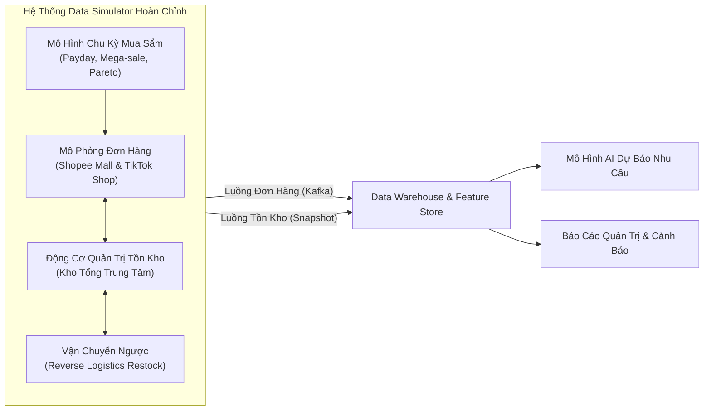
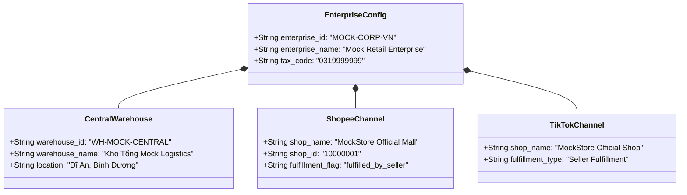
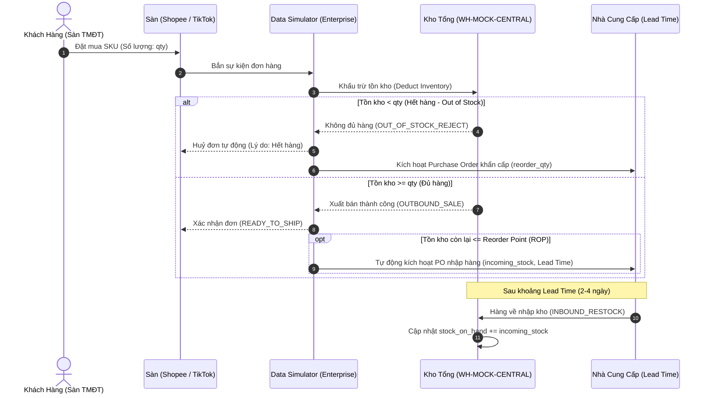

# BÁO CÁO KỸ THUẬT
# XÂY DỰNG HỆ THỐNG MÔ PHỎNG DỮ LIỆU ĐA KÊNH & QUẢN TRỊ TỒN KHO THỜI GIAN THỰC
**Đề tài:** Xây dựng luồng dữ liệu dự báo nhu cầu mua hàng và cảnh báo tồn kho cho Doanh nghiệp bán lẻ Đa kênh (Shopee & TikTok Shop)  
**Tác giả:** Đội ngũ Kỹ thuật & Nghiên cứu MLOps Pipeline  
**Ngày hoàn thành:** Tháng 10/2026  
**Cập nhật:** 31/10/2026 — nhu cầu lịch sử theo SKU và nhập kho thích ứng.

**Báo cáo lần sửa:** [So sánh trước–sau và kết quả PostgreSQL](../04-pipeline-updates/lan-08-simulator-seasonality-2026-10-31.md). Các hệ số mùa vụ là giả định kịch bản; chưa được hiệu chỉnh từ doanh số thị trường.

---

## MỤC LỤC
1. [Đặt vấn đề & Mục tiêu thiết kế](#1-đặt-vấn-đề--mục-tiêu-thiết-kế)
2. [Cơ sở thực tiễn: Khai thác bộ dữ liệu thực tế XomData](#2-cơ-sở-thực-tiễn-khai-thác-bộ-dữ-liệu-thực-tế-xomdata)
3. [Thiết kế Thực thể Doanh nghiệp Giả lập (Mock Enterprise Architecture)](#3-thiết-kế-thực-thể-doanh-nghiệp-giả-lập-mock-enterprise-architecture)
   - [3.1. Căn cứ Khoa học & Lập luận Bảo vệ trước Hội đồng](#31-căn-cứ-khoa-học--lập-luận-bảo-vệ-trước-hội-đồng-định-vị-mô-hình-bách-hóa-bán-lẻ-tổng-hợp-general-merchandise-retailer)
4. [Mô hình hóa nhu cầu theo SKU — cập nhật 31/10/2026](#nhu-cau-sku)
5. [Động cơ Quản trị Tồn kho & Vận hành Khép kín (Inventory Engine)](#5-động-cơ-quản-trị-tồn-kho--vận-hành-khép-kín-inventory-engine)
6. [Định dạng Dữ liệu Đầu ra & Chuẩn hóa Schema](#6-định-dạng-dữ-liệu-đầu-ra--chuẩn-hóa-schema)
7. [Kết quả kiểm thử và chạy dữ liệu ngày 31/10/2026](#ket-qua-31102026)
8. [Giá trị Ứng dụng Đối với Bài toán AI Dự báo & Báo cáo Quản trị](#8-giá-trị-ứng-dụng-đối-với-bài-toán-ai-dự-báo--báo-cáo-quản-trị)

---

## 1. Đặt vấn đề & Mục tiêu thiết kế

### 1.1. Bối cảnh thực tế
Trong thương mại điện tử hiện đại, bài toán quản trị vận hành của một doanh nghiệp không chỉ dừng lại ở việc ghi nhận đơn hàng phát sinh, mà cốt lõi sống còn nằm ở **sự cân bằng giữa luồng bán ra (Sales Demand) và năng lực cung ứng tồn kho (Inventory Supply)**:
- **Tồn kho quá mức (Overstock):** Làm ứ đọng dòng vốn lưu động, tăng chi phí lưu kho, tăng nguy cơ suy giảm giá trị hoặc hết hạn hàng hóa.
- **Thiếu hụt hàng hóa (Stockout / Understock):** Dẫn đến mất doanh thu ngay lập tức, bị sàn phạt vì không giao hàng đúng cam kết, giảm uy tín thương hiệu và mất khách hàng trung thành vào tay đối thủ.

### 1.2. Thách thức về dữ liệu trong nghiên cứu & phát triển
1. **Thiếu tính đồng bộ:** Các bộ dữ liệu công khai trên Internet thường chỉ ghi nhận đơn hàng mua bán (Order Logs) độc lập mà hoàn toàn **thiếu vắng trạng thái kho nội bộ** (Current Stock, Safety Stock, Reorder Point, thời gian nhập hàng Lead Time).
2. **Tính bảo mật:** Dữ liệu kinh doanh và khách hàng (PII) của các doanh nghiệp thực không thể đưa nguyên vẹn vào báo cáo học thuật hoặc mã nguồn mở.
3. **Mục tiêu của Data Simulator:** Xây dựng một module giả lập dữ liệu độc lập, khép kín, mô phỏng sát nhất với quy luật hoạt động của một **Doanh nghiệp bán lẻ đa kênh (Single Enterprise Multi-Channel Retailer)** tại Việt Nam.



---

## 2. Cơ sở thực tiễn: Khai thác bộ dữ liệu thực tế XomData

Phần thiết kế ban đầu tham khảo cấu trúc dữ liệu thương mại điện tử Việt Nam tại [XomData Vietnam Ecommerce](https://dataset.xomdata.com/datasets/schema/vietnam_ecommerce):
- **Tập dữ liệu Shopee:** Gồm **25,500** dòng giao dịch với **84 cột thuộc tính**.
- **Tập dữ liệu TikTok Shop:** Gồm **102,000** dòng giao dịch với **71 cột thuộc tính**.

> Các nhận định và quy mô dữ liệu trong phần này được giữ làm bối cảnh thiết kế ban đầu; đợt sửa 31/10 không kiểm chứng lại nguồn ngoài hoặc ước lượng các hệ số từ nguồn đó. Các tỷ lệ phí, COD và mùa vụ trong simulator là giả định kiểm thử, không phải kết quả thống kê đã xác nhận trong lần sửa này.

### Các giả định nghiệp vụ của thiết kế ban đầu:
1. **Bản chất một chủ thể bán (Single Multi-Channel Seller):** Dữ liệu thực chất ghi nhận nhật ký bán hàng của một doanh nghiệp duy nhất phân phối trên 2 sàn với các mã định danh gian hàng (`shop_id`, `shop_name`, `warehouse_id`).
2. **Cấu trúc chiết khấu & Phí sàn phức tạp:**
   - Shopee: Phí cố định sàn (`commission_fee`, `service_fee`, `transaction_fee`), trợ giá từ người bán (`seller_discount`), voucher sàn (`voucher_from_shopee`), tiền tạm giữ (`escrow_amount`).
   - TikTok Shop: Thuế VAT 10% tính riêng trên tiền hàng và tiền ship (`product_tax`, `shipping_tax`), phí đơn hàng nhỏ (`small_order_fee`), trợ giá vận chuyển (`shipping_seller_discount`, `shipping_platform_discount`).
3. **Tỷ lệ COD áp đảo:** Phương thức thanh toán khi nhận hàng (Cash On Delivery) chiếm phần lớn thị phần giao dịch, kéo theo tỷ lệ hoàn hàng/giao không thành công từ 8% đến 15%.

---

## 3. Thiết kế Thực thể Doanh nghiệp Giả lập (Mock Enterprise Architecture)

Nhằm đảm bảo tính trung tính, tuân thủ nguyên tắc không sử dụng tên thật của bất kỳ doanh nghiệp nào ngoài đời thực, hệ thống đã chuẩn hóa toàn bộ định danh theo mô hình Doanh nghiệp Giả lập:



### Danh mục Sản phẩm Quản trị (20 SKU Trọng điểm):
Mỗi sản phẩm được thiết lập thông số phục vụ cả nghiệp vụ bán hàng lẫn bài toán quản trị chuỗi cung ứng:
- **`initial_stock`**: Mức tồn kho khởi tạo ban đầu.
- **`safety_stock` (Tồn an toàn - SS)**: Mức đệm tối thiểu phòng ngừa biến động nhu cầu bất thường.
- **`reorder_point` (Điểm đặt hàng lại - ROP)**: Ngưỡng tồn kho kích hoạt tự động đơn nhập hàng mới (PO).
- **`reorder_qty`**: Số lượng hàng tiêu chuẩn cho mỗi đơn nhập bổ sung.
- **`lead_time_days`**: Thời gian nhà cung cấp sản xuất và vận chuyển hàng đến kho (2 – 4 ngày).
- **`popularity_weight`**: Trọng số sức mua phản ánh mức độ phổ biến của mặt hàng trên thị trường.

### 3.1. Căn cứ Khoa học & Lập luận Bảo vệ trước Hội đồng: Định vị Mô hình Bách Hóa Bán Lẻ Tổng Hợp (General Merchandise Retailer)

Khi trình bày và bảo vệ đề tài trước Hội đồng Đánh giá / Hội đồng Khoa học, việc lựa chọn mô hình **Doanh nghiệp Chuỗi Bách Hóa Bán Lẻ Tổng Hợp (General Merchandise Retailer / Megastore)** được bảo vệ vững chắc bởi 3 căn cứ học thuật và kỹ thuật:

1. **Căn cứ từ Dữ liệu Mẫu Thực tế (Empirical Data Grounding):**
   - Bộ dữ liệu thực tế XomData (Shopee 25.5k dòng, TikTok Shop 102k dòng) là nhật ký giao dịch thực tế của một doanh nghiệp phân phối tổng hợp đa kênh tại thị trường Việt Nam.
   - Danh mục tổng hợp được chọn để thử nhiều kiểu chuỗi nhu cầu và trọng lượng hàng; chưa có bằng chứng cho thấy tỷ trọng 20 SKU mô phỏng đại diện cho cơ cấu thị trường thực tế.

2. **Yêu cầu Kỹ thuật Cốt lõi của Pipeline MLOps & Dự báo Nhu cầu (Technical Necessity):**
   - **Ma trận Phân loại Tồn kho ABC / XYZ:** Để thuật toán phân loại ABC/XYZ hoạt động có ý nghĩa, danh mục sản phẩm bắt buộc phải có sự phân hóa sâu sắc về hệ số biến thiên nhu cầu ($CV = \sigma / \mu$):
     - *Nhóm X (Nhu cầu ổn định cao, thiết yếu lặp lại):* Bột giặt OMO (`OMO-6KG`), Khẩu trang y tế (`KT-KF94-10`).
     - *Nhóm Y (Nhu cầu biến động vừa, phụ kiện thay thế):* Sạc nhanh Type-C (`SN-65W-GAN`), Tai nghe Bluetooth (`TN-TWS-PRO`).
     - *Nhóm Z (Nhu cầu biến động mạnh, mang tính mùa vụ / xung động flash sale):* Kem chống nắng (`KCN-ANESSA`), Quạt mini cầm tay (`QM-USB-01`), Nồi chiên không dầu (`AF-6L-001`).
     - *Nếu thu hẹp chỉ về 1 sản phẩm ngách (ví dụ: chỉ bán ốp lưng), ma trận ABC/XYZ sẽ bị suy biến hoàn toàn, làm mất đi giá trị của module Feature Store và chính sách tồn kho.*
   - **Kiểm thử Thuật toán Tính Phí Vận chuyển Logistics:** Cân nặng trải dài từ **0.02 kg** (miếng dán cường lực) đến **6.0 kg** (bột giặt) cho phép kiểm chứng trọn vẹn logic tính cước sàn Shopee/TikTok (hàng siêu nhẹ vs hàng cồng kềnh/quá khổ).
   - **Phân tích Báo cáo Đa chiều (OLAP Slice & Dice):** Trong kho dữ liệu Star Schema, trường `Category` (Mỹ phẩm, Gia dụng, Thời trang, Phụ kiện...) cho phép xây dựng các báo cáo quản trị trực quan, phân tích đóng góp biên lợi nhuận theo ngành hàng cho Ban Giám đốc.

3. **Mô hình Kinh doanh Thực tiễn (Business Model Realism):**
   - Mô hình Doanh nghiệp Bách Hóa Bán Lẻ Tổng Hợp (General Retailer) tương tự như chuỗi **WinMart, Bách Hóa Xanh, Aeon, Miniso** hoặc các **Tổng kho phân phối hàng tiêu dùng & đời sống đa kênh** có quy mô doanh thu hàng trăm tỷ đồng trên Shopee Mall và TikTok Shop hiện nay.

---

<a id="nhu-cau-sku"></a>

## 4. Mô hình hóa nhu cầu theo SKU — cập nhật 31/10/2026

### 4.1. Phân biệt mô phỏng trực tiếp và lịch sử

`ECommerceSimulator` tiếp tục tạo payload, vòng đời đơn và biến động kho. Luồng
trực tiếp vẫn dùng `orders_per_second()` với các hệ số giờ, cuối tuần, sale,
payday và xu hướng đã có. Lựa chọn sản phẩm có truyền thời điểm sử dụng thêm
hệ số mùa vụ theo SKU; lời gọi `_pick_product()` không truyền thời điểm vẫn dùng
trọng số phổ biến nền để giữ tương thích.

Luồng lịch sử qua `scripts/simulate_historical_data.py` đã chuyển sang
`ProductDemandModel` và `iter_historical_days()`. Không còn tính số đơn mỗi ngày
bằng mức nền cố định nhân riêng hệ số cuối tuần/ngày đôi. `--orders-per-day`
chỉ là quy mô nền, không phải chỉ tiêu cố định cho tổng đơn ngày hoặc tháng.

### 4.2. Kỳ vọng và lấy mẫu từng mặt hàng

Kỳ vọng đơn mỗi SKU/ngày kết hợp trọng số danh mục, hệ số thị trường theo tháng,
mùa vụ SKU, xu hướng riêng, cuối tuần, payday, sale và các trạng thái nhiễu.
Động cơ dùng Gamma–Poisson (negative binomial): nếu kỳ vọng là `mu`, độ biến
động của SKU là `v`, thì cường độ được lấy mẫu Gamma với `shape=1/v²`,
`scale=mu/shape`, rồi số đơn lấy mẫu Poisson theo cường độ đó. Trước cơ chế ngày
ngừng bán ở SKU thưa, phương sai có điều kiện là `mu + v²*mu²`.

- Thị trường có nhiễu liên tiếp giữa các ngày; nhóm hàng có nhiễu theo tháng;
  từng SKU có trạng thái nhiễu riêng và đợt tăng nhu cầu ngắn 3–7 ngày.
- Một số SKU bán chậm có xác suất ngày không có đơn; không ép đủ đơn mỗi SKU/ngày.
- Chiến dịch có tác động trước ngày sale, ngày chính và giai đoạn giảm sau sale.
  Mức phản ứng khác nhau giữa các SKU.
- Quạt mini/kem chống nắng có hệ số tăng vào mùa nóng; balo tăng trước tựu trường;
  đồ trang trí tăng ở các tháng đã cấu hình; bột giặt có mùa vụ nhẹ hơn.
- Các cấu hình là giả định phục vụ thử nghiệm, chưa phải hệ số đo từ thị trường.
  Không gán cố định nhãn ABC/XYZ cho SKU trước khi tính trên dữ liệu thực sinh.

### 4.3. Thời gian, kênh và vòng đời

Sự kiện được lấy mẫu giờ trong ngày rồi sắp xếp theo timestamp trước khi cập
nhật kho. Nhóm mỹ phẩm/thời trang dùng tỷ trọng Shopee 42%, các nhóm còn lại
65%; phần còn lại là TikTok. Đây là tỷ trọng lấy mẫu của kịch bản.

Ngày nghiệp vụ tính theo `Asia/Ho_Chi_Minh`. Lượt chạy lịch sử chặn tại thời
điểm yêu cầu/hiện tại, loại các chuyển trạng thái sau mốc chặn và chọn lại trạng
thái sàn phù hợp. Lỗi đơn Shopee `COMPLETED` thiếu `completed_time` đã được sửa
bằng ánh xạ đúng giai đoạn sinh timestamp.

Cùng seed và khoảng ngày tái lập được số đơn/SKU. UUID ingestion vẫn được sinh
riêng; đây không phải cam kết tái lập từng byte của toàn bộ payload.

---
## 5. Động cơ Quản trị Tồn kho & Vận hành Khép kín (Inventory Engine)

Module Tồn kho được thiết kế theo mô hình **Sổ cái Giao dịch Kho (Inventory Transaction Ledger)**, ghi nhận đầy đủ lịch sử biến động qua bảng sự kiện `InventoryMovementEvent`.



### 5.1. Cơ chế Đặt hàng lại (Reorder Point & Lead Time)
- Khi phát sinh đơn hàng, nếu lượng tồn sau bán $Stock \le ROP$ và chưa có lệnh nhập nào đang vận chuyển (`incoming_stock == 0`), hệ thống tự động sinh một Lệnh Đặt Hàng Mua (Purchase Order) với khối lượng `reorder_qty`.
- Thời điểm hàng về kho (`restock_eta`) được tính toán chuẩn xác: $ETA = \text{now} + \text{lead\_time\_days}$.
- Khi đồng hồ mô phỏng tiến tới thời điểm $ETA$, hàng tự động được kiểm đếm và cộng vào `stock_on_hand` với mã giao dịch `INBOUND_RESTOCK`.

### 5.2. Chu trình Hoàn hàng & Logistics Ngược (Reverse Logistics Restocking)
Trong thương mại điện tử, tỷ lệ giao hàng thất bại (khách bom hàng COD, không liên lạc được) hoặc khách hàng trả hàng là một phần tất yếu của chuỗi cung ứng:
1. **Huỷ đơn trước khi xuất kho (`stage < 2`):** Hàng chưa rời khỏi kho $\rightarrow$ Tồn kho được hoàn trả ngay lập tức với sự kiện `CANCEL_RELEASE`.
2. **Giao hàng thất bại / Trả hàng sau khi đã gửi đi (`stage >= 2`):** Kiện hàng đã được đơn vị vận chuyển tiếp nhận. Khi trạng thái chuyển sang hủy/hoàn, kiện hàng được đưa vào **Hàng đợi Vận chuyển ngược (Pending Returns Queue)**. Sau khoảng thời gian luân chuyển ngược $3 - 5$ ngày, hàng về lại kho tổng và được kiểm định tái nhập kho (`RETURN_RESTOCK`).

### 5.3. Báo cáo Quản trị Cảnh báo Tồn kho (Inventory Alerts Snapshot)
Hệ thống cung cấp hàm `get_inventory_snapshot()` và `get_inventory_alerts()` phân loại tình trạng kho thành **3 cấp độ rủi ro**:

| Mức Cảnh Báo | Điều Kiện Tồn Kho | Hành Động Quản Trị Cần Thực Hiện |
|:---|:---|:---|
| <span style="color:red; font-weight:bold;">CRITICAL</span> | $Stock \le SafetyStock$ | **Nguy cấp:** Nguy cơ đứt hàng xuất bán trong 24h tới; kích hoạt nhập hàng khẩn cấp. |
| <span style="color:orange; font-weight:bold;">WARNING</span> | $SafetyStock < Stock \le ROP$ | **Cảnh báo:** Chạm ngưỡng đặt hàng lại; cần theo dõi tiến độ PO từ nhà cung cấp. |
| <span style="color:green; font-weight:bold;">NORMAL</span> | $Stock > ROP$ | **Bình thường:** Tồn kho đảm bảo an toàn cho hoạt động kinh doanh ổn định. |

---

### 5.4. Chính sách nhập hàng cho lịch sử dài ngày — cập nhật 31/10

Luồng lịch sử dùng trung bình số lượng yêu cầu của tối đa 14 ngày đã qua,
kết hợp 70% mức quan sát và 30% mức kế hoạch mùa vụ. Mức kế hoạch dùng quy mô
nền, trọng số SKU và giả định 2,5 sản phẩm/đơn; không đọc trước số đơn lấy mẫu.
Tồn đầu kỳ đủ cho quy mô kịch bản; điểm đặt hàng, tồn an toàn và lượng nhập
được điều chỉnh theo nhu cầu. Các mức sàn trong danh mục vẫn được giữ.

Với tốc độ nhu cầu đơn vị/ngày là `r`, công thức dùng phần trần nguyên:
`SS=max(SS_catalog,ceil(0.8*r))`,
`ROP=max(ROP_catalog,ceil(r*(lead_time_days+1.2)))`,
`Q=max(Q_catalog,ceil(7*r))`.
Đột biến và lead time vẫn có thể gây thiếu hàng. Phần kho trực tiếp giữ chính
sách nền hiện có; điều chỉnh thích ứng này thuộc bộ sinh lịch sử.

---
## 6. Định dạng Dữ liệu Đầu ra & Chuẩn hóa Schema

Mỗi sự kiện đơn hàng được sinh ra đều chứa đầy đủ thông tin để nạp thẳng vào Data Warehouse / Data Lakehouse:

### Ví dụ Sự kiện Đơn hàng Shopee (`ShopeeOrderEvent`):
```json
{
  "pkId": "SPE-10000001-SPE261003000001",
  "shop_id": "10000001",
  "shop_name": "MockStore Official Mall",
  "order_sn": "SPE261003000001",
  "order_status": "COMPLETED",
  "create_time": "2026-10-03T20:15:00+00:00",
  "pay_time": "2026-10-03T20:25:00+00:00",
  "shipped_time": "2026-10-04T10:00:00+00:00",
  "completed_time": "2026-10-06T15:30:00+00:00",
  "fulfillment_flag": "fulfilled_by_seller",
  "item_sku": "OL-IP15PM",
  "item_name": "Ốp lưng iPhone 15 Pro Max silicon",
  "quantity": 2,
  "original_price": 59000,
  "total_order_value": 118000,
  "buyer_total_amount": 108000,
  "commission_fee": 4720,
  "service_fee": 3540,
  "transaction_fee": 2360,
  "payment_method": "SPayLater",
  "cod": "False",
  "shipping_carrier": "SPX Express",
  "state": "TP.HCM",
  "city": "TP.HCM",
  "district": "Quận 1"
}
```

### Ví dụ Sự kiện Đơn hàng TikTok Shop (`TikTokOrderEvent`):
```json
{
  "pkId": "58e2354a-a434-453b-8bdc-cb8e5ef0a599",
  "order_id": "TT261003000002",
  "order_type": "livestream",
  "shop_name": "MockStore Official Shop",
  "order_status": "AWAITING_SHIPMENT",
  "created_time": "2026-10-03T20:45:00+00:00",
  "paid_time": "2026-10-03T20:50:00+00:00",
  "warehouse_id": "WH-MOCK-CENTRAL",
  "fulfillment_type": "Seller Fulfillment",
  "seller_sku": "KT-KF94-10",
  "product_name": "Combo 10 khẩu trang 3D KF94",
  "quantity": 3,
  "total_amount": 148500,
  "sub_total": 135000,
  "tax_amount": 13500,
  "payment_method": "COD",
  "is_cod": "True",
  "shipping_provider": "J&T Express",
  "region_state": "Hà Nội",
  "city_town": "Hà Nội",
  "district": "Cầu Giấy"
}
```

---

<a id="ket-qua-31102026"></a>

## 7. Kết quả kiểm thử và chạy dữ liệu ngày 31/10/2026

### 7.1. Kiểm thử hiện tại

Lệnh `python -m unittest tests.test_historical_demand tests.test_data_simulator -v`
đạt **24/24 kiểm thử**: 17 kiểm thử simulator hiện có và 7 kiểm thử nhu cầu lịch sử.
Nhóm mới kiểm tra seed, mùa vụ khác nhau theo SKU, biến động số đơn, ngày không
có đơn, thứ tự/mốc thời gian, dữ liệu đầu vào và chính sách nhập kho thích ứng.
Nhật ký đầy đủ lưu trong [bằng chứng kiểm thử](../04-pipeline-updates/evidence/simulator-tests-2026-10-31.json).

Kết quả lịch sử “58 passed, 1 warning trong 5,80 giây” của bản báo cáo trước
không được sử dụng làm bằng chứng cho phiên bản mới. Đợt này không chạy lại toàn
bộ suite hoặc nghiệm thu lại Kafka/MinIO, API, BI và chất lượng mô hình dự báo.

### 7.2. Chạy thực tế vào PostgreSQL

| Nội dung | Kết quả |
|---|---:|
| Đơn mô phỏng cũ được thay | 106.131 |
| Đơn mô phỏng mới | 125.423 |
| Đơn có trước đợt mô phỏng được giữ | 19.428 |
| Tổng dòng `fact_orders` sau thay | 144.851 |
| Bản ghi tồn kho mô phỏng được thay | 6.060 |
| Bản ghi tồn kho cũ được giữ | 38 |
| Số ngày có đơn mô phỏng, 01/01–31/10/2026 | 304 |
| Ngày thiếu / chuyển trạng thái sau mốc chặn | 0 / 0 |

Dữ liệu thay thế dùng tiền tố `SIM26YTD-`. Việc thay diễn ra trong một giao dịch,
có bản sao lưu, kiểm tra hoàn tác và so khớp số dòng/nội dung của dữ liệu được
bảo vệ. Các hệ số mùa vụ, số đơn từng tháng và số liệu từng SKU có trong
[báo cáo tổng kết lần sửa](../04-pipeline-updates/lan-08-simulator-seasonality-2026-10-31.md)
và [bằng chứng tổng hợp](../04-pipeline-updates/evidence/simulator-comparison-2026-10-31.json).

---
## 8. Giá trị Ứng dụng Đối với Bài toán AI Dự báo & Báo cáo Quản trị

Việc xây dựng thành công bộ sinh dữ liệu mô phỏng này mang lại các giá trị nền tảng cốt lõi cho đề tài tốt nghiệp:

1. **Dữ liệu thử nghiệm cho bài toán dự báo:**
   - Cung cấp chuỗi thời gian liên tục mang đầy đủ tính quy luật (tính xu hướng dài hạn, tính mùa vụ theo tuần, các cú sốc cầu vào ngày Payday, Flash sale, Mega-sale).
   - Giúp các mô hình Machine Learning (LightGBM, XGBoost) và Deep Learning (LSTM, GRU, Temporal Fusion Transformer) thử học các quan hệ lịch và nhu cầu đã đặt trong kịch bản. Chất lượng trên dữ liệu thị trường cần được đánh giá riêng bằng dữ liệu thực và kiểm định theo thời gian.
2. **Khép kín bài toán Cảnh báo Tồn kho:**
   - Không dừng lại ở việc dự báo con số vô hồn, luồng dữ liệu cho phép so sánh tức thời:
     $$\text{Forecasted Demand (7 ngày)} \quad \text{vs.} \quad \text{Current Stock on Hand} + \text{Incoming Stock}$$
   - Từ đó tự động đưa ra khuyến nghị: *SKU nào cần tạo lệnh nhập hàng khẩn cấp? Số lượng nhập tối ưu là bao nhiêu?*
3. **Báo cáo Quản trị Doanh nghiệp:**
   - Dễ dàng tổng hợp dữ liệu để hiển thị lên Dashboard (Streamlit / PowerBI) giúp Ban Giám đốc và Bộ phận Kho vận nắm bắt toàn bộ bức tranh dòng hàng, phát hiện điểm nghẽn thiếu hụt hoặc dư thừa tồn kho tức thì.

---
**KẾT LUẬN CẬP NHẬT 31/10/2026:** Bộ sinh lịch sử đã có nhu cầu biến động riêng theo SKU, kho thích ứng và dữ liệu PostgreSQL phủ đủ 304 ngày. Phạm vi đã kiểm chứng gồm 24 kiểm thử, kết quả nạp và bảo toàn dữ liệu cũ. Các hệ số vẫn là giả định; chưa có căn cứ để xác nhận mức đại diện thị trường, cải thiện chất lượng dự báo hoặc trạng thái production-ready của toàn hệ thống.
