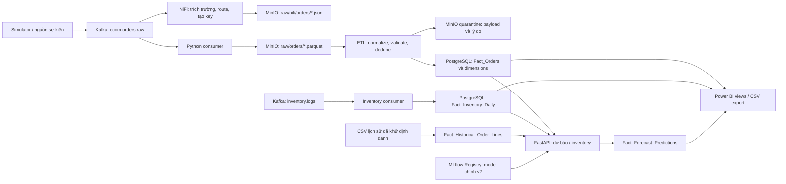

# BÁO CÁO TỔNG HỢP SỬA LỖI VÀ DEMO LUỒNG STREAMING MLOPS E-COMMERCE

**Ngày báo cáo:** 14/10/2026, múi giờ Việt Nam `Asia/Ho_Chi_Minh` (UTC+7).

**Phạm vi:** Tổng hợp các bản sửa ngày 12–14/10; kiểm thử toàn vẹn dữ liệu, tối ưu inventory, migration và demo trực quan NiFi ngày 14/10. Số liệu trong báo cáo là kết quả của các lượt chạy được dẫn nguồn, không phải trạng thái realtime hoặc sức tải production đã nghiệm thu.

## 1. Kết quả chính

Các lỗi đã phát hiện liên quan đến ngày phân vùng, provenance, mất dòng SKU, thiếu quarantine và thống kê sai đã được sửa. Lượt kiểm thử toàn vẹn dữ liệu ngày 14/10 đạt **12/12 tiêu chí**. Bộ regression cuối trước demo đạt **106 passed, 0 failed, 0 errors, 0 skipped**.

Demo NiFi và các chặng thu nạp/warehouse/API được đối soát thành công: **64 event được gửi → 64 JSON qua NiFi → 64 dòng Parquet → 32 đơn duy nhất trong warehouse**. API trả đúng tồn kho 123 và 47 units cho hai SKU kiểm thử; dự báo từ model Registry được kiểm tra trên một SKU thuộc catalog lịch sử.

Endpoint inventory toàn catalog 216 SKU được tối ưu: ba lượt đo HTTP tuần tự sau sửa là **0,194 / 0,114 / 0,109 giây**, so với số đo trước đó **23,312 giây**. Công thức Moving Average được giữ và có kiểm thử parity.

**Chưa nghiệm thu production:** còn thiếu snapshot tồn kho thực cho catalog CSV, kiểm tra update đảo thứ tự/late arrival và các bài tải, mở rộng, chịu lỗi, backup/restore. Báo cáo này không xác nhận độ chính xác mô hình.

## 2. Kiến trúc và phạm vi hiển thị trên NiFi



Canvas NiFi hiện hiển thị **nhánh Kafka → JSON MinIO**. Nhánh Parquet → ETL → PostgreSQL và phục vụ API chạy bằng Python bên ngoài NiFi. Không có bước ETL/training tự xuất hiện trên canvas chỉ vì demo đã đi tới warehouse và serving.

Features, training và Registry là phần kiến trúc MLOps; chúng đã được kiểm tra riêng ngày 13/10 trên model E2E. Lượt demo ngày 14/10 dùng model đang phục vụ, **không huấn luyện lại hoặc thay deployment**. Luồng lịch sử CSV và streaming được giữ nguồn riêng để đối soát đúng.

## 3. Các lỗi đã sửa ở giai đoạn trước

Các mục dưới đây là bản sửa có từ ngày 12–13/10; không tính lại như lỗi mới vừa sửa ngày 14/10.

| Vấn đề | Nguyên nhân và cách sửa | Phạm vi kiểm chứng |
|---|---|---|
| TikTok bị partition sai ngày khi batch trộn sàn | Shopee có create_time, TikTok có created_time; đổi từ chọn một cột cho batch sang parse và kết hợp từng dòng, rồi chuyển giờ Việt Nam | Unit test và các batch runtime hỗn hợp |
| Retraining đọc nguồn khác deployment | Truyền data_origin/source_datasets, kiểm tra nguồn drift/registration và giữ fingerprints trong manifest | Regression và training/Registry/closed-loop model E2E ngày 13/10 |
| Forecast ghép với actual sai nguồn hoặc coi chưa có dữ liệu là 0 | Fact forecast lưu provenance; chỉ đối chiếu actual khi có coverage và đúng nguồn, ngày tương lai để NULL | SQL checks và runtime export |
| ABC/XYZ SQL khác Python | Thống nhất calendar grid, ngày không bán, Pareto, CV, tie ordering và công thức tồn kho | SQL/Python đối soát 22 SKU streaming trong lượt runtime trước |
| Lỗi đọc MinIO bị coi như dữ liệu rỗng | Cho S3Error lan lên orchestrator thay vì nuốt lỗi | Regression lỗi đọc và runtime thành công |
| API metadata bỏ fingerprints | Thêm source_datasets vào schema và response | Regression HTTP và API thật |
| NiFi dùng sai schema/bucket | Dùng $._platform, shopee/tiktok, order_sn/order_id đúng sàn, bucket cấu hình; key có UUID và ingest_date Việt Nam | NiFi thật ghi JSON và lượt demo hiện tại |
| Unit test ghi đè báo cáo vận hành | Drift test dùng thư mục tạm, unit load runner không xuất đè báo cáo runtime | Bộ regression |

Chi tiết giai đoạn trước: [báo cáo sửa ngày 12/10](bao-cao-chinh-sua-he-thong-2026-10-12.md) và [runtime ngày 13/10](../03-testing-and-benchmark/runtime_e2e_report_2026-10-13.md).

## 4. Lỗi toàn vẹn dữ liệu phát hiện trong bài 1

### 4.1. Dữ liệu trước sửa

Lượt `DI20261013ba6be6` gửi 18 event: 16 dòng hợp lệ và hai dòng lỗi chủ động. MinIO giữ đủ đầu vào, nhưng warehouse không giữ đủ các dòng SKU.

| Chỉ số | Kỳ vọng | Trước sửa |
|---|---:|---:|
| Raw event trong MinIO | 18 | 18 |
| Dòng hàng hợp lệ trong warehouse | 16 | 12 |
| Quantity fixture | 38 | 28 |
| Subtotal fixture (VND) | 402.000 | 296.000 |
| Dòng lỗi vào quarantine | 2 | 0 |

Các tổng quantity/tiền ở đây gồm đơn hủy để đối soát measure của fixture, không phải doanh thu thuần sau loại đơn hủy. Mất dòng xảy ra ở tầng xử lý/warehouse; raw còn trong MinIO nên có thể replay.

### 4.2. Mất SKU do sai grain dữ liệu

Dedupe và UNIQUE/upsert cũ dùng `(order_id, platform)`. Một đơn có ba SKU bị xem như ba phiên bản trùng của một dòng; keep-last chỉ giữ một SKU. Database cũng không cho cùng mã đơn/sàn có nhiều fact.

**Bản sửa:** bổ sung `source_line_id`, dùng khóa `(order_id, platform, source_line_id)` xuyên suốt dedupe và database. Ưu tiên `order_line_id` hoặc `line_id` từ nguồn; fallback nguồn cũ là `sku:<SKU>`. Hai dòng cùng SKU vẫn được giữ riêng khi có line ID khác nhau. ID số được chuẩn hóa để 17 và 17.0 không đổi khóa khi đi qua Parquet nullable.

Fallback theo SKU có điều kiện: nguồn phải có tối đa một dòng/SKU/đơn. Không thể suy ra hai dòng giống SKU chỉ từ giá/quantity nếu không có ID ổn định. Khi chuyển nguồn cũ sang line ID cần migration đối soát, tránh tạo thêm dòng cho cùng dữ liệu cũ.

### 4.3. Dữ liệu lỗi bị bỏ trước validator

Cleaning cũ loại thiếu SKU hoặc quantity ngoài khoảng trước validator. Validator chỉ nhận các dòng còn lại nên có thể báo pass rate 100%, dù raw có lỗi bị loại và không có audit riêng.

**Bản sửa của production ETL:** normalize tất cả dòng → validate từng dòng → dedupe các dòng hợp lệ → load. Platform lạ được đưa qua validation. Kiểu số không hợp lệ không bị biến im lặng thành 0; quantity phân số và định danh vượt độ dài schema cũng bị phát hiện.

### 4.4. Thiếu quarantine bền vững

Quarantine cũ chỉ là DataFrame/count trong lượt chạy. Pipeline mới lưu JSONL vào MinIO trước bước load, dưới `quarantine/orders/run_id=<run_id>/rejected.jsonl`, chứa:

- Raw payload và định danh order/platform/line khi có.
- Source object Parquet và số dòng nguồn.
- Run ID, trạng thái rejected và rejection_reasons.

Nếu lưu quarantine thất bại, lỗi được truyền lên và ETL không báo SUCCESS hoặc tiếp tục nạp facts. Dry-run không ghi audit hoặc facts. Việc tự sửa/resolve/replay quarantine vẫn cần công cụ và chính sách vận hành riêng.

### 4.5. Duplicate và số đơn bị thống kê sai

`generate_quality_report()` cũ lấy toàn bộ chênh lệch trước/sau clean làm duplicate, lẫn dòng lỗi với dòng trùng. Pipeline mới tách số dòng hợp lệ, duplicate và rejected, đồng thời kiểm tra:

```text
raw_records = clean_records sau dedupe + duplicates_removed + quarantined_records
```

Sau khi fact chuyển sang dòng hàng, báo cáo đếm dòng sẽ làm số đơn tăng sai. Đã cập nhật Power BI SQL/DAX và history/features streaming sang đếm đơn phân biệt theo `(platform, order_id)`. AOV được tính bằng tổng revenue chia số đơn. Hạt dữ liệu lịch sử khử định danh vẫn được giữ riêng.

### 4.6. Upsert giữ quantity/tiền cũ

Upsert trước đó chỉ cập nhật lifecycle. Bản sửa cập nhật quantity, giá, measure tiền và dimension theo line ID, cùng trạng thái và timestamps. Chưa có source version để bảo vệ khỏi event cũ ghi đè event mới; không coi replay giống nhau là bằng chứng đã xử lý đúng mọi thứ tự cập nhật.

## 5. Migration và phục hồi dữ liệu

Đã áp dụng `scripts/init_warehouse.py` trên PostgreSQL Docker, không dùng `--drop-first`. Các bước migration:

1. Thêm source_line_id vào Fact_Orders.
2. Backfill dòng cũ từ SKU của Dim_Products; dòng không có product dùng legacy:<order_fact_id> để giữ dữ liệu.
3. Áp dụng NOT NULL, bỏ UNIQUE cũ và tạo UNIQUE ba cột.
4. Cài lại Power BI views tương ứng.

Không xóa bảng hoặc facts. Dòng legacy cần đối soát riêng nếu muốn nối lại nguồn. Writer/ETL cũ phải dừng khi áp dụng ở môi trường khác vì ON CONFLICT hai cột cũ không còn tương thích.

Hai tập test cũ được phục hồi riêng từ các raw objects đã ghi nhận:

| Run ID | Trước backfill | Sau backfill |
|---|---|---|
| DI20261013f7b3a3 | 12 dòng, 28 units, 296.000 VND | 16 dòng, 38 units, 402.000 VND |
| DI20261013ba6be6 | 12 dòng, 28 units, 296.000 VND | 16 dòng, 38 units, 402.000 VND |

Mỗi lượt cũng lưu hai dòng lỗi vào quarantine. Đây là backfill fixtures có tiền tố riêng; không chạy backfill toàn bộ dữ liệu nghiệp vụ hoặc tự xác nhận coverage của ngày.

## 6. Tối ưu inventory và bằng chứng không đổi công thức

Trước tối ưu, GET inventory toàn catalog 216 SKU mất 23,312 giây trong lượt đo ngày 13/10. Model Moving Average phải đi qua đường dựng nhiều features và DataFrame một dòng ở từng bước dự báo đệ quy cho từng SKU.

Bản sửa bổ sung `predict_from_history()` cho MovingAverageModel. ModelManager dùng đường này nếu model hỗ trợ; các model khác tiếp tục dùng feature spec và model.predict. Cửa sổ vẫn là shifted rolling_mean_7, loại ngày hiện tại như pipeline huấn luyện. Không đổi thuật toán hoặc model version đang phục vụ.

Test parity chạy 90 bước đệ quy, so sánh giá trị với đường DataFrame cũ; cũng kiểm tra thiếu feature rolling_mean_7 vẫn trả 0 như baseline.predict.

| Lượt đo HTTP sau sửa | Thời gian | SKU |
|---|---:|---:|
| 1 | 0,194 giây | 216 |
| 2 | 0,114 giây | 216 |
| 3 | 0,109 giây | 216 |

Các số đo là request local tuần tự; không phải P95/P99 dưới tải hoặc đối chứng cùng môi trường/cùng thời điểm với số đo cũ. Cả 216 SKU này còn stock_source=simulated_demo do thiếu snapshot đúng SKU; cải thiện tốc độ không chứng minh đã có dữ liệu tồn kho thực.

## 7. Kiểm thử sau sửa

### 7.1. Regression suite

JUnit ghi **106 tests, 0 failures, 0 errors, 0 skipped**, khoảng 6,15 giây. Console ghi 30 deprecation warnings, không phải lỗi thất bại. Kết quả này được tạo sau bản sửa integrity/optimization, trước các điều chỉnh runner phục vụ demo trực quan; runner demo được xác nhận riêng qua lượt runtime thành công.

Kiểm thử mới bao gồm nhiều SKU, hai dòng cùng SKU/line ID riêng, replay, invalid quantity/price/platform, audit payload, storage failure, ID số nullable, order count cấp đơn và parity baseline.

### 7.2. Bài 1 chạy lại

Run ID `DI2026101400c8fb`, hoàn tất khoảng **22:49 ngày 14/10/2026 UTC+7**. Đây là fixture mở rộng 22 event, không phải cùng kích thước với fixture 18 event trước sửa.

| Chặng/chỉ số | Kết quả |
|---|---|
| Kafka ack → MinIO | 22/22 event; 7 Parquet objects |
| Normalize | 22/22 dòng còn để validation |
| Valid / rejected | 20 / 2 |
| Warehouse | 20/20 dòng hợp lệ |
| Tổng quantity/subtotal | 48 units / 508.000 VND, khớp kỳ vọng |
| Quarantine | 2/2 dòng có payload, lý do và source object |
| Dedupe/replay | Không đổi số dòng, quantity hoặc tiền |
| Đơn hủy / mã đơn trùng giữa sàn | Giữ đúng |
| Ngày nghiệp vụ/partition | Đúng ở hai phía 23:59/00:01 Việt Nam |
| Dimension | Ánh xạ đúng khi nguồn cung cấp; carrier/payment thiếu từ nguồn được nhận diện là tùy chọn |
| Đối soát accounting | Raw = valid + duplicate + rejected |
| Tổng tiêu chí | **12/12 PASS** |

Sau backfill fixtures, Power BI executive summary được đối chiếu toàn database: **11.598 đơn / 7.590.770.770 VND** khớp truy vấn facts độc lập. Đây là số liệu môi trường demo/kiểm thử, không phải doanh thu kinh doanh đã xác minh.

## 8. Demo luồng ngày 14/10

Run ID thành công: **E2E20261014e09628**. Traffic được gửi chậm, mỗi event cách nhau 0,8 giây để quan sát canvas. 32 đơn được gửi hai lần, tổng 64 event, phục vụ kiểm tra replay.

### 8.1. Các bước trên canvas NiFi

| Processor | Vai trò | In | Out |
|---|---|---:|---:|
| ConsumeKafka (ecom.orders.raw) | Nhận event từ Kafka | 0 | 64 |
| EvaluateJsonPath | Trích platform và order ID theo sàn | 64 | 64 |
| RouteOnAttribute | Route shopee/tiktok | 64 | 64 |
| UpdateAttribute | Tạo S3 key, bucket và ingest_date Việt Nam | 64 | 64 |
| PutS3Object | Ghi raw JSON vào MinIO | 64 | 64 |
| LogAttribute | Ghi provenance/thuộc tính | 64 | 0 |

Cả sáu processor RUNNING/VALID; năm queue đều về `0 (0 bytes)` sau khi xử lý. ConsumeKafka là điểm nguồn nên In=0; LogAttribute là điểm cuối nên Out=0. Không dùng hai số này để kết luận mất dữ liệu.

JSON thực đọc lại từ MinIO: **64 files**, Shopee 32 và TikTok 32. Object key dùng UUID để hai event replay cùng order ID không ghi đè raw.

### 8.2. Parquet, ETL và warehouse

Python consumer dùng consumer group riêng, ghi **64 dòng trong 64 Parquet files** vì gửi chậm và timeout batch ngắn. Số file này phục vụ demo, không phải khuyến nghị kích thước file production.

Partition Parquet theo ngày tạo đơn Việt Nam, trong lượt demo là 13 và 14/10; JSON NiFi dùng ngày nhận ingest_date=14/10. Hai nhánh có mục đích partition khác nhau.

Warehouse theo tiền tố run ID:

| Sàn | Đơn duy nhất | Tổng quantity |
|---|---:|---:|
| Shopee | 16 | 32 |
| TikTok | 16 | 28 |
| Tổng | **32** | **60** |

ETL được chạy lại và giữ nguyên số đơn/quantity. Các stats ETL theo ngày còn gồm fixtures cũ; quarantine trong stats này là lỗi đã cài từ bài trước, không phải mất dữ liệu trong 32 đơn demo mới.

### 8.3. Inventory và serving

| SKU demo | Tồn kho database/API | Stock source | Demand source |
|---|---:|---|---|
| E2E20261014e09628-S | 123 | warehouse_snapshot:2026-10-14 | fallback_catalog |
| E2E20261014e09628-T | 47 | warehouse_snapshot:2026-10-14 | fallback_catalog |

Tồn kho của SKU demo đi qua topic inventory.logs và PostgreSQL thật. Demand vẫn fallback_catalog vì hai SKU mới không thuộc lịch sử CSV của model chính. Không dùng kết quả này để nói model đã học ngay các đơn vừa gửi.

Forecast model thật được kiểm tra riêng trên SKU đã khử định danh `*****` của catalog CSV, từ 15 đến 17/10. API trả model `ECommerceDemandForecastModel`, version **2**, stage **Staging**, model_source=mlflow_registry và history_source=warehouse. Ba giá trị dự báo bằng 0 là output quan sát được, không phải bằng chứng dự báo chính xác.

API readiness trả 200, model loaded và warehouse connected. Model được giữ nguyên; không retrain/reload deployment để làm demo đạt.

### 8.4. Power BI export

Đã xuất bảy CSV từ warehouse thật vào `powerbi/data/`:

| File | Số dòng |
|---|---:|
| Dim_Dates.csv | 1.095 |
| Dim_Products.csv | 76 |
| Dim_Geography.csv | 20 |
| Fact_Orders_Summary.csv | 14 |
| Forecast_vs_Actual.csv | 6 |
| Inventory_Health_Alerts.csv | 24 |
| Historical_Demand_Daily.csv | 2.211 |

Export chạy thành công không có nghĩa Power BI Desktop đã được mở/refresh hoặc dashboard đã nghiệm thu. Forecast tương lai chưa được đối chiếu actual hoàn tất.

### 8.5. Các sự cố trong quá trình demo

- Lượt đầu chưa gửi event vì một consumer kiểm thử không khởi động đủ. Runner được đổi sang khởi tạo/assign partition tuần tự rồi chuyển từng consumer cho worker trên Windows; lượt tiếp theo chạy thành công.
- Sau khi snapshot vào DB, API có thể còn cache cũ trong TTL 60 giây. Assert ngay tại thời điểm này không đạt; recheck trên cùng run ID đã trả đúng snapshot. Runner chờ tối đa 75 giây cho cache cập nhật, không coi cache window là mất dữ liệu.
- Snapshot mới và các object/facts được giữ để đối soát; không reset offset của consumer group nghiệp vụ hoặc xóa queues để tạo kết quả đạt.

## 9. Hướng dẫn xem và chạy lại

| Giao diện | Địa chỉ |
|---|---|
| NiFi canvas | [http://localhost:8080/nifi/](http://localhost:8080/nifi/) |
| MinIO console | [http://localhost:9001/](http://localhost:9001/) |
| API Swagger | [http://localhost:8000/docs](http://localhost:8000/docs) |
| API readiness | [http://localhost:8000/ready](http://localhost:8000/ready) |
| MLflow | [http://localhost:5000/](http://localhost:5000/) |
| Grafana | [http://localhost:3000/](http://localhost:3000/) |

Mở NiFi rồi nhấp đúp [xem_luong_nifi.bat](../../xem_luong_nifi.bat) ở thư mục gốc. Bấm Refresh để xem In/Out tăng. Chọn PutS3Object → View data provenance để xem events và thuộc tính filename/platform. Queue về 0 sau khi kết thúc là bình thường; counter cửa sổ gần đây sẽ giảm khi hết cửa sổ thống kê.

Trong MinIO, chọn bucket ecom-raw-lake rồi tìm:

```text
raw/nifi/orders/platform=shopee/ingest_date=2026-10-14/
raw/nifi/orders/platform=tiktok/ingest_date=2026-10-14/
raw/orders/platform=<sàn>/year=2026/month=10/day=<ngày nghiệp vụ>/
quarantine/orders/run_id=<ETL run ID>/rejected.jsonl
```

Lọc filename có E2E20261014e09628 để xem lượt đã chạy; demo chạy lại tạo ID mới và ingest_date theo ngày chạy ở Việt Nam. Không chia sẻ credential trong báo cáo; dùng cấu hình truy cập môi trường của dự án.

Lệnh chạy từ thư mục gốc, với Docker và dependencies sẵn sàng:

```powershell
# Demo mới, gửi traffic chậm và đối soát hai nhánh.
.\.venv\Scripts\python.exe scripts/run_nifi_live_demo.py

# Đối soát lại lượt đã chạy, không gửi thêm dữ liệu.
.\.venv\Scripts\python.exe scripts/run_nifi_live_demo.py --verify-run E2E20261014e09628

# Kiểm tra integrity mở rộng và regression.
.\.venv\Scripts\python.exe scripts/run_data_integrity_check.py
.\.venv\Scripts\python.exe -m pytest tests -q

# Xuất dữ liệu warehouse cho Power BI.
.\.venv\Scripts\python.exe powerbi/export_powerbi_dataset.py
```

Demo tạo dữ liệu có tiền tố riêng và để lại facts/objects; chạy nhiều lần cần theo dõi dung lượng. E2E runner xử lý toàn bộ Parquet của ngày mục tiêu trong lake, nên dùng môi trường demo/staging riêng khi hệ thống đã nhận dữ liệu kinh doanh.

## 10. Các file thay đổi chính

| Nhóm | File | Vai trò |
|---|---|---|
| Schema | warehouse/ddl/01_star_schema.sql | Migration source_line_id và UNIQUE mới |
| Extract | warehouse/etl/extract.py | Gắn source object/row để truy vết |
| Transform/validation | warehouse/etl/transform.py, data_validation.py | Khóa dòng, normalize, giữ lỗi đến validator, kiểm tra kiểu/range/độ dài |
| Orchestration/audit | warehouse/etl/pipeline.py, quarantine.py | Validate trước dedupe, lưu audit, kiểm tra accounting |
| Load | warehouse/etl/load.py | Upsert theo dòng và cập nhật measure; CLI dùng pipeline có audit |
| Features | ml/features/feature_pipeline.py, time_series_features.py | Truyền line grain và đếm đơn streaming đúng |
| Reporting | powerbi/views_for_powerbi.sql, dax_measures.md | Distinct orders và AOV |
| Serving | serving/app/baseline_models.py, model_loader.py, data_access.py | Suy luận baseline nhanh và history order count |
| Regression | tests/test_order_line_integrity.py | Kiểm tra các lỗi mới và parity |
| Demo | scripts/run_e2e_runtime_check.py, run_nifi_live_demo.py, xem_luong_nifi.bat | Traffic có nhịp, consumer startup tuần tự, đối soát NiFi/API |
| Tài liệu | Checklist, báo cáo sửa và báo cáo demo | Trạng thái nghiệm thu và giới hạn |

Các commit đã push trước đợt hiện tại gồm `343487d`, `3dbb81e`, `7e258d9`. Tại thời điểm lập báo cáo, các bản sửa integrity/optimization và demo ngày 14/10 cùng báo cáo này còn trong workspace, **chưa commit/push**. Không đồng nhất cấu hình runtime đã áp dụng với phiên bản GitHub hiện có.

## 11. Việc còn lại trước vận hành production

| Ưu tiên | Việc cần làm | Điều kiện nghiệm thu |
|---|---|---|
| P1 | Đồng bộ inventory đúng SKU với catalog vận hành | Snapshot nghiệp vụ thật; không dùng stock demo để quyết định nhập hàng |
| P1 | Chốt line ID và measure cấp dòng trong adapter nguồn | Hai dòng cùng SKU phân biệt; tiền cấp đơn không bị lặp trên từng SKU |
| P1 | Update ordering/source version và late arrival | Event cũ không ghi đè mới; backfill đúng ngày cũ, coverage có căn cứ |
| P1 | Kiểm thử tải thường/burst/scale/soak | Throughput, lag, P95/P99, tài nguyên đạt SLO đã thống nhất |
| P1 | Chịu lỗi, backup/restore/rollback | Sự kiện đã ack có dấu vết; replay đúng; đạt RPO/RTO |
| P1 | Bảo mật và cảnh báo người nhận | Quyền/kết nối triển khai đúng; alert firing/resolved đến được người vận hành |
| P2 | Quarantine resolve/replay và retention | Sửa dữ liệu, xử lý lại không duplicate, audit rõ và dung lượng có kiểm soát |
| P2 | Thiết kế batch/Parquet compaction và capacity | Không tích lũy file nhỏ quá mức; DB/storage đủ quy mô lịch sử dự kiến |

Compose một máy với Kafka một broker/replication factor 1 chưa chứng minh HA. Readiness 200 không thay thế đối soát dữ liệu, freshness hoặc kiểm thử dưới tải. Lịch sử model chính mới tới 11/08/2026; độ chính xác trên dữ liệu thị trường mới phải đánh giá riêng.

Checklist đầy đủ: [10 nhóm kiểm thử trước vận hành](../03-testing-and-benchmark/checklist-truoc-van-hanh-production.md).

## 12. Danh mục bằng chứng

| Tài liệu/dữ liệu | Nội dung |
|---|---|
| [Bài 1 trước sửa](../03-testing-and-benchmark/data_integrity_DI20261013ba6be6.md) | FAIL 7/10, mất dòng SKU và thiếu quarantine |
| [Bài 1 sau sửa](../03-testing-and-benchmark/data_integrity_DI2026101400c8fb.md) | PASS 12/12, ledger và checks |
| [JSON migration/backfill/views/HTTP](../03-testing-and-benchmark/integrity_fixes_runtime_2026-10-14.json) | UNIQUE mới, phục hồi fixtures, inventory latency, đối soát SQL |
| [JUnit regression](../03-testing-and-benchmark/pytest_integrity_fixes_2026-10-14.xml) | 106 tests, không failure/error/skip |
| [Báo cáo sửa chi tiết](lan-06-order-line-quarantine-2026-10-14.md) | Thay đổi và giới hạn của migration/line contract |
| [Hướng dẫn/demo NiFi](../03-testing-and-benchmark/nifi_live_demo_2026-10-14.md) | Canvas, provenance, localhost và cách chạy lại |
| data/runtime_checks/DI2026101400c8fb/result.json | Ledger chi tiết integrity, lưu cục bộ |
| data/runtime_checks/E2E20261014e09628/streaming_result.json | Kafka/Parquet/ETL/inventory/replay, lưu cục bộ |
| data/runtime_checks/E2E20261014e09628/nifi_live_demo.json | NiFi before/after, object keys, API stock và model forecast, lưu cục bộ |

Dữ liệu trong data/ được Git ignore; không có trong GitHub nếu chỉ push source và docs. Các số liệu quan trọng đã được tổng hợp trong tài liệu; cần giữ artifacts cục bộ khi bàn giao hoặc kiểm toán.

**Kết luận nghiệm thu của đợt này:** lỗi toàn vẹn đã có kiểm chứng sửa thành công; demo NiFi và các chặng warehouse/API đạt trên dữ liệu kiểm thử. Chuyển sang các bài operational/scale tiếp theo trong checklist trước khi vận hành rộng. Kiểm tra, mã sửa và tài liệu có hỗ trợ AI (Codex).
