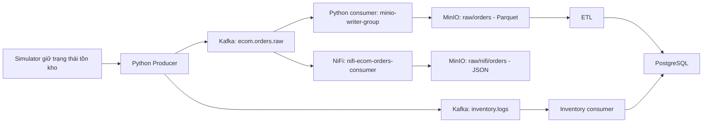

# Phần 2 — Thu nhận dữ liệu: Simulator, Kafka, NiFi và MinIO

Ngày đối chiếu: 16/10/2026. Phạm vi: đọc mã/cấu hình, chạy kiểm thử cục bộ và thử lỗi bằng client giả lập; đối chiếu hiện vật demo ngày 14/10. Chưa chạy lại luồng trên dịch vụ thật trong lượt này.

## 1. Vai trò và kiến trúc thực tế

Tầng ingestion tiếp nhận sự kiện bán hàng và snapshot tồn kho từ simulator. Kafka tách tiến trình phát dữ liệu khỏi tiến trình tiêu thụ; MinIO lưu bản raw phục vụ ETL và đối soát. Repository triển khai hai nhánh đọc topic đơn hàng bằng hai consumer group khác nhau:



NiFi và Python consumer đọc độc lập, không nối tiếp nhau. NiFi phục vụ quan sát, routing và lưu JSON; nhánh Python ghi Parquet mới là đầu vào mặc định của ETL. Nhánh tồn kho đi thẳng từ Kafka vào PostgreSQL, không qua MinIO trong mã hiện tại.

## 2. Producer và Kafka

`ingestion/producer.py` dùng simulator để tạo đơn và gửi JSON UTF-8. Message key ưu tiên mã đơn, sau đó mới đến SKU. Các sự kiện có cùng key được định tuyến nhất quán theo partition trong cấu hình partitioner thông thường; không tuyên bố thứ tự toàn topic.

| Thành phần | Giá trị đọc từ mã/cấu hình |
|---|---|
| Kafka trong Docker network | `kafka:9092` |
| Kafka cho tiến trình host | Mặc định `localhost:29092` |
| Orders topic | Mặc định `ecom.orders.raw` |
| Inventory topic | Mặc định `inventory.logs` |
| Topic khởi tạo | Mỗi topic 3 partition, replication factor 1 |
| Producer acknowledgement | `acks=all` |
| Retry trong KafkaProducer | 3 |
| Gom batch producer | `linger_ms=50`, `batch_size=32768` bytes |
| Nén producer | LZ4 |
| Snapshot tồn kho | Gửi ngay lúc khởi động, sau đó mặc định mỗi 60 giây |

Đây là giá trị trong mã và Compose, chưa phải mô tả topic/config lấy từ broker hôm nay. Cấu hình môi trường có thể thay đổi endpoint, topic và chu kỳ snapshot.

Producer gửi bất đồng bộ và gắn callback thành công/lỗi. Biến `total_sent` tăng sau khi gọi gửi, trước khi callback xác nhận, nên bộ đếm này phản ánh sự kiện đã yêu cầu gửi, chưa thay thế số ACK từ Kafka. Errback hiện ghi log; chưa có hàng đợi lỗi bền vững ở tầng ứng dụng. Khi dừng bình thường, producer gọi flush rồi close.

`acks=all` trong cấu hình một broker/replication factor 1 không tạo ra nhiều bản sao trên nhiều broker. Compose chưa khai báo volume riêng cho Kafka/ZooKeeper hoặc thiết lập retention tường minh. Khả năng giữ dữ liệu sau khi thay container và thời hạn replay cần kiểm tra riêng trước khi đưa vào cam kết vận hành.

## 3. Python consumer → MinIO Parquet

`ingestion/consumer_to_minio.py` sử dụng group `minio-writer-group`, `auto_offset_reset=earliest` và `enable_auto_commit=False`.

`earliest` áp dụng khi group chưa có offset hợp lệ; không có nghĩa consumer tự đọc lại từ đầu ở mọi lần khởi động.

Consumer gom mặc định 500 message hoặc 60 giây, rồi phân nhóm theo platform và ngày sự kiện. Timestamp ưu tiên `create_time`, sau đó dùng `created_time` nếu giá trị thứ nhất không hợp lệ. Timestamp được parse như UTC rồi đổi về `BUSINESS_TZ`, mặc định `Asia/Ho_Chi_Minh`. Nếu cả hai thiếu hoặc sai, partition dùng ngày nhận.

Đường dẫn đối tượng:

```text
raw/orders/platform=<platform>/year=YYYY/month=MM/day=DD/
    part-<thoi_diem_flush>-<batch_uuid>-<so_dong>.parquet
```

Parquet được nén Snappy. Hậu tố UUID giảm nguy cơ hai lần flush ghi đè cùng tên. Các cột hỗ trợ phân vùng được bỏ khỏi nội dung tệp; ETL khôi phục platform từ đường dẫn và bổ sung `_source_object`, `_source_row` khi đọc.

Sau khi hàm upload hoàn tất, vòng lặp mới commit Kafka offset. Nếu upload lỗi, lỗi được truyền ra ngoài và offset không được commit ở nhánh đó. Khi dừng, consumer thử flush buffer còn lại rồi đóng kết nối.

### 3.1. Ngữ nghĩa giao nhận và replay

Cơ chế commit sau upload hướng tới giao nhận ít nhất một lần (at-least-once) cho đầu vào hợp lệ, trong điều kiện Kafka vẫn giữ dữ liệu và offset được quản lý đúng. Chưa có bằng chứng đủ để kết luận exactly-once.

Nếu upload một phần batch đã thành công nhưng phần sau lỗi, hoặc upload xong rồi tiến trình chết trước commit, lần đọc lại có thể sinh object mới chứa các dòng đã lưu. Raw lake cho phép bản sao; cơ chế chống trùng ở ETL/warehouse sẽ được kiểm tra ở phần 3.

Thử lỗi cục bộ đã tái hiện: batch 2 dòng thuộc 2 platform, upload thứ hai lỗi, sau đó gọi lại cả batch. Kết quả lưu 3 dòng trong 3 object, nhưng chỉ có 2 ID duy nhất. Đây là bằng chứng hành vi replay ở hàm upload, chưa phải phép đo crash/restart trên Kafka thật.

### 3.2. Điểm có thể làm mất dòng lỗi

Nếu cột `_platform` hoàn toàn không tồn tại, hàm gán `unknown`. Nếu cột tồn tại nhưng một dòng mang giá trị `null`, `groupby` hiện bỏ dòng đó. Trường hợp thử một dòng `_platform=None` trả về 0 object, không ném lỗi. Vòng lặp chính gọi commit sau khi hàm trở về, nên có đường đi commit một batch mà dòng lỗi chưa được lưu raw.

Đây là lỗi biên đã tái hiện ở tầng hàm, không chứng minh các event hợp lệ từ simulator đã bị mất. Hướng xử lý: bảo toàn platform rỗng thành nhóm lỗi hoặc từ chối batch có audit/quarantine rõ ràng trước commit; cần chốt khi chuyển sang khắc phục.

## 4. Nhánh NiFi → MinIO JSON

Script triển khai định nghĩa sáu processor:

1. `ConsumeKafka_2_6`: nhận dữ liệu topic đơn hàng.
2. `EvaluateJsonPath`: lấy platform và các mã đơn riêng của hai sàn.
3. `RouteOnAttribute`: phân nhánh `shopee` và `tiktok`.
4. `UpdateAttribute`: đặt bucket, tên object và MIME type.
5. `PutS3Object`: ghi JSON vào MinIO.
6. `LogAttribute`: ghi các thuộc tính để theo dõi.

Script triển khai Python và script sửa routing dùng đường dẫn:

```text
raw/nifi/orders/platform=<platform>/ingest_date=<ngay_nhan_VN>/
    <ma_don>-<uuid>.json
```

Partition JSON theo ngày nhận; partition Parquet theo ngày sự kiện. Khi đơn đến muộn hoặc replay, ngày của hai nhánh có thể khác nhau một cách hợp lệ. Đối soát cần dựa vào ID/payload và run ID, không chỉ so ngày thư mục.

`warehouse/etl/extract.py` mặc định chỉ đọc `.parquet` dưới `raw/orders/`; JSON của NiFi không được nạp lại vào ETL qua đường này. Hai nhóm consumer độc lập cho phép mỗi nhánh nhận cùng dữ liệu; không phải chia tải giữa NiFi và Python.

### 4.1. Chênh lệch giữa các hiện vật cấu hình

Template XML hiện còn đặt JSON dưới `raw/orders/` và sử dụng biểu thức tạo tên khác script triển khai. README NiFi cũng còn chỉ về prefix cũ. Vì vậy import template mới có thể tạo flow khác script triển khai/sửa routing. Hồ sơ demo ngày 14/10 xác nhận nhánh thực nghiệm khi đó ghi `raw/nifi/orders/`; hôm nay chưa đọc được config NiFi đang chạy để xác nhận lại.

Trong `deploy_ecommerce_flow.py`, `EvaluateJsonPath` tự kết thúc `failure/unmatched`, router tự kết thúc `unmatched`, và `PutS3Object` tự kết thúc `failure`. Script chưa nối các quan hệ đó đến retry hoặc dead-letter/quarantine. Vì vậy chưa thể tuyên bố nhánh JSON bảo toàn mọi sự kiện khi parse/routing/upload lỗi.

Compose chỉ mount template vào NiFi; chưa khai báo volume riêng cho flow configuration, FlowFile/content/provenance repositories. Template có khai báo backpressure ở một số connection, nhưng cần đọc config connection thực trên runtime trước khi dùng các ngưỡng đó làm bằng chứng của flow triển khai qua API.

## 5. Nhánh inventory → PostgreSQL

`consumer_inventory_to_postgres.py` sử dụng group `inventory-postgres-writer-group`, tắt auto commit, gom mặc định 200 message hoặc 10 giây. Hàm `prepare_snapshots` đổi ngày theo múi giờ nghiệp vụ, sắp xếp timestamp và giữ snapshot mới nhất cho từng SKU/ngày trong cùng batch.

Upsert dimension và fact nằm trong một transaction. Chỉ sau khi hàm DB kết thúc mới commit Kafka offset. Khóa xung đột của fact là `(product_key, date_key)`.

Hai giới hạn từ việc đọc mã cần kiểm tra ở phần warehouse:

- SQL cập nhật theo xung đột chưa so sánh timestamp nguồn giữa các batch; snapshot cũ đến sau có thể ghi đè snapshot mới.
- SQL join với `Dim_Dates`; nếu ngày chưa có trong dimension, dòng không được insert, trong khi hàm trả số dòng đầu vào và vòng lặp vẫn có thể commit. Chưa tái hiện bằng DB thật ở lượt này.

## 6. Bằng chứng kiểm tra ngày 16/10/2026

### 6.1. Kiểm thử hiện có

Đã chạy bằng Python với `PYTHONPATH` trỏ `.venv/Lib/site-packages` và tắt tự nạp plugin pytest ngoài phạm vi:

```powershell
$env:PYTHONPATH = (Resolve-Path '.venv/Lib/site-packages').Path
$env:PYTEST_DISABLE_PLUGIN_AUTOLOAD = '1'
python -m pytest tests/test_ingestion.py -q --tb=short
python scripts/check_ingestion_offline.py
```

Kết quả pytest: **6 passed, 29 warnings, 0,72 giây**. Cảnh báo đến từ lớp tương thích PyArrow/pandas (`Pandas4Warning`), không phải lỗi assertions.

Các test xác nhận batch hai sàn dùng ngày của từng event; đổi ngày/năm ở nửa đêm Việt Nam; ISO timestamp khác offset; dùng timestamp thay thế; fallback ngày nhận; và hợp đồng timestamp không offset được hiểu là UTC.

### 6.2. Thử lỗi bằng client trong bộ nhớ

| Trường hợp | Kết quả |
|---|---|
| Khởi tạo producer bằng mock | Xác nhận `acks`, retry, batch và compression như bảng cấu hình |
| Upload thành công trong vòng lặp consumer | Thứ tự `uploaded → committed → closed` |
| Upload lỗi cả lần chính và flush cuối | Không commit; consumer đóng kết nối |
| Upload một phần rồi gọi lại batch | Tái hiện 3 dòng raw cho 2 ID duy nhất |
| `_platform=null` | Tái hiện 1 dòng đầu vào, 0 object, không có exception |
| Snapshot cùng SKU/ngày đến đảo thứ tự trong batch | Giữ snapshot mới nhất, ngày nghiệp vụ đúng UTC+7 |

Script kiểm chứng: `scripts/check_ingestion_offline.py`. Kết quả máy đọc được: `evidence/ingestion_offline_2026-10-16.json`. Script không kết nối broker, object storage hoặc database; các assertions xác nhận cả hành vi mong đợi và vấn đề đã tái hiện, không phải chứng nhận toàn bộ ingestion đạt.

### 6.3. Trạng thái kết nối dịch vụ trong phiên kiểm tra

`docker compose ps --format json` không kết nối được pipe `dockerDesktopLinuxEngine`, báo không tìm thấy đường dẫn. Kết nối TCP vào các cổng mặc định 29092, 8080, 9000, 9001 đều timeout trong phép thử 1 giây/cổng. Chưa xác nhận dịch vụ qua endpoint khác hoặc cấu hình port khác.

Vì vậy lượt này chưa đo lại producer ACK, consumer lag, processor status, queue size, object trên MinIO thật hoặc độ trễ event → object. Không suy ra hệ thống đã hỏng từ việc môi trường hiện tại chưa truy cập được dịch vụ.

## 7. Đối chiếu hồ sơ demo trước đó

Đã đọc hai JSON hiện có trong `data/runtime_checks/E2E20261014e09628/`, không chỉ dựa vào mô tả báo cáo:

| Bằng chứng ngày 14/10 | Giá trị lưu trong hiện vật |
|---|---|
| `streaming_result.json` | `status=PASS`, 64 dòng Parquet |
| `nifi_live_demo.json` | `status=PASS`, Shopee 32 JSON, TikTok 32 JSON |
| Fact theo platform | Shopee 16 dòng/32 units; TikTok 16 dòng/28 units |
| Snapshot tồn kho hai SKU demo | 123 và 47 units |

Theo báo cáo đi kèm, 64 event là 32 đơn phát hai lần để thử replay. Kết quả này là bằng chứng của lượt demo 14/10; không thay thế kiểm thử hiện hành hay chứng minh độ bền khi crash, broker lỗi hoặc tải lớn. Các snapshot API dùng `warehouse_snapshot`, nhưng demand của hai SKU demo dùng `fallback_catalog`; không được gộp thành bằng chứng model dự báo thật cho SKU mới.

## 8. Các điểm cần chốt

| ID | Nội dung | Mức bằng chứng / hướng tiếp theo |
|---|---|---|
| I-01 | Hai nhánh Kafka độc lập; ETL đọc nhánh Parquet | Đã đối chiếu mã và hồ sơ demo |
| I-02 | Phân vùng ngày theo event và UTC+7 | 6 test đạt |
| I-03 | Commit sau upload; lỗi upload không commit | Đã thử vòng lặp với client giả lập |
| I-04 | Trùng raw khi upload một phần rồi replay | Đã tái hiện; kiểm tra dedupe ETL tiếp theo |
| I-05 | Null platform bị bỏ mà không báo lỗi | Đã tái hiện; cần khắc phục trước nghiệm thu dữ liệu lỗi |
| I-06 | Failure/unmatched NiFi chưa có retry hoặc nơi lưu lỗi trong script | Đọc mã; cần kiểm tra và đồng bộ runtime |
| I-07 | XML/README và script NiFi khác cấu hình object key | Cần thống nhất hiện vật triển khai |
| I-08 | Độ bền Kafka/NiFi, replication, retention, backpressure | Chưa nghiệm thu phục hồi trên runtime |
| I-09 | Snapshot cũ và ngày thiếu trong dimension | Đọc mã; chuyển phần warehouse để kiểm chứng |

## 9. Câu hỏi bảo vệ

**Vì sao có cả NiFi và Python consumer?** Hai nhánh có vai trò khác nhau: NiFi cho quan sát/routing và lưu JSON; Python gom Parquet phục vụ ETL. Hai consumer group độc lập giúp mỗi nhánh nhận đầy đủ luồng của mình.

**Hệ thống có exactly-once không?** Chưa có căn cứ khẳng định. Consumer Parquet commit sau ghi; raw có thể trùng khi replay. Cần kết hợp dedupe và khóa nghiệp vụ ở ETL/warehouse để kiểm soát kết quả cuối.

**`acks=all` có chống lỗi một broker không?** Cấu hình hiện chỉ có một broker và replication factor 1; chưa có bản sao trên broker khác để bảo đảm sẵn sàng khi broker đó lỗi.

**Vì sao ngày partition JSON khác Parquet?** JSON NiFi đặt theo ngày nhận, Parquet theo ngày tạo sự kiện sau đổi sang múi giờ nghiệp vụ. Dữ liệu đến muộn/replay có thể thuộc hai ngày thư mục khác nhau.

**Làm sao chứng minh không mất dữ liệu?** Cần đối soát sự kiện đã được ACK, offsets, số dòng/object và kết quả valid/duplicate/rejected ở ETL; đồng thời thử lỗi và phục hồi. Bộ đếm gửi hoặc canvas xanh chưa đủ.

## 10. Minh bạch sử dụng AI

AI hỗ trợ đọc mã/cấu hình, chạy bộ test hiện có, viết và chạy script kiểm chứng trong bộ nhớ, đối chiếu hiện vật và soạn nội dung báo cáo. Chưa sửa mã xử lý production hoặc thay cấu hình dịch vụ trong lượt này. Sinh viên xác nhận đóng góp tự thực hiện và quyết định phạm vi khắc phục trước khi đưa vào báo cáo cuối.
