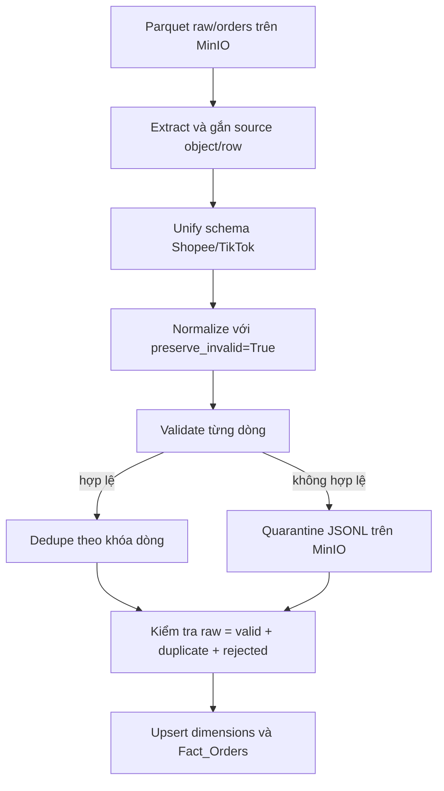

# Phần 3 — ETL, chất lượng dữ liệu và kho dữ liệu

Ngày kiểm tra: **19/10/2026**. Căn cứ: mã nguồn hiện tại, 29 kiểm thử, thử dữ liệu biên trong bộ nhớ và đối soát chỉ đọc trên PostgreSQL/MinIO thật. Không chạy lại tác vụ nạp, ghi quarantine hoặc xác nhận coverage trong lượt này.

## 1. Mục tiêu và quy trình xử lý

ETL chuyển dữ liệu đơn hàng từ Parquet trên MinIO thành các dòng hàng chuẩn hóa trong PostgreSQL. Các yêu cầu chính là bảo toàn độ hạt dòng hàng, kiểm soát replay, lưu lý do từ chối và đối soát số lượng đầu vào với kết quả xử lý.

Quy trình thực tế trong `run_etl_pipeline`:



Pipeline validate trước khi dedupe. Vì vậy một dòng lỗi trùng định danh với dòng tốt vẫn được kiểm tra và ghi nhận lỗi riêng, thay vì biến mất như một bản sao.

## 2. Extract và khả năng truy vết

`warehouse/etl/extract.py` mặc định duyệt `.parquet` dưới `raw/orders/`, có thể chọn partition ngày cho hai platform. Việc đọc dùng thread pool tối đa 16 worker. Hàm chờ kết quả các future theo danh sách tệp được liệt kê, không dùng thời điểm hoàn thành worker làm thứ tự dữ liệu.

Mỗi dòng được bổ sung `_source_object` và `_source_row`. Platform được khôi phục từ đường dẫn object. Nếu đọc một object lỗi, ngoại lệ được truyền lên; pipeline không báo thành công dựa trên phần object đọc được trước đó. Response MinIO được đóng và trả kết nối cả khi đọc thất bại.

Phạm vi extract là toàn bộ tệp tìm thấy theo prefix/ngày, chưa thấy checkpoint xử lý object hoặc watermark trong hàm này. Chạy lại có thể đọc lại tệp cũ; chống trùng được thực hiện ở các tầng tiếp theo. Đây là căn cứ để mô tả ETL theo batch, tách khỏi streaming ingestion.

## 3. Chuẩn hóa schema và định danh dòng hàng

| Trường chuẩn | Shopee | TikTok |
|---|---|---|
| `order_id` | `order_sn` | `order_id` |
| `sku` | `item_sku` | `seller_sku` |
| `create_time` | `create_time` | `created_time` |
| `original_price` | `original_price` | `item_original_price` |
| `subtotal` | `total_order_value` | `sub_total` |
| `buyer_total_amount` | `buyer_total_amount` | `total_amount` |
| `shop_id` | `shop_id` | `shop_id`, nếu thiếu dùng `shop_name` |

Thời điểm nguồn được parse với `utc=True`, đổi về `BUSINESS_TZ` rồi bỏ timezone trước khi nạp vào cột `TIMESTAMP`. Ngày nghiệp vụ `order_date` được lấy sau khi đổi múi giờ. Timestamp không offset được hiểu là UTC; cần xác nhận hợp đồng này khi tiếp nhận nguồn mới.

Độ hạt của `Fact_Orders` là **một dòng hàng trong một đơn trên một platform**. Khóa chống trùng hiện tại là:

```text
(order_id, platform, source_line_id)
```

`source_line_key` ưu tiên `order_line_id`, `line_id`, rồi `source_line_id`; nếu không có thì dùng `sku:<SKU>`. Mã số nguyên dạng 17 và 17.0 được chuẩn hóa giống nhau; mã chuỗi `0017` được giữ nguyên.

Thiết kế này bảo toàn đơn nhiều SKU và nhiều dòng cùng SKU nếu có line ID riêng. Khi nguồn thiếu line ID, thiết kế giả định mỗi SKU chỉ có một dòng trong đơn. Thử hai dòng cùng SKU với quantity 2 và 3, không có line ID, cho kết quả chỉ còn một dòng. Báo cáo cần nêu giả định thay vì tuyên bố bảo toàn mọi cấu trúc đơn nguồn.

Các trường tiền được ánh xạ theo tên nguồn; adapter chưa chứng minh đã phân bổ số tiền cấp đơn xuống nhiều dòng. Trước khi nhận dữ liệu sàn thật, cần xác nhận độ hạt từng chỉ tiêu để tránh cộng lặp tổng tiền cấp đơn.

## 4. Kiểm tra chất lượng và quarantine

`clean_data(..., preserve_invalid=True)` chuẩn hóa kiểu dữ liệu, timestamp và trạng thái, đồng thời giữ các dòng lỗi cho validator. Các khoản phí tùy chọn vắng mặt có thể mặc định 0; giá trị sai kiểu đã được cung cấp được giữ là không hợp lệ.

Validator hiện kiểm tra:

- Trường bắt buộc: order ID, platform, SKU, thời điểm tạo và trạng thái.
- Platform và trạng thái thuộc tập được cho phép; giới hạn chiều dài định danh.
- Quantity là số nguyên dương, không vượt 100 theo cấu hình mặc định.
- Các trường tiền được kiểm tra không âm, không vượt trần mặc định 1 tỷ và đúng kiểu.
- Trật tự một số mốc thời gian, có ngoại lệ được lập trình cho COD ở nhánh ship trước pay.

Đơn hủy vẫn được giữ trong fact cùng cờ `is_cancelled`; việc loại khỏi chuỗi lượng bán diễn ra ở tầng feature engineering. Trong ETL hiện tại, cờ này chỉ gắn cho trạng thái `CANCELLED`, trong khi importer lịch sử còn đánh dấu `IN_CANCEL`/`CANCEL_REQUESTED`. Cần chốt định nghĩa nghiệp vụ xuyên nguồn ở phần ML/BI.

Quarantine lưu JSONL tại:

```text
quarantine/orders/run_id=<run_id>/rejected.jsonl
```

Nội dung có payload nguồn, vị trí dòng/object, lý do từ chối và run ID. Pipeline ghi quarantine trước khi load. Nếu ghi audit lỗi, ngoại lệ làm pipeline dừng và không gọi load. `--dry-run` không ghi quarantine và không nạp PostgreSQL; vẫn cần đọc MinIO.

Phương trình đối soát:

```text
raw_records = clean_records_sau_dedupe + duplicates_removed + quarantined_records
```

Đây là đối soát dòng của tập dữ liệu đã extract, không chứng minh Kafka đã nhận đủ mọi sự kiện từ producer. Stats được trả về dưới dạng dictionary; CLI chưa có bước lưu nhật ký run bền vững riêng. Quarantine và các runner có hiện vật riêng, nhưng không nên mô tả stats của mọi lần ETL như một ledger đã luôn được lưu.

## 5. Star schema và load

DDL định nghĩa sáu dimension: sản phẩm, shop, địa lý, ngày, thanh toán và đơn vị vận chuyển. Các fact chính gồm đơn hàng, tồn kho theo ngày, lịch sử CSV và dự báo đã phát hành. Bảng coverage lưu xác nhận ngày đủ dữ liệu theo nguồn/dataset.

`load` upsert các dimension, lookup ngày/thanh toán, rồi nạp fact. Các helper dimension và helper fact mở transaction riêng; chưa có một transaction bao trùm toàn bộ bước load. Khi fact lỗi, dimension đã commit có thể còn lại; không tuyên bố toàn bộ ETL là một transaction nguyên tử.

Fact sử dụng `ON CONFLICT (order_id, platform, source_line_id) DO UPDATE`. Nhờ đó replay giữ số dòng theo khóa và cho phép cập nhật trạng thái, quantity, tiền và các mốc vòng đời. Unique index theo đúng ba trường đã được xác nhận trên PostgreSQL thật.

`rows_loaded` hiện cộng số dòng gửi vào các chunk upsert, gồm cả dòng cập nhật; **không phải số dòng mới insert**. Do đó replay có `loaded_records > 0` vẫn có thể giữ nguyên tổng số dòng warehouse. Cần kiểm tra khóa, quantity và tiền trước/sau để đánh giá idempotency.

Các khóa dimension của `Fact_Orders` có thể NULL theo DDL. Loader chưa bắt buộc lookup phải thành công trước insert; dữ liệu ngày ngoài khoảng đã seed có thể thiếu `date_key`. Hiện DDL seed `Dim_Dates` từ 2025 đến hết 2027. Bảng fact vận hành chưa có CHECK quantity dương tương tự bảng lịch sử, nên kiểm soát đầu vào vẫn phụ thuộc ETL.

## 6. Coverage và tồn kho

`Warehouse_Daily_Coverage` có khóa `(data_origin, source_dataset, full_date)`. Script `confirm_daily_coverage.py` được dùng sau khi đã đối soát đủ nguồn. Script không tự suy ra coverage từ việc một ngày có đơn, và không cho xác nhận ngày hiện tại/chưa hoàn tất theo giờ Việt Nam.

Tại thời điểm truy vấn 19/10, bảng có **0 bản ghi**. Cần tách biệt giữa ngày có dòng bán, ngày được điền 0 trong chuỗi và ngày đã xác nhận nạp đầy đủ. Lượt kiểm tra không tự xác nhận coverage vì mới đối soát một partition, chưa có số liệu kỳ vọng đầy đủ từ nguồn.

Nhánh inventory có hai giới hạn đã đọc ở phần ingestion: ngày vắng trong `Dim_Dates` có thể không join được khi insert; và upsert chưa so sánh timestamp nguồn giữa các batch. Lượt này chưa chạy thử ghi/rollback inventory nên hai điểm đó vẫn là kết luận từ mã, không phải thử nghiệm DB đã tái hiện.

## 7. Kết quả kiểm chứng ngày 19/10/2026

### 7.1. Kiểm thử cục bộ

Chạy ba tệp `test_etl.py`, `test_order_line_integrity.py`, `test_pipeline_integrity.py`: **29 passed trong 4,67 giây**. Nhóm thứ ba có cả kiểm tra provenance ML/serving; con số 29 không phải 29 test riêng cho SQL ETL.

Lượt đầu đạt 25 test, 4 lỗi setup do pytest không tạo được thư mục tạm mặc định trong sandbox. Sau khi chuyển `--basetemp` sang thư mục mới dưới `scratch/`, cả 29 test đạt, không cần sửa mã xử lý hoặc test.

Môi trường: Python runtime cục bộ của Codex; thư viện từ `.venv/Lib/site-packages`; `PYTEST_DISABLE_PLUGIN_AUTOLOAD=1`, `OMP_NUM_THREADS=1`. Windows Store Python alias không chạy được trong phiên này nên dùng executable runtime trực tiếp.

Các bằng chứng chức năng gồm: giữ các dòng có line ID riêng, replay không tăng số dòng sau dedupe, lỗi không bị che bởi dedupe, raw payload có trong quarantine, ghi quarantine lỗi chặn load, và lỗi đọc MinIO không tạo thành công một phần.

### 7.2. Tổng quan warehouse thật

Các truy vấn chạy trong transaction chỉ đọc:

| Chỉ tiêu | Kết quả |
|---|---:|
| Dòng `Fact_Orders` | 19.269 |
| Đơn theo `(platform, order_id)` | 19.255 |
| Tổng quantity, gồm cả dòng hủy | 38.969 |
| Dòng đánh dấu hủy | 7.609 |
| Thiếu `product_key` / `date_key` | 0 / 0 |
| Thiếu `shop_key` | 32 |
| Coverage đã xác nhận | 0 |
| Dòng lịch sử CSV | 7.000 |
| SKU trong toàn bộ bảng lịch sử | 228 |

32 dòng thiếu shop đều có ID thuộc nhóm fixture theo tiền tố `E2E`/`DI`; không có dòng thiếu shop ngoài hai tiền tố trong truy vấn này. Đây là bằng chứng phân nhóm theo định danh kiểm thử, chưa phải truy vết đầy đủ tác giả từng dòng.

Dữ liệu fact vận hành có thời điểm tạo từ 30/09 đến 14/10/2026; lịch sử CSV từ 26/12/2025 đến 11/08/2026. 228 SKU trong toàn bảng lịch sử khác 216 SKU trong artifact của phần 1: chưa thể coi đó là sai lệch vì phạm vi lọc/ngày và trạng thái khác nhau; cần đối chiếu tập huấn luyện ở phần ML.

### 7.3. Đối soát partition ngày 14/10 trên MinIO và PostgreSQL

Đã đọc lại raw thật và chạy transform/validate/dedupe trong bộ nhớ, không gọi load:

| Chỉ tiêu | Kết quả |
|---|---:|
| Object Parquet trong tập đọc | 37 |
| Dòng raw | 52 |
| Dòng hợp lệ sau dedupe | 34 |
| Dòng trùng | 16 |
| Dòng lỗi | 2 |
| Dòng warehouse cùng ngày | 34 |
| Khóa hợp lệ thiếu trong warehouse | 0 |
| Khóa warehouse không có trong raw hợp lệ của ngày | 0 |
| Khóa chung có chênh lệch các trường đã so sánh | 0 |
| Tổng quantity hợp lệ / warehouse | 73 / 73 |

Phương trình khớp: **52 = 34 + 16 + 2**. Các trường đối chiếu theo khóa dòng là quantity, SKU, order status, cờ hủy, subtotal và buyer total amount. Hai trường tiền được so đến độ chính xác 0,01 theo kiểu NUMERIC của fact; chưa đối chiếu toàn bộ phí/giảm giá hoặc mọi dimension.

Hai lỗi gồm một dòng thiếu SKU và một dòng quantity không dương. Đã đọc 8 object quarantine hiện có và tìm thấy vị trí nguồn của cả **2/2 dòng lỗi**. Điều này xác nhận có hồ sơ cách ly cho hai vị trí nguồn; chưa chứng minh cơ chế tự sửa và nạp lại quarantine.

Phạm vi là dữ liệu hiện có của ngày 14/10, không phải phép đối soát toàn lịch sử hoặc một lượt publish mới. Số lượng này không dùng thay cho cohort demo 64 event được ghi nhận trong báo cáo ngày 14/10 ở phần 2.

## 8. Các giới hạn tái hiện được bằng dữ liệu biên

| ID | Trường hợp | Quan sát |
|---|---|---|
| W-01 | Hai bản cùng khóa, trạng thái cũ/mới | Dedupe `keep=last` chọn bản cuối theo thứ tự đầu vào; đảo thứ tự làm kết quả đổi từ COMPLETED sang READY_TO_SHIP |
| W-02 | Hai dòng cùng SKU/đơn, thiếu line ID | Khóa fallback trùng, hai dòng còn một; cần hợp đồng một dòng/SKU hoặc line ID thực |
| W-03 | `voucher_from_seller="bad"` | Cộng voucher ở unify phát sinh TypeError trước validator/quarantine |
| W-04 | `model_discounted_price="bad"` | Dòng vẫn qua validator, nhưng chuyển `discounted_price` sang float theo loader phát sinh ValueError |

W-01 là giới hạn xử lý sự kiện cập nhật/đến muộn. Thứ tự tệp hoặc thứ tự extract không thay thế source version/event timestamp; SQL upsert cũng chưa có điều kiện chỉ nhận phiên bản mới hơn. Replay cùng payload đã được kiểm soát khác với việc xử lý replay bản cũ sau cập nhật mới.

W-03 làm pipeline dừng thay vì âm thầm nạp sai, nhưng dòng lỗi chưa đến được nơi lưu audit. W-04 xác nhận khoảng trống validator và chuyển kiểu; thử nghiệm chỉ thực hiện chuyển kiểu trong bộ nhớ, không chạy insert lỗi trên database thật.

## 9. Đánh giá và bước tiếp theo

Tập ngày 14/10 đã đối soát khớp ở các trường được chọn, có unique index đúng độ hạt và có quarantine cho các dòng bị từ chối. Bằng chứng hiện tại chưa đủ nghiệm thu toàn bộ lịch sử, tính nguyên tử toàn luồng, sự kiện cập nhật đến sai thứ tự hoặc coverage ngày đầy đủ.

Ưu tiên khắc phục sau kiểm tra: đưa lỗi kiểu dữ liệu về validator/quarantine; quy định version/thời gian cập nhật để chống ghi lùi trạng thái; thống nhất line ID; bổ sung kiểm tra lookup và nhật ký run bền vững. Các vấn đề này được ghi nhận, chưa thay đổi mã production trong lượt kiểm tra.

Phần tiếp theo kiểm tra feature engineering và Machine Learning: định nghĩa lượng bán, ngày thiếu/zero-fill, leakage khi chia tập theo thời gian, ánh xạ 228 SKU lịch sử → 216 SKU artifact, đánh giá baseline và provenance model.

## 10. Câu hỏi bảo vệ

**Vì sao fact có nhiều dòng hơn số đơn?** Fact lưu dòng hàng. Một đơn nhiều SKU hoặc có nhiều line ID sẽ có nhiều dòng; số đơn phải đếm distinct `(platform, order_id)`.

**Chống trùng ở đâu?** Dedupe trong batch hợp lệ và unique index/upsert tại PostgreSQL. Hai cơ chế kiểm soát bản sao, nhưng chưa tự giải quyết phiên bản sự kiện cũ/mới đến sai thứ tự.

**52 dòng raw còn 34 dòng fact có mất dữ liệu không?** Trong tập đã đối soát, 16 dòng là bản sao, 2 dòng không hợp lệ đã tìm thấy audit quarantine; cả 34 dòng hợp lệ khớp warehouse ở các trường kiểm tra.

**Nạp lại báo 34 loaded có nghĩa thêm 34 dòng không?** Không. Bộ đếm hiện phản ánh số dòng xử lý bằng upsert, gồm cả cập nhật. Cần đo tổng số dòng và các đại lượng theo khóa trước/sau.

**Có dữ liệu ngày đó có nghĩa ngày đã đầy đủ chưa?** Chưa. Coverage là xác nhận riêng sau đối soát nguồn; bảng này hiện trống.

## 11. Hiện vật và minh bạch sử dụng AI

- Script tái hiện: `scripts/check_etl_warehouse_readonly.py`.
- Kết quả tổng hợp: `evidence/etl_warehouse_2026-10-19.json`.
- Mã căn cứ: `warehouse/etl/{extract,transform,data_validation,quarantine,pipeline,load}.py`, DDL và script xác nhận coverage.

AI hỗ trợ kiểm tra mã, chạy test, soạn script chỉ đọc, đối soát và viết báo cáo. Các truy vấn nghiệp vụ không ghi PostgreSQL/MinIO; kết quả được lưu cục bộ. Sinh viên xác nhận phần tự thực hiện và quyết định cách xử lý các tồn đọng khi hoàn thiện bản cuối.
