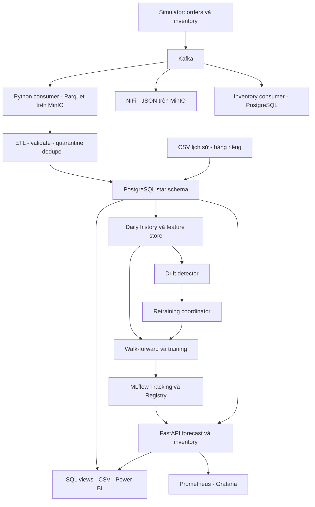

# Báo cáo tổng hợp đồ án Streaming MLOps E-Commerce

> **Cập nhật lần 9, 20/10/2026:** Đã có worker Kafka → MinIO → ETL → PostgreSQL → CSV chạy liên tục, giữ checkpoint sau restart; sửa lưu lỗi/null platform, version đơn/tồn kho, validation và policy inventory. 145 test đạt; hai lượt đối soát thực tế đạt, API ready 200. [Báo cáo lần 9](../04-pipeline-updates/lan-09-on-dinh-end-to-end-2026-10-20.md) phân biệt các phần đã sửa và các mục ML/PBIX/coverage chưa nghiệm thu. Những con số audit cũ bên dưới giữ nguyên ngày đo.

> **Cập nhật KPI 20/10/2026:** Đã sửa số đơn/AOV trong SQL view và exporter; dữ liệu runtime khớp 11.646 đơn không hủy, AOV tổng 653.440,57. Toàn suite gồm SQL integration đạt 114 test. Xem [báo cáo khắc phục lần 8](../04-pipeline-updates/lan-08-powerbi-orders-aov-2026-10-20.md). Chưa refresh/render PBIX; các kết quả audit cũ bên dưới giữ nguyên để đối chiếu.

> **Cập nhật 20/10/2026:** Đã khắc phục lỗi phục hồi model sau startup timeout; API thực tế `/ready` 200, dùng `mlflow_registry` v2. Toàn suite sau sửa đạt 110 test. Xem [báo cáo khắc phục lần 7](../04-pipeline-updates/lan-07-model-startup-recovery-2026-10-20.md). Các trạng thái ngày 19/10 bên dưới được giữ làm bằng chứng trước sửa; giới hạn dữ liệu và chất lượng dự báo vẫn còn.

**Dự báo lượng bán và hỗ trợ quản trị tồn kho đa kênh Shopee/TikTok Shop**

Đợt kiểm tra: 16–19/10/2026 · Mốc tổng hợp: 19/10/2026

Bản thảo kỹ thuật có bằng chứng; thông tin trường, giảng viên, tác giả và định dạng học thuật sẽ bổ sung theo hồ sơ chính thức.

## Tóm tắt

Đồ án xây dựng pipeline thu nhận dữ liệu đơn hàng và tồn kho, lưu raw, chuẩn hóa warehouse, tạo đặc trưng dự báo, quản lý mô hình qua MLflow và cung cấp kết quả qua API/BI. Simulator mô phỏng hai kênh bán của một doanh nghiệp dùng kho trung tâm; lịch sử CSV được quản lý riêng cho thử nghiệm dự báo.

Kiểm tra xác nhận cơ chế tích hợp đã có bằng chứng end-to-end ở các lượt trước; ETL của một ngày đối soát khớp, dữ liệu huấn luyện truy vết được và metric moving average tái lập. Toàn suite ngày 19/10 đạt **106 test**. Tuy nhiên, runtime API hiện fallback vì nạp Registry timeout lúc khởi động; chất lượng dự báo chưa đạt căn cứ ứng dụng nghiệp vụ; Power BI còn lỗi KPI và PBIX chưa hoàn thiện theo thiết kế. Báo cáo trình bày các kết quả này theo ngày/phạm vi, không đồng nhất chạy thông luồng với chất lượng hoặc sẵn sàng production.

## 1. Bài toán, mục tiêu và phạm vi

Trong kịch bản doanh nghiệp bán đa kênh, dữ liệu hai sàn khác schema trong khi quyết định chuẩn bị hàng cần thông tin thống nhất theo sản phẩm và ngày. Hệ thống hướng tới giảm thao tác ghép dữ liệu, tạo dự báo có phiên bản và cung cấp cảnh báo tồn kho có thể truy vết nguồn.

Các mục tiêu kỹ thuật gồm thu nhận sự kiện liên tục, giữ raw, kiểm soát lỗi/trùng, warehouse theo mô hình chiều, đặc trưng chuỗi thời gian, đánh giá model ngoài mẫu theo thời gian, quản lý artifact, API và giám sát. Dự báo được định nghĩa theo lượng đặt chưa hủy; chưa có bước ước lượng nhu cầu bị che khuất do hết hàng.

Phạm vi bằng chứng là môi trường demo và dữ liệu hiện có trong repository. Chưa xác nhận kết nối tài khoản kinh doanh thật, tự phát hành đơn mua hàng, tối ưu đa kho, tính đại diện thị trường của CSV hoặc tiết kiệm chi phí thực tế.

Người sử dụng gồm quản lý bán hàng, kế hoạch/mua hàng, quản lý kho và nhóm dữ liệu/MLOps. Đầu ra hỗ trợ quyết định; chưa thay thế chính sách nhập hàng đã được doanh nghiệp nghiệm thu.

Chi tiết: [Phần 1 — Bài toán và dữ liệu](01-bai-toan-va-du-lieu.md).

## 2. Kiến trúc triển khai

NiFi và Python consumer là hai nhánh đọc Kafka độc lập. JSON NiFi phục vụ quan sát/đối soát; Parquet là đầu vào mặc định của ETL. Ingestion là streaming; ETL, features, training, export BI và các tác vụ drift/retrain là những bước riêng. Mũi tên drift/retrain biểu diễn đường chức năng trong mã, chưa chứng minh scheduler vòng lặp đã vận hành liên tục.

Chi tiết: [Phần 2 — Ingestion](02-ingestion-kafka-nifi-minio.md).

## 3. Dữ liệu và quản lý chất lượng

Simulator hiện có 20 SKU, dataclass Shopee 61 trường và TikTok 70 trường. Đây là schema hiện có trong mã, không phải xác nhận schema chính thức của sàn. Các con số 19 SKU và 84/71 trường trong ghi chép cũ cần đồng bộ.

Kho vận hành có 19.269 dòng hàng thuộc 19.255 đơn; tổng quantity gồm cả dòng hủy là 38.969. Bảng lịch sử CSV có 7.000 dòng/228 SKU; sau loại hủy còn 216 SKU vì 12 SKU chỉ có dòng hủy.

ETL dùng khóa dòng `(order_id, platform, source_line_id)`, validate trước dedupe, lưu rejected kèm payload/vị trí nguồn, rồi upsert warehouse. Unique index đúng khóa đã được xác nhận trên DB thật. Nếu thiếu upstream line ID, khóa fallback theo SKU đòi hỏi giả định một dòng/SKU/đơn.

Đối soát ngày 14/10 trên dữ liệu đang lưu:

| Raw | Hợp lệ sau dedupe | Trùng | Rejected | Warehouse khớp |
|---:|---:|---:|---:|---:|
| 52 | 34 | 16 | 2 | 34 |

Tổng quantity 73/73; không chênh lệch các trường SKU, quantity, status, cờ hủy, subtotal và buyer total trên các khóa hợp lệ. Cả hai vị trí nguồn bị từ chối có audit quarantine. Đây là đối soát một partition, chưa chứng minh toàn nguồn không mất dữ liệu.

Chi tiết: [Phần 3 — ETL và warehouse](03-etl-va-data-warehouse.md).

## 4. Phương pháp dự báo và kết quả

Feature store có 42.768 dòng/51 cột, với 43 cột đầu vào model. Daily history có 49.032 ô SKU/ngày. Chuỗi dựng lại từ warehouse khớp toàn bộ demand của artifact; nhãn t+1 khớp actual ngày kế tiếp.

Lag lớn nhất 28 ngày; readiness ba fold mặc định yêu cầu 92 ngày lịch sử. Mã sử dụng walk-forward theo target date và dự báo đệ quy cho 14 ngày test. ABC/XYZ được fit trước vùng holdout; nguồn CSV thiếu tài chính dùng quantity cho trọng số ABC.

Ba baseline tái đánh giá trên cùng artifact:

| Ứng viên theo mã hiện tại | WAPE trung bình fold | WAPE gộp |
|---|---:|---:|
| Naive | 126,73% | 123,95% |
| Seasonal naive | 153,97% | 153,88% |
| Moving average | 126,08% | 124,41% |

Moving average v2 trong MLflow Staging có `cv_wape=126,08%`, khớp phép tái lập. Đây là trung bình WAPE từng fold, không phải WAPE gộp. Tổng được chấm 8.484/9.072 dòng test; phần còn lại bị bỏ do không đủ lịch sử phù hợp.

Khoảng 95,49% ô daily history bằng 0 sau tổng hợp; coverage ngày chưa được xác nhận. Baseline còn giới hạn căn chỉnh ngày, metric zero-demand và lựa chọn holdout. Vì WAPE vượt 100%, chưa có cơ sở kết luận model phù hợp quyết định tồn kho. Mã LSTM/GRU cần xử lý hợp đồng chuỗi và nghiệm thu riêng trước khi sử dụng kết quả so sánh học thuật.

Chi tiết: [Phần 4 — Feature engineering và ML](04-feature-engineering-va-machine-learning.md).

## 5. API, tồn kho và giám sát

API có đường forecast một/nhiều SKU, inventory alerts, health/readiness, metadata/reload và metrics. Response phân biệt model source, history source, stock source và demand source.

Runtime ngày 19/10 có `/health=200 degraded`, `/ready=503`, model_loaded=false. Log cho thấy MLflow timeout đọc 5 giây ở startup; manager chuyển sang heuristic và chưa tự thử nạp lại sau khi đánh dấu khởi tạo hoàn tất. Registry có artifact không đồng nghĩa tiến trình API đã nạp nó.

Các request kiểm tra trả heuristic_history khi có lịch sử, heuristic_catalog cho SKU simulator hoặc không biết. Số dòng audit forecast trước/sau đều 6. Nguồn lịch sử kết thúc 11/08, cũ 69 ngày; snapshot tồn đã kiểm tra cũ 5–10 ngày, chưa có gate loại stale data.

SS/ROP được tính từ mean, sigma, lead time và service level, có các sàn số nguyên. Đây là quy tắc hỗ trợ quản trị, chưa phải kết quả tối ưu chi phí đã đo. Cảnh báo dùng snapshot thật vẫn có thể dựa trên demand fallback; cần đọc đồng thời hai nhãn nguồn.

Prometheus scrape up và Grafana health tốt; chỉ thấy rule thiếu lịch sử huấn luyện, không có active Alertmanager. Summary drift và trạng thái training có ngày cũ; chưa có bằng chứng scheduler chạy vòng retrain ngày kiểm tra. Khoảng dự báo trong API chưa hiệu chuẩn coverage.

Chi tiết: [Phần 5 — Serving và monitoring](05-serving-inventory-va-monitoring.md).

## 6. BI, dashboard và thực nghiệm

Đã xuất bảy CSV bằng SELECT trên runtime và so với bộ đang lưu: nội dung khớp. Tuy nhiên, bảng summary đếm 11.628 dòng thành “orders”, trong khi cùng phạm vi có 11.614 đơn duy nhất; join shop còn bỏ 32 dòng fixture thiếu khóa. AOV là trung bình theo dòng, cần thống nhất theo đơn.

Sáu forecast được xuất chưa có actual complete vì coverage bằng 0. WAPE/accuracy vận hành phải để trống; không lấy metric CV của ML thay vào đó. View đã có gate thời điểm phát hành và coverage để tránh dùng actual chưa hoàn tất.

PBIX hiện có một trang tồn kho với ba thành phần, chỉ một card có query binding tới năm measure. Chưa khớp thiết kế ba trang trong README; chưa render/refresh hoặc chạy DAX engine trong đợt kiểm tra. DAX tài liệu và dimension mapping cần đồng bộ với phương thức nạp dữ liệu được chọn.

Các số đo tải/soak được giữ đúng phạm vi: raw load JSON hiện là in-process 5 users/25 requests ngày 12/10; báo cáo HTTP 200 users ngày 09/10 là kết quả lịch sử trên fallback; soak một giờ chỉ kiểm tra ingestion. Chưa chạy lại hiệu năng model live vì model chưa nạp.

Chi tiết: [Phần 6 — Power BI và thực nghiệm](06-power-bi-va-tong-hop-thuc-nghiem.md).

## 7. Tổng hợp mức bằng chứng

| Nội dung | Đã xác nhận | Giới hạn |
|---|---|---|
| Ingestion | Phân vùng đúng trong 6 test; commit sau upload; có hồ sơ E2E cũ | Null platform bị bỏ; raw có thể trùng khi replay; chưa nghiệm thu HA/phục hồi |
| ETL/warehouse | Một ngày đối soát khớp; rejected có audit; khóa dòng đúng | Update đến sai thứ tự, validation kiểu tiền, lookup và transaction toàn luồng còn giới hạn |
| ML data | 49.032 khóa daily khớp; 43 cột đúng thứ tự; nhãn t+1 khớp | Zero-fill chưa có coverage; không có SKU chung với simulator |
| ML model | Metric moving average tái lập; version/artifact có trên Registry | WAPE cao; baseline alignment; chưa có holdout cuối độc lập |
| Serving | API chạy và gắn nhãn fallback; lỗi startup có log | Model live chưa nạp, readiness đỏ, dữ liệu/snapshot cũ |
| Monitoring | Targets up, metrics và một rule được nạp | Chưa cảnh báo model down/freshness; chưa có đường thông báo được nghiệm thu |
| BI | Export thật tái lập; actual chưa đủ được để NULL | Count/AOV sai khác; DAX/mapping chưa đồng bộ; PBIX chưa hoàn chỉnh |
| Kiểm thử | 106 passed, 30 warnings, seed 20261019, 7,31 giây | Một lượt seed cố định; có lỗi biên ngoài suite; không thay thế runtime |

Không cộng các số test từng chương vì có tập trùng. Kết quả toàn suite không phủ định trường hợp buyer amount bằng 0 được tái hiện ở simulator bằng seed 128, hoặc những giới hạn có bằng chứng trong các script audit.

## 8. Danh sách việc cần hoàn thiện

“Ưu tiên trước nghiệm thu” thể hiện mức ảnh hưởng đến tính đúng và khả năng bảo vệ báo cáo; không phải sự cố production đã được phân loại theo SLA doanh nghiệp.

| ID | Việc cần làm | Bằng chứng / điều kiện đóng |
|---|---|---|
| A-01 | Phục hồi model live, thêm retry startup phù hợp | Đã khắc phục 20/10: ready 200, forecast Registry; regression và probe lỗi lần đầu rồi đọc artifact thật đạt; xem báo cáo lần 7 |
| A-02 | Sửa KPI orders/AOV và phạm vi shop thiếu | Đã sửa SQL/exporter/DAX tài liệu 20/10: đối soát nguồn khớp, bốn SQL test đạt; refresh/visual PBIX thuộc A-03 |
| A-03 | Hoàn thiện PBIX, DAX và relationships theo dataset chọn | Render/refresh; kiểm tra KPI, filters và đủ các trang đã cam kết |
| A-04 | Xác nhận coverage và phân biệt thiếu nguồn với zero demand | Hồ sơ kỳ vọng nguồn theo ngày; gate readiness/feature/scoring nhất quán |
| A-05 | Chuẩn hóa baseline alignment và mốc so sánh nhu cầu thưa | Thử chuỗi có kỳ vọng; CV cùng protocol; holdout cuối chưa dùng chọn model |
| A-06 | Xử lý metric khi actual toàn 0 và báo tỷ lệ được chấm | Metric không báo WAPE hoàn hảo sai nghĩa; theo SKU/segment/horizon |
| A-07 | Giữ dòng null platform và nhánh lỗi NiFi | Đã sửa lần 9: unknown partition, quarantine JSON/platform, retry PutS3; cohort AUTO đạt, NiFi 7 processor chạy/queue=0. Chưa thử mất MinIO toàn hệ thống |
| A-08 | Hoàn thiện validation tiền trước transform/load | Đã sửa lần 9: sai voucher/discounted price/timestamp/weight/độ dài vào quarantine; batch trộn kiểu và số vô hạn có regression |
| A-09 | Chốt line ID và version sự kiện | Đã chặn ghi lùi đơn/tồn kho trong batch và DB. Vẫn cần upstream line ID khi một SKU có nhiều dòng; cùng timestamp chưa có tie-break từ nguồn |
| A-10 | Quản lý spec theo model và lookup dimension | Model/spec đúng cặp; SKU lịch sử có mapping; không silently NULL/mất join |
| A-11 | Chặn hoặc gắn rõ dữ liệu stale và fallback trong sản phẩm | Threshold freshness, nhãn nguồn/tuổi dữ liệu, quy tắc SKU lạ |
| A-12 | Đồng nhất validation inventory GET/POST và công thức API/BI | Đã sửa lần 9: POST 422 khi ngoài miền; SS/ROP và NORMAL được đối chiếu bằng SQL integration. Nguồn demand hai tầng vẫn phân biệt |
| A-13 | Bổ sung alert model/readiness/fallback và đường giao nhận | Lần 9 nạp sáu rule hợp lệ, thêm pipeline/freshness gauges. Chưa nghiệm thu Alertmanager/người nhận |
| A-14 | Nghiệm thu scheduler drift/retrain và rollback | Provenance đúng, version live xác nhận, lịch sử audit và thử lỗi mạng |
| A-15 | Nghiệm thu học sâu nếu giữ trong phạm vi kết quả | Chuỗi theo SKU, validation không chồng train, inference đúng seq_len |
| A-16 | Đo lại hiệu năng và phục hồi sau khắc phục | Lần 9 có smoke HTTP model thật 20 request/concurrency 4, P95 37,80 ms; restart giữ 287 object và tổng kho. Chưa nghiệm thu tải hỗn hợp/soak/HA |
| A-17 | Đồng bộ tài liệu và nguồn gốc dữ liệu | Schema/SKU, hình ảnh dashboard, giấy phép/nguồn CSV và thông tin môi trường |

Các mục trên được ghi nhận; đợt này chưa sửa thuật toán production, dashboard hoặc cấu hình triển khai. Khi thực hiện khắc phục, cần lưu báo cáo trước/sau và không sửa ngược bằng chứng lịch sử.

## 9. Nội dung kết luận có thể sử dụng

Đồ án đã xây dựng các thành phần chính của một pipeline Streaming MLOps phục vụ dự báo lượng bán và hỗ trợ quản trị tồn kho. Thực nghiệm xác nhận khả năng tích hợp dữ liệu, kiểm soát bản sao theo khóa dòng, lưu audit dữ liệu bị từ chối, quản lý artifact theo phiên bản và tái lập một kết quả đánh giá dự báo.

Các kết quả đồng thời chỉ ra khác biệt giữa tính thông suốt kỹ thuật và chất lượng sử dụng. Dữ liệu ngày cần được xác nhận đầy đủ, baseline và metric cần chuẩn hóa, model live cần cơ chế phục hồi sau lỗi khởi tạo, và lớp BI cần hoàn thiện định nghĩa/hiển thị KPI. Chưa có cơ sở kết luận hệ thống sẵn sàng production, model đủ tốt cho nhập hàng thật hoặc đã tạo lợi ích kinh tế đo được.

Hướng phát triển là khép các điều kiện nghiệm thu theo danh sách A-01–A-17, chạy lại thực nghiệm có đối chứng và hoàn thiện báo cáo theo mẫu trường. Những giới hạn này là kết quả phân tích của đồ án, cần được trình bày minh bạch trong phần thảo luận thay vì bỏ qua.

## 10. Tài liệu và hiện vật tham chiếu

Các số liệu trong bản tổng hợp dẫn về sáu chương và [danh mục bằng chứng](README.md). Mã nguồn, SQL, JSON và JUnit XML là căn cứ nội bộ chính. Báo cáo lịch sử trong `docs/03-testing-and-benchmark/` được dùng với đúng ngày, môi trường và phạm vi.

Đây chưa phải danh mục trích dẫn học thuật hoàn chỉnh. Tài liệu nền tảng/công nghệ và các phát biểu thị trường cần được xác minh, trích dẫn theo chuẩn của trường khi biên tập bản chính thức; không tự gán nguồn hoặc tính đại diện cho dữ liệu chưa có hồ sơ.

## 11. Minh bạch sử dụng AI

AI hỗ trợ rà soát mã, xây script kiểm chứng, chạy các kiểm thử được nêu, đối soát dịch vụ, tổng hợp và soạn bản thảo. Sinh viên cần xác nhận phần tự thực hiện, quyết định kỹ thuật, nguồn dữ liệu và diễn giải kết quả. Không quy kết toàn bộ mã hoặc lịch sử triển khai hiện có là sản phẩm tự làm của sinh viên hay của AI khi chưa có xác nhận.
