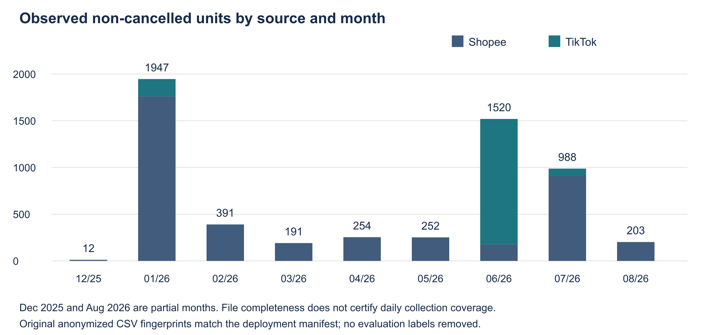
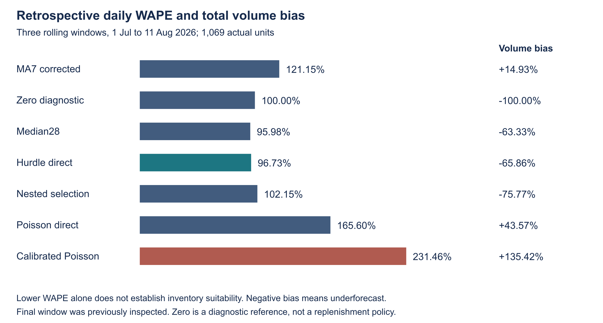

# Kiểm tra dữ liệu và cải thiện dự báo ngày 08 tháng 11 năm 2026

Đối soát lại hai CSV gốc, đánh giá nguyên nhân WAPE cao và lưu cả các phương án không đạt. Kết quả dưới đây là hồi cứu; mô hình phục vụ chưa thay đổi.

## 3.12 Phân tích nguyên nhân sai số và thử nghiệm nhu cầu thưa

Bản cập nhật ngày 08/11/2026 mở rộng đánh giá trên cùng nhãn và cùng ba cửa sổ lịch sử. Mô hình Hurdle giảm WAPE hồi cứu nhưng dự báo thiếu tổng lượng lớn; chưa đủ căn cứ thay mô hình phục vụ nhập hàng. Em công bố cả kết quả chọn mô hình lồng nhau và thử nghiệm hiệu chỉnh bị loại, giữ nguyên artifact triển khai. [R7]

### 3.12.1 Kiểm tra lại CSV gốc và ý nghĩa của nhãn

Hai CSV sinh viên vừa tải lại có dấu vân tay trùng nguồn trong manifest. Shopee có 867 dòng hủy; TikTok có 399 dòng hủy. Tái dựng daily history từ các trường cho phép đọc cho kết quả khớp toàn bộ snapshot. Điều này khép lại hạn chế chưa có CSV gốc ở lần kiểm tra 07/11, nhưng chưa xác nhận độ đầy đủ thu thập theo ngày hoặc hồ sơ cấp phép.

Bảng 3-13 Kết quả kiểm tra chất lượng dữ liệu từ hai CSV gốc

| Kiểm tra | Bằng chứng ngày 08/11 | Diễn giải |
|---|---|---|
| Tệp gốc | Shopee 5.000; TikTok 2.000 dòng; đọc hợp lệ đủ 7.000 dòng | Cả hai SHA-256 khớp manifest; không đồng nghĩa đủ thu thập mọi ngày |
| Tổng hợp và nhãn | 0 ô SKU/ngày lệch; 0 khóa trùng; 0 nhãn t+1 sai | Đối soát theo quy tắc hiện hành; target hữu hạn và không âm |
| Nhu cầu thưa | 95,49% ô bằng 0; 140/216 SKU có ≤3 ngày dương | 25.866 ô trước lần bán dương đầu tiên; chưa có ngày mở bán thật |
| Định danh nguồn | 2 SKU xuất hiện ở cả hai nguồn, liên quan 153 đơn vị không hủy | Thiếu bảng ánh xạ danh mục để xác nhận cùng sản phẩm |
| Thời gian và dòng giống | 0 timestamp có offset; 98/19 dòng giống ở các trường cho phép đọc | Giữ giả định UTC và giữ dòng; khử định danh có thể làm giá trị trùng nhau |

Target hiện là tổng quantity của dòng thuộc đơn không hủy theo ngày, còn chứa trạng thái đang xử lý, vận chuyển và chờ trả hàng. Vì vậy, nhãn chưa phải lượng giao thành công ròng sau hoàn trả và chưa phản ánh nhu cầu bị mất do hết hàng. Không xóa ngoại lệ lớn, dòng có giá trị giống hoặc chuyển ngày để làm giảm WAPE. Các trường giá và doanh thu bằng 0 do chính sách đọc giới hạn; category thiếu toàn bộ nên không được xem là tín hiệu kinh doanh đã xác nhận.

### 3.12.2 Các yếu tố giải thích WAPE còn cao

MA7 có tổng sai số tuyệt đối 1.295,12 trên 1.069 đơn vị thực tế. Sai số ở ngày nhãn bằng 0 là 628,62; ở ngày có nhu cầu là 666,50. Mười SKU đóng góp 47,26% sai số. Đây là bằng chứng sai số vừa đến từ dự báo dương sai ngày, vừa đến từ bỏ lỡ ngày bán; không chỉ từ một lỗi chia mẫu số.

Tháng 6, TikTok đóng góp 1.341/1.520 đơn vị; tháng 7 còn 71/988. TikTok chỉ có 46 ngày xuất hiện đơn không hủy trong tệp. Cơ cấu nguồn biến động mạnh là một giả thuyết giải thích suy giảm khả năng chuyển tiếp của mô hình; chưa thể quy toàn bộ thành biến động thị trường khi coverage chưa rõ. Tháng 12 và tháng 8 chỉ quan sát một phần tháng.

WAPE là sai số tuyệt đối gộp chia tổng actual. Khi tổng actual dương, dự báo toàn 0 có WAPE 100%; tối ưu sai số tuyệt đối hướng tới trung vị. Với dữ liệu nhiều số 0, dự báo thiên về 0 có thể giảm WAPE nhưng vẫn thiếu lượng cho nhập hàng. Do đó phải đọc thêm bias tổng lượng và RMSE tổng nhu cầu 14 ngày theo SKU; không dùng một ngưỡng WAPE để tự kết luận đạt nghiệp vụ. [R8]

### 3.12.3 Mô hình mới và thiết kế đánh giá

Em bổ sung Croston SBA, hai cấu hình TSB và mô hình cây HistGradientBoosting của scikit-learn 1.9.1 với loss L1, Poisson và Hurdle. Hurdle gồm xác suất phát sinh nhu cầu và kích thước dương theo L1; chỉ phát kích thước khi xác suất ≥0,5. Đây là dự báo điểm thiên về trung vị, không phải kỳ vọng lượng hàng. LightGBM gặp lỗi native khi fit trên môi trường hiện tại, nên không có kết quả LightGBM mới và không gán tên thuật toán này cho HistGB. [R9, R10]

Nhánh học máy dùng 24 đặc trưng từ lịch sử đã quan sát: lag, trung bình, trung vị, tỷ lệ ngày có bán, kích thước dương, số ngày từ lần bán gần nhất, tuổi quan sát từ lần bán dương đầu tiên và lịch ngày cần dự báo. Dự báo trực tiếp các chân trời 1–14 ngày từ cùng một origin; không coi dự báo phân số là một sự kiện bán mới. Tuổi quan sát không được gọi là tuổi mở bán. Không dùng phân nhóm ABC/XYZ tính trên toàn tương lai hoặc trường tài chính chưa có dữ liệu.

Ba cửa sổ ngoài là 01–14/07, 15–28/07 và 29/07–11/08/2026. Mỗi origin chỉ học đến ngày trước cửa sổ; hai cửa sổ 14 ngày trước đó dùng để chọn mô hình, mọi nhãn học đều không vượt origin. Chỉ chấm SKU đã có nhu cầu dương trong lịch sử origin; lần lượt 183, 208 và 215 SKU, tổng 8.484 cặp SKU/ngày. Có 122/1.191 đơn vị ở SKU chưa biết tại origin nằm ngoài điểm so sánh; cold-start chưa được nghiệm thu. Bộ tham số cố định: 100 vòng, learning rate 0,05, tối đa 15 lá, sâu 5, min_samples_leaf 40, L2=5, seed 42, cửa sổ origin huấn luyện 120 ngày.

Cửa sổ cuối đã được xem ở lần làm việc trước. Toàn bộ so sánh này là đánh giá cuốn chiếu hồi cứu có lựa chọn lồng nhau; không gọi là một tập kiểm tra độc lập mới. Kết quả một mô hình cố định nhìn lại khác với chất lượng của quy trình chọn mô hình từ dữ liệu quá khứ.

### 3.12.4 Kết quả và phương án bị loại

Bảng 3-14 So sánh dự báo trên cùng ba cửa sổ hồi cứu

| Phương án | WAPE gộp % | Bias lượng % | Lượng dự báo |
|---|---|---|---|
| MA7 đã sửa | 121,15 | 14,93 | 1228,56 |
| Mean28 | 231,75 | 103,79 | 2178,50 |
| Median28 | 95,98 | -63,33 | 392,00 |
| Croston SBA | 237,60 | 94,57 | 2079,91 |
| TSB chậm | 160,30 | 30,49 | 1394,95 |
| TSB nhanh | 146,59 | 36,68 | 1461,14 |
| HistGB L1 | 100,00 | -100,00 | 0,00 |
| HistGB Poisson | 165,60 | 43,57 | 1534,74 |
| Hurdle trực tiếp | 96,73 | -65,86 | 365,00 |
| Mốc toàn 0 | 100,00 | -100,00 | 0,00 |
| Chọn mô hình lồng nhau | 102,15 | -75,77 | 259,00 |

WAPE gộp = 100 × tổng sai số tuyệt đối / tổng actual; bias = 100 × (tổng dự báo − tổng actual) / tổng actual. Tổng actual của mọi dòng bảng là 1.069. Bias âm là dự báo thiếu. Không lấy trung bình WAPE fold thay cho tỷ lệ gộp.

Bảng 3-15 Kết quả từng cửa sổ và mô hình được chọn trước origin

| Cửa sổ nhãn 2026 | SKU đã biết | MA7 WAPE % | Hurdle WAPE % | Lựa chọn từ hai cửa sổ trước |
|---|---|---|---|---|
| 01/07 đến 14/07 | 183 | 118,99 | 100,00 | HistGB L1 |
| 15/07 đến 28/07 | 208 | 109,78 | 92,62 | HistGB L1 |
| 29/07 đến 11/08 | 215 | 142,19 | 96,73 | Median28 |

Hurdle đạt WAPE 96,73% so với MA7 121,15%, giảm 24,43 điểm phần trăm, tương đương 20,16% tương đối. Tuy nhiên, mô hình chỉ dự báo 365/1.069 đơn vị, bias −65,86%. Sai số ngày không bán giảm còn 165 nhưng sai số ngày có bán tăng lên 869. Median28 còn có WAPE 95,98%, nên không có bằng chứng Hurdle tốt nhất trên mọi tiêu chí hoặc vượt phương án đơn giản nhất.

Quy trình lựa chọn lồng nhau đạt WAPE 102,15%, bias −75,77%; hai origin chọn HistGB L1 dự báo toàn 0, origin cuối chọn Median28. Điều này cho thấy loại tên zero khỏi danh sách chọn vẫn chưa ngăn mô hình suy biến về 0. Hurdle được lưu làm ứng viên nghiên cứu dự báo điểm hằng ngày; không phê duyệt làm kỳ vọng nhu cầu cho tồn kho.

Thử nghiệm tiếp theo hiệu chỉnh Poisson bằng tỷ lệ tổng actual/tổng dự báo của hai cửa sổ ngoài mẫu trước origin, chặn hệ số trong [0,1; 2,0]. Phương án đạt WAPE gộp 231,46%, bias +135,42%, RMSE tổng 14 ngày trung bình ba cửa sổ 9,28 so với MA7 3,99. Dù cửa sổ cuối đạt 141,58% so với MA7 142,19%, kết quả gộp xấu hơn nên bị loại; không chọn riêng cửa sổ thuận lợi để công bố cải thiện.

### 3.12.5 Kiểm thử và quyết định sử dụng

Lượt hồi quy liên quan có 124 kiểm thử đạt, 0 lỗi, 1 kiểm thử PostgreSQL opt-in bỏ qua. Đã kiểm tra huấn luyện thật ba objective, lưu/nạp artifact, hợp đồng 14 ngày, dữ liệu không âm/hữu hạn, ngày liên tục, tính tương thích baseline và đường suy luận trực tiếp chỉ gọi một lần. Giá trị nhỏ dưới 0,1 đơn vị/ngày được giữ đến 4 chữ số thập phân ở nhánh trực tiếp; dự báo lỗi được đánh dấu nguồn dự phòng. Đây không phải nghiệm thu lại dịch vụ đang chạy hoặc PostgreSQL thật.

Hash của daily_history, features_daily, feature_spec và model_manifest được kiểm tra không đổi. Chưa đăng ký Registry, chưa nạp lại serving. Bước tiếp theo có ý nghĩa là xác nhận coverage và múi giờ, ánh xạ SKU hai nguồn, thống nhất nhãn hoàn trả, rồi đánh giá trước trên dữ liệu mới cùng chi phí thiếu/dư hàng. Hiện kết quả cải thiện WAPE hồi cứu chưa khép lại điều kiện chất lượng dự báo phục vụ nhập hàng của đồ án. [R7]

## Phụ lục F Đối soát CSV và quyết định ứng viên dự báo

Dấu vân tay SHA-256 bắt đầu bằng 6ae345e24648 cho Shopee và 881e893f6b31 cho TikTok. Hai giá trị đầy đủ được lưu trong data-quality.json và khớp manifest. Chỉ đối soát trường cho phép đọc; không đưa dữ liệu định danh khách hàng vào bằng chứng.

Trong evidence/forecast-improvement-2026-11-08: data-quality.json ghi đối soát; experiment-protocol.json ghi thiết kế cố định; model-evaluation.json và model-comparison.csv lưu đủ phương án; errors-by-sku.csv phân rã sai số; calibration-protocol.json và calibration-evaluation.json giữ kết quả thử nghiệm bị loại; candidate-decisions.json ghi quyết định và hash. JUnit: pytest_forecast_improvement_2026-11-08.xml. Các biểu đồ được dựng từ những tệp này.

Ứng viên Hurdle và ứng viên hiệu chỉnh được lưu riêng dưới output/models/forecast-improvement-2026-11-08, có model card ghi phạm vi và quyết định; ứng viên hiệu chỉnh bị loại. Môi trường thử dùng scikit-learn 1.9.1, trong khi image serving ghim 1.5.1; chưa kiểm chứng nạp artifact khác phiên bản trong container. Cần huấn luyện lại đúng môi trường hoặc dựng lại image và kiểm thử trước triển khai. Không ghi đè mô hình phục vụ. Bootstrap ghép cặp theo SKU 1.000 lần cho chênh lệch WAPE MA7−Hurdle có khoảng 95% [10,89; 52,18] điểm phần trăm; đây chỉ là độ bất định thăm dò theo SKU của hai phương án cố định trên các cửa sổ đã xem, không bao phủ phụ thuộc thời gian hay thiếu thu thập và không xác nhận cải thiện ngoài mẫu mới.

Quyền dùng CSV vẫn theo khai báo của sinh viên: quản trị viên Xóm Data trên Facebook đã cho phép, liên kết gốc đã gỡ. Dấu vân tay khớp chỉ xác nhận đúng tệp, không thay giấy phép hoặc bằng chứng đồng ý của quản trị viên. Đợt 08/11 có Codex hỗ trợ phân tích dữ liệu, viết mã thử nghiệm, kiểm thử và cập nhật báo cáo. Sinh viên cần tự đọc, đối chiếu và giải thích các nội dung bổ sung. Khai báo phần sinh viên trực tiếp làm ở Phụ lục E được giữ theo thông tin đã cung cấp; ảnh gốc và xác nhận vẫn cần hoàn thiện.

## Tài liệu tham khảo

[R7] Hồ sơ kiểm tra dữ liệu và dự báo ngày 08/11/2026. evidence/forecast-improvement-2026-11-08, JUnit pytest_forecast_improvement_2026-11-08.xml; scripts/audit_forecast_data.py, improve_sparse_forecast.py, evaluate_volume_calibration.py và serving/app/sparse_demand.py.

[R8] Hyndman, R. J. (2025). WAPE Weighted Absolute Percentage Error. https://robjhyndman.com/hyndsight/wape.html. Truy cập 08/11/2026.

[R9] Hyndman, R. J. và Athanasopoulos, G. Forecasting Principles and Practice, ấn bản 3, mục 13.2 Time series of counts. https://otexts.com/fpp3/practical.html. Truy cập 08/11/2026. Croston tách kích thước dương và khoảng cách phát sinh; triển khai SBA/TSB cụ thể được ghi trong mã của thí nghiệm.

[R10] scikit-learn. HistGradientBoostingRegressor, tài liệu phiên bản 1.9.1. https://scikit-learn.org/stable/modules/generated/sklearn.ensemble.HistGradientBoostingRegressor.html. Truy cập 08/11/2026.

## Tái lập

Dùng môi trường Python có các phụ thuộc của dự án; đặt OMP_NUM_THREADS=1. Chạy lần lượt `scripts/audit_forecast_data.py` với hai đường dẫn CSV, `scripts/improve_sparse_forecast.py`, `scripts/evaluate_volume_calibration.py`, rồi bộ kiểm thử liên quan. Hai script mô hình chỉ tạo ứng viên offline trong thư mục riêng; không đăng ký Registry.
