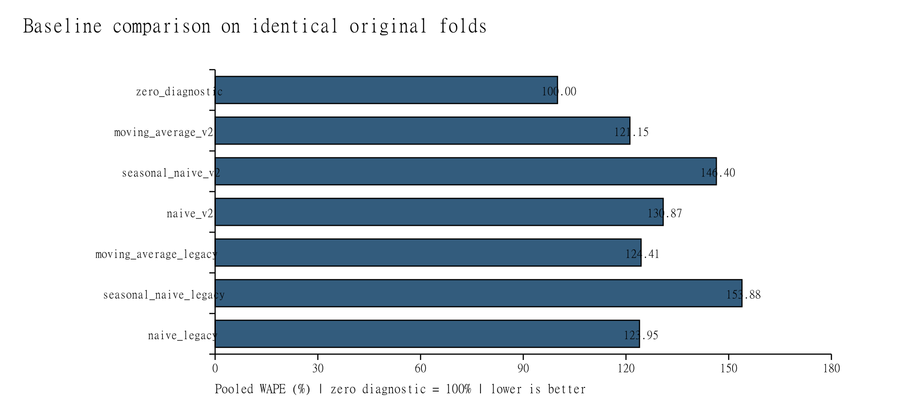
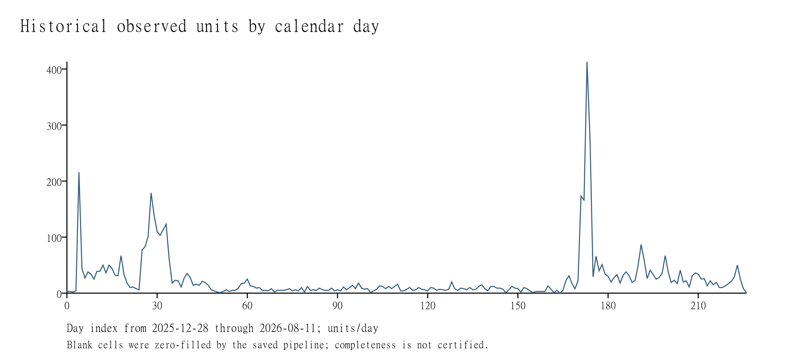

# Khắc phục theo cẩm nang ngày 07 tháng 11 năm 2026

Đã sửa căn chỉnh baseline, quy ước WAPE/bias khi tổng actual bằng 0, cách gộp metric và lọc protocol khi chọn run đăng ký. Đã đánh giá lại trên snapshot lịch sử, bổ sung holdout cuối, thống kê EDA và cập nhật bản báo cáo. Không sửa ngược bằng chứng tháng 10/04–11 và không thay model đang phục vụ.

## Bản sửa chuyên môn

Dòng đặc trưng ngày t dự báo ngày t+1. Baseline mới có `alignment_version=2`:

| Mô hình | Công thức mới | Kiểm tra chuỗi 1..41 tại origin 10/02/2026, target 11/02 |
| --- | --- | ---: |
| Naive | y[t] | 41 |
| Seasonal Naive | y[t−6] = y[(t+1)−7] | 35 |
| Moving Average | mean(y[t−6..t]) | 38 |

`lag_6` được thêm vào hợp đồng đặc trưng mặc định của lần tạo mới. Rolling cũ vẫn là mean(y[t−7..t−1]); Moving Average mới thay phần tử cũ nhất bằng y[t]. Builder online và offline được kiểm tra tương đương. Đường nhanh từ history được kiểm tra khớp `predict()` qua 90 bước đệ quy.

Artifact cũ thiếu `alignment_version` vẫn dùng công thức lịch sử. **Phiên bản công thức baseline không phải version trong MLflow Registry.** Registry model v2 hiện có không tự trở thành baseline mới. Feature snapshot, spec và manifest triển khai được so SHA-256 trước/sau phép đánh giá và không thay đổi.

WAPE và bias trả `None`/JSON `null` khi tổng actual bằng 0, kể cả khi prediction cũng bằng 0. Với actual=[0,0], prediction=[4,4], MAE=4 còn WAPE/bias=null. Đầu vào metric rỗng, lệch chiều, NaN/Infinity hoặc actual âm bị từ chối. MAPE hiện là biến thể mẫu số y+1 và được ghi rõ trong metadata.

Điểm WAPE dùng chọn model là tổng sai số tuyệt đối chia tổng actual của tất cả cặp được chấm. Sai số ở fold toàn actual=0 vẫn góp vào tử số khi gộp với fold khác. `mean_fold_wape` chỉ là chỉ số chẩn đoán và đếm rõ số fold xác định/không xác định. Không lấy giá trị 0 giả cho nhóm ABC/XYZ không có actual. Run đăng ký phải có protocol `origin_t_plus_1_pooled_wape_v2`, metric hữu hạn và nguồn phù hợp; các run theo cách tính cũ không được trộn vào lượt chọn mới.

## Kết quả thực đo

Nguồn: hai artifact Parquet đã lưu, 216 SKU, 49.032 ô ngày, 42.768 dòng đặc trưng. Chỉ thêm lag_6 trong bộ nhớ; không ghi đè dữ liệu triển khai, không train/register/reload và không chứng nhận lại runtime.

| Baseline | WAPE gộp trước sửa (%) | WAPE gộp sau sửa (%) |
| --- | ---: | ---: |
| Naive | 123,95 | 130,87 |
| Seasonal Naive | 153,88 | 146,40 |
| Moving Average | 124,41 | 121,15 |
| Dự báo 0, chỉ chẩn đoán | 100,00 | 100,00 |

Cả trước và sau dùng đúng ba test window 01–14/07, 15–28/07 và 29/07–11/08/2026; chấm cùng 8.484/9.072 cặp SKU/ngày, 93,52%. Các SKU không có lịch sử phù hợp bị loại theo hợp đồng serving, nên đây là metric có điều kiện. Bảng trước–sau là phép chẩn đoán, không phải đánh giá độc lập sau chọn model.

Đánh giá cuối giữ riêng **29/07–11/08**. Ba fold phát triển nằm trong **17/06–28/07**. Chọn Moving Average bằng WAPE gộp phát triển **111,49%**; holdout của model đã chọn là **142,19%**. Không dùng holdout để chọn lại. Biến ABC/XYZ không tham gia công thức của ba baseline; không dùng profile tương lai để tạo dự báo baseline.

Sửa công thức không bảo đảm metric giảm ở mọi model. Naive tăng sai số sau căn chỉnh; Moving Average và Seasonal Naive giảm trên các fold gốc. Holdout vẫn kém mốc dự báo 0 theo WAPE. Chưa đủ căn cứ dùng kết quả này cho nhập hàng hoặc tuyên bố tối ưu tồn kho.



## EDA được bổ sung

Snapshot lịch sử có mean demand 0,1174; median 0; std 1,6212; min 0; max 232; tỷ lệ ô bằng 0 **95,49%** và không trùng khóa SKU/ngày. Đây là dữ liệu đã tổng hợp, không phải 49.032 giao dịch gốc. Cột category nguồn lịch sử thiếu toàn bộ; dữ liệu tài chính của importer không được dùng như số liệu kinh doanh thực.

Các ô trống đã được pipeline trước điền 0. Phép EDA và đánh giá offline không thể tự xác nhận đó là ngày không bán đã thu thập đủ. Cần đối chiếu coverage, múi giờ và dữ liệu gốc; không chạy xác nhận coverage hàng loạt chỉ để có metric đẹp.



## Thông tin do sinh viên xác nhận

Ngày 07/11, sinh viên xác nhận lớp **DCCTKH67A**, hệ **Đại học**. Hai CSV được nhận từ Xóm Data trên Facebook; liên kết gốc đã gỡ; theo sinh viên, quản trị viên đã cho phép sử dụng. Chưa có bản sao trao đổi cấp phép hoặc điều kiện tái phân phối trong bộ hồ sơ. Nội dung này được ghi là khai báo nguồn, không thay bằng một giấy phép do AI suy đoán.

Công cụ AI được khai báo: Codex, Antigrafity và Claude. Sinh viên trực tiếp hình thành ý tưởng, lựa chọn công cụ/quy trình, chọn star schema, xây dựng Power BI và data dictionary; kiểm tra mã AI sinh, yêu cầu kê khai nội dung và Q&A để điều chỉnh. Chưa phân định được công cụ cho từng đoạn mã hoặc tỷ lệ chỉnh sửa. Bảng AI trong báo cáo mô tả mức sửa định tính và tách rõ lượt khắc phục do Codex thực hiện.

## Kiểm thử và tái lập

Lượt hồi quy liên quan được lưu tại [JUnit](evidence/pytest_baseline_remediation_2026-11-07.xml). Các nhóm kiểm tra gồm baseline/metric, features, data readiness, order-line integrity, Deep Learning contract, monitoring, pipeline integrity, runtime fixes và model recovery. Test PostgreSQL tích hợp chỉ chạy khi bật cờ riêng; không tính phần bỏ qua là đạt.

```powershell
python -m pytest tests/test_baseline_metric_remediation.py tests/test_ml_pipeline.py tests/test_features.py tests/test_order_line_integrity.py tests/test_data_readiness.py tests/test_deep_learning.py tests/test_monitoring.py tests/test_pipeline_integrity.py tests/test_runtime_integrity_fixes.py tests/test_model_recovery.py -q
python scripts/evaluate_baseline_remediation.py
```

Trên môi trường có giới hạn ghi thư mục tạm, đặt TEMP/TMP vào một thư mục có quyền ghi trong dự án. Không cần chạy Docker hoặc MLflow cho phép đánh giá offline. Bản đồ nguồn, fingerprint, môi trường Python/Pandas/NumPy, phạm vi từng fold và phân vị sai số nằm trong [JSON đánh giá](evidence/remediation-2026-11-07/baseline-evaluation.json). Biểu đồ dùng ReportLab; nếu cần PNG cho Word, có thể chuyển SVG bằng công cụ chuyển ảnh sẵn có.

## Các điều kiện chưa đóng

- Bản sao cấp phép dữ liệu và phạm vi sử dụng/tái phân phối; xác nhận đầy đủ theo ngày từ nguồn.
- Ảnh thật của quá trình sử dụng AI; sinh viên duyệt và giải thích được mã sau sửa.
- Đối chứng ít nhất hai cấu hình hạ tầng trong cùng môi trường; ngưỡng thông lượng và phân vị độ trễ sự kiện đầu cuối.
- Apply/Refresh/render và đối soát KPI trong Power BI Desktop.
- Mẫu báo cáo/slide, các xác nhận GVHD/GVPB và diễn tập hỏi đáp trực tiếp.

Các mục này không được đánh dấu hoàn thành chỉ bằng việc thêm mô tả vào báo cáo.
