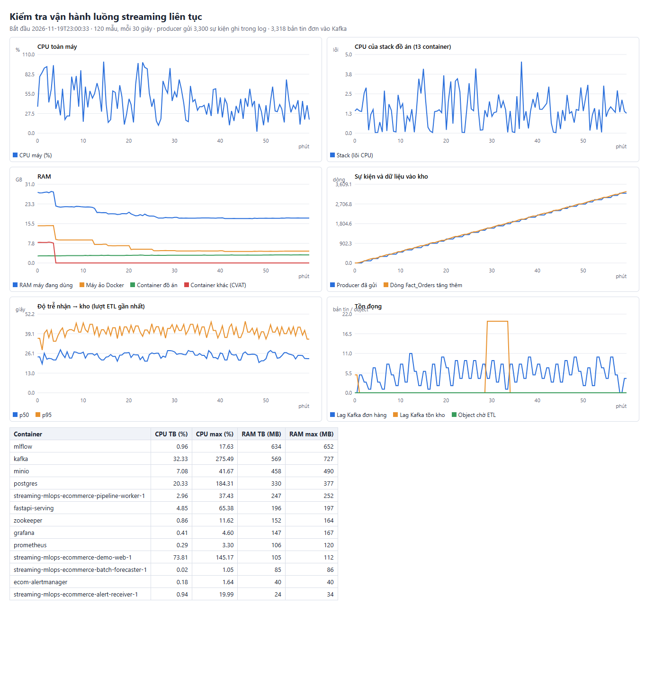

# Kiểm tra vận hành luồng streaming liên tục 1 giờ — 19–20/11/2026

## 1. Mục tiêu và phạm vi

Bài kiểm tra trả lời ba câu hỏi:
1. Luồng có chạy liên tục một giờ mà không mất, không trùng dữ liệu không?
2. Từng service vận hành ra sao trong lúc chạy?
3. Toàn luồng tiêu thụ bao nhiêu CPU và RAM của máy?

Producer chạy từ **23:00:33 ngày 19/11 đến 00:00:40 ngày 20/11/2026** (giờ Việt Nam). `pipeline-worker` xử lý như vận hành thật; không chạy consumer hay ETL thủ công. Đây là bài **chạy bền ở tải thường của simulator**, không phải bài thử tải cao điểm.

## 2. Môi trường

| Thành phần | Cấu hình |
|---|---|
| Máy | Intel Core Ultra 7 258V, 8 lõi / 8 luồng; RAM 31,5 GB; SSD 477 GB; Windows 11 Home build 26200 |
| Docker | Docker Engine 29.7.2 trên Docker Desktop (WSL2); máy ảo được cấp 8 CPU, 16,5 GB RAM |
| Stack đồ án | 13 container: zookeeper, kafka, minio, postgres, mlflow, fastapi, pipeline-worker (gồm 2 consumer và ETL), batch-forecaster, prometheus, grafana, alertmanager, alert-receiver, demo-web |
| Producer | `ingestion/producer.py` chạy trên máy (ngoài Docker) |

Điều chỉnh môi trường trong lúc test:
- **NiFi** (ngoài phạm vi) bị Docker Desktop tự bật lại, nên được dừng trước khi test.
- Ở **phút thứ 4 (23:04:20)**, 16 container **CVAT** của dự án khác được dừng theo đồng ý của sinh viên. Từ thời điểm này, số đo toàn máy phản ánh sát hơn mức tiêu thụ của luồng.
- Hai lần chụp màn hình bằng Chrome headless (23:19:45–23:24:20) làm CPU toàn máy tăng tạm thời.

Mốc thời gian ghi tại `output/streaming-soak-2026-11-19/su-kien.txt`.

## 3. Cách đo

- `scripts/check_streaming_soak.py --minutes 60 --interval 30` bật producer và mỗi 30 giây ghi một mẫu (120 mẫu):
  - CPU và RAM toàn máy (CIM), bộ nhớ máy ảo Docker (tiến trình `vmmem`), RAM của producer;
  - CPU và RAM từng container (`docker stats`), tách riêng container đồ án và container khác;
  - lag Kafka theo consumer group, số object chờ ETL, độ trễ từ lúc nhận đến lúc vào kho (p50, p95 của lượt ETL gần nhất);
  - số dòng trong `Fact_Orders`, `Fact_Inventory_Daily`, `mart.fact_sales_line`.
- Hết giờ, script dừng producer, chờ hai consumer group chính về lag 0 và không còn object chờ, rồi ghi tổng kết.
- `scripts/check_etl_warehouse_readonly.py --runtime` đối soát kho thô và kho dữ liệu cho hai ngày nguồn 19/11 và 20/11 (chỉ đọc).
- `scripts/capture_service_screenshots.py` chụp giao diện từng service ở phút 20 và sau khi kết thúc.
- `scripts/render_soak_report.py` vẽ biểu đồ.

## 4. Kết quả vận hành

| Chỉ tiêu | Kết quả |
|---|---|
| Thời gian chạy producer | 60 phút 7 giây; producer không dừng giữa chừng |
| Bản tin đơn hàng vào Kafka (`ecom.orders.raw`) | **3.318** (khoảng 0,9 sự kiện/giây) |
| Bản tin tồn kho vào Kafka (`inventory.logs`) | 1.180 (20 SKU mỗi 60 giây) |
| Dòng thô trong MinIO (ngày nguồn 19/11 + 20/11) | 3.281 + 37 = **3.318**, trong 659 + 8 object |
| Dòng `Fact_Orders` tăng thêm | **3.318**; `mart.fact_sales_line` cũng tăng 3.318 |
| Dòng `Fact_Inventory_Daily` tăng thêm | 40 (20 SKU × 2 ngày; các snapshot sau upsert vào cùng khóa SKU-ngày) |
| Đối soát kho thô với kho dữ liệu | Cân bằng; **0 dòng thiếu**, 0 lệch giá trị, 0 trùng, 0 bị loại |
| Độ trễ nhận → kho, p50 | trung bình 24,7 giây (19,2–28,5) |
| Độ trễ nhận → kho, p95 | trung bình 40,9 giây (28,3–47,4) |
| Lag Kafka đơn hàng | trung bình 5,4; tối đa 11 bản tin |
| Object chờ ETL | 0 ở cả 120 mẫu |
| Sau khi dừng producer | Lag hai group chính về 0, không còn object chờ; worker `healthy` |

**Kết luận:** trong một giờ chạy liên tục, mọi bản tin đơn hàng gửi vào Kafka đều xuất hiện đúng một lần trong kho thô, trong `Fact_Orders` và trong data mart. Pipeline không tồn đọng, và dữ liệu vào kho với độ trễ p95 dưới 50 giây (mục tiêu YC5 là dưới 1 phút).

## 5. Tài nguyên tiêu thụ

| Đối tượng | Trung bình | Tối đa |
|---|---|---|
| CPU toàn máy (8 luồng) | 45,4% | 100% (lúc chụp màn hình) |
| RAM toàn máy đang dùng (trên 31,5 GB) | 19,4 GB | 28,2 GB (trước khi dừng CVAT) |
| RAM máy ảo Docker (`vmmem`) | 6,3 GB | 14,8 GB (trước khi dừng CVAT) |
| **CPU của 13 container đồ án** | **1,45 lõi** (khoảng 18% máy) | 4,55 lõi |
| CPU của stack, không tính demo-web | 0,71 lõi | 3,72 lõi |
| **RAM của 13 container đồ án** | **3,02 GB** | 3,22 GB |
| RAM của producer | 10,7 MB | 10,9 MB |

Theo từng container:

| Container | CPU TB (%) | CPU max (%) | RAM TB (MB) | RAM max (MB) |
|---|---:|---:|---:|---:|
| mlflow | 0,96 | 17,6 | 634 | 653 |
| kafka | 32,3 | 275,5 | 569 | 727 |
| minio | 7,1 | 41,7 | 458 | 490 |
| postgres | 20,3 | 184,3 | 330 | 377 |
| pipeline-worker | 3,0 | 37,4 | 247 | 252 |
| fastapi-serving | 4,9 | 65,4 | 196 | 197 |
| zookeeper | 0,9 | 11,6 | 152 | 164 |
| grafana | 0,4 | 4,6 | 147 | 167 |
| prometheus | 0,3 | 3,3 | 106 | 120 |
| demo-web | **73,8** | 145,2 | 105 | 112 |
| batch-forecaster | 0,02 | 1,1 | 85 | 86 |
| alertmanager | 0,2 | 1,6 | 40 | 40 |
| alert-receiver | 0,9 | 20,0 | 24 | 35 |

Cột CPU theo cách tính của `docker stats`: 100% bằng một lõi.

**Nhận xét:**
- RAM của stack ổn định quanh 3 GB suốt một giờ, không có dấu hiệu rò rỉ bộ nhớ.
- Kafka và PostgreSQL có đỉnh CPU ngắn theo chu kỳ ETL 30 giây và lần làm mới mart.
- demo-web dùng nhiều CPU nhất, dù không có ai mở trang. Cứ 4 giây, nó liệt kê toàn bộ object trong MinIO (khoảng 3.900 object) và đọc toàn bộ `checkpoint.json`, nên chi phí tăng theo số object. Đây là thêm một biểu hiện của giới hạn tăng dung lượng MinIO đã giữ lại có chủ đích cho demo (lần 12). Khi không cần demo, có thể tắt demo-web hoặc giới hạn nó chỉ đọc phân vùng của ngày hiện tại.
- Một giờ ở 0,9 sự kiện/giây tạo ra 659 object Parquet nhỏ cho riêng ngày 19/11. Con số này minh họa vì sao vận hành thật cần gộp tệp nhỏ và checkpoint theo mốc (Bảng KL-5).
- CPU toàn máy còn gồm Windows, Docker Desktop, chính script đo (truy vấn CIM khoảng 10 giây mỗi mẫu) và Chrome khi chụp màn hình. Vì vậy mức tiêu thụ của luồng nên đọc theo số đo container, không theo CPU toàn máy.

## 6. Ảnh chụp từng service

Ảnh nằm trong `output/streaming-soak-2026-11-19/screenshots/`. Mỗi service có hai bộ ảnh: hậu tố `-phut-20` chụp trong lúc chạy, hậu tố `-cuoi-test` chụp sau khi kết thúc. Service không có giao diện web được chụp từ trang hiển thị kết quả lệnh kiểm tra thật tại thời điểm chụp; mã HTML lưu trong `screenshots/_pages/`.

| Ảnh | Service | Nội dung |
|---|---|---|
| `01-flowlab-demo` | demo-web | Bảng điều khiển FlowLab: trạng thái các tầng |
| `02-grafana-dashboard` | Grafana | Dashboard 6 nhóm panel, có nhóm Data Pipeline End to End |
| `03-prometheus-targets`, `03b-prometheus-alerts` | Prometheus | Các target đang thu thập và rule cảnh báo |
| `04-producer` | Producer | Log gửi sự kiện |
| `05-kafka` | Kafka | Topic, partition và lag của từng consumer group |
| `06-zookeeper` | ZooKeeper | Broker đang đăng ký |
| `07-minio-raw-orders` | MinIO | Bucket `ecom-raw-lake`, phân vùng `raw/orders` theo sàn |
| `08-postgresql` | PostgreSQL | Số dòng các bảng, đơn nạp gần nhất, số dòng nạp theo phút |
| `09-pipeline-worker` | pipeline-worker | Heartbeat và log điều phối ETL, coverage, mart |
| `10-consumers` | 2 consumer | Log consumer và snapshot tồn kho mới nhất |
| `11-fastapi-*` | FastAPI | `/pipeline/status`, `/ready`, tài liệu API |
| `12-batch-forecaster` | batch-forecaster | Lượt dự báo theo lô và log |
| `13-docker-stats` | Docker | Trạng thái và tài nguyên từng container |
| `14-mlflow-models` | MLflow | Model Registry |
| `15-alertmanager` | Alertmanager | Cảnh báo đang hoạt động |

### 6.1. Ảnh chụp màn hình desktop thật (20/11/2026)

Các ảnh ở mục 6 được chụp bằng Chrome chạy ẩn (headless) và trang hiển thị kết quả lệnh. Để có ảnh đúng như người dùng nhìn thấy, ngày 20/11/2026 luồng được chạy lại:
- producer chạy từ 22:23 đến khoảng 23:07;
- ảnh được chụp nguyên màn hình Windows (1920×1200) khi luồng đang chạy, có thanh tác vụ và đồng hồ hệ thống.

Thư mục: `output/streaming-soak-2026-11-19/desktop/`.

| Ảnh | Nội dung |
|---|---|
| `02-docker-desktop.png` | Docker Desktop, trang Containers: nhóm `streaming-mlops-ecommerce` dùng 46,7%/800% CPU và 2,35 GB RAM; RAM, CPU của máy ảo Docker ở thanh dưới |
| `02-docker-desktop-containers.png`, `03-docker-desktop-containers-2.png` | CPU và RAM của từng container trong 13 container |
| `10-flowlab.png` | Trình duyệt mở FlowLab |
| `11-grafana.png`, `12-grafana-pipeline.png` | Grafana: phục vụ mô hình, cảnh báo tồn kho, nhóm Data Pipeline End to End |
| `13-prometheus-targets.png` | Prometheus: hai target UP |
| `14-minio.png` | MinIO Console: bucket `ecom-raw-lake` (7.720 object, 124,1 MiB) |
| `15-mlflow.png` | MLflow Model Registry |
| `16-fastapi-pipeline-status.png` | FastAPI `/pipeline/status` |
| `17-alertmanager.png` | Alertmanager |
| `20-producer.png` | Cửa sổ producer gửi sự kiện (0,9 sự kiện/giây) và snapshot tồn kho mỗi phút |
| `21-kafka-lag.png` | Lệnh `kafka-consumer-groups`: lag của hai consumer group |
| `22-postgresql.png` | `psql`: `Fact_Orders` và `mart.fact_sales_line` cùng 163.477 dòng; các đơn nạp gần nhất |
| `23-pipeline-worker-log.png` | Log `pipeline-worker` |
| `24-docker-stats.png` | Lệnh `docker compose ps` và `docker stats` |

Không có ảnh Task Manager:
- Task Manager chạy với quyền quản trị nên công cụ tự động không chuyển được sang trang Performance.
- Trang Processes liệt kê ứng dụng cá nhân nên không đưa vào báo cáo.
- Số đo CPU, RAM toàn máy lấy từ mục 5 và thanh trạng thái của Docker Desktop.

## 7. Hiện tượng cần giải thích

- **Lag tồn kho 20 bản tin (phút 29–34).** Log cho thấy consumer tồn kho vẫn ghi 20 snapshot mỗi phút trong khoảng này. Producer gửi snapshot mỗi 60 giây, script đo lag cũng mỗi 60 giây. Trong năm phút đó, thời điểm đo trùng vài giây giữa lúc gửi và lúc consumer xử lý, nên đo được đúng một lô đang trên đường. Đây không phải tắc nghẽn.
- **Ngày 18/11 không được tự xác nhận.** Ngày này producer không chạy; worker ghi "Giữ lại 1 ngày có khối lượng thấp bất thường". Đây là đúng quy tắc coverage có điều kiện khối lượng.
- **Lag của group `nifi-ecom-orders-consumer` tăng tới 3.318.** NiFi đã dừng nên group này không đọc. Group không thuộc luồng chính và không ảnh hưởng kết quả. Script đo đã được sửa để chỉ xét hai group chính khi chờ xử lý hết tồn đọng.
- **RAM máy ảo Docker giảm dần sau khi dừng CVAT**, vì WSL2 trả RAM cho Windows từ từ chứ không ngay lập tức.

## 8. Giới hạn của bài kiểm tra

- Tốc độ producer khoảng 0,9 sự kiện/giây, do simulator mô phỏng nhu cầu ban đêm thấp. Chưa đo ở tải cao điểm 12 sự kiện/giây (YC7 vẫn chưa đạt).
- Chỉ một máy, một broker Kafka, một worker. Không thử mất dịch vụ trong bài này; phần thử lỗi đã làm ngày 16/11.
- Số đo CPU toàn máy có nhiễu từ script đo và từ lúc chụp màn hình (đã ghi mốc).

## 9. Hiện vật

- Thư mục `output/streaming-soak-2026-11-19/`:
  - `samples.csv`, `containers.csv`, `summary.json`, `metrics.json`;
  - `producer.log`, `su-kien.txt`;
  - `doi-soat-2026-11-19.json`, `doi-soat-2026-11-20.json`;
  - `report.html`, `screenshots/`.
- Script:
  - `scripts/check_streaming_soak.py`
  - `scripts/capture_service_screenshots.py`
  - `scripts/render_soak_report.py`

## 10. Minh bạch sử dụng AI

- **AI (Claude Code) hỗ trợ:**
  - viết ba script đo, chụp màn hình và vẽ biểu đồ;
  - chạy bài kiểm tra, đối soát;
  - phân tích các hiện tượng và soạn báo cáo này.
- **Sinh viên:**
  - yêu cầu bài kiểm tra 1 giờ với ảnh chụp từng service và số đo CPU, RAM;
  - đồng ý dừng các container ngoài dự án để số đo sát hơn.
