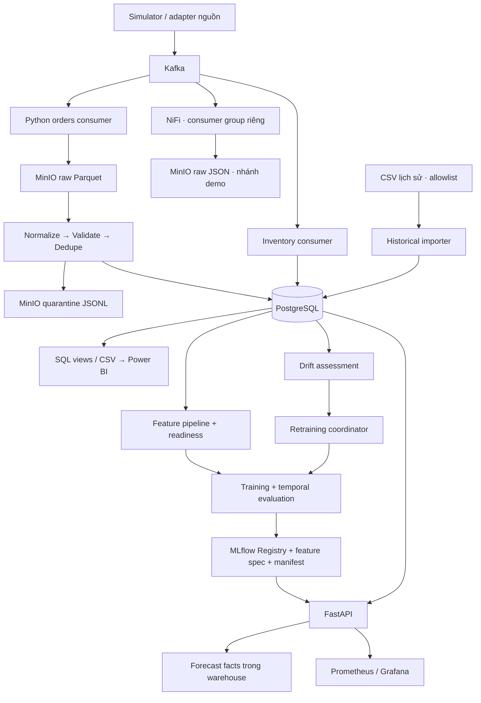

# TÀI LIỆU DỰ ÁN STREAMING MLOPS E-COMMERCE

**Dự báo nhu cầu hàng hóa và hỗ trợ quản trị tồn kho đa kênh**  
Ngày biên soạn: 16/10/2026 · Phiên bản: 1.0 · Ngôn ngữ: Tiếng Việt  
Góc nhìn: Data Engineer (DE), MLOps Engineer, Project Manager (PM), Product Owner (PO).

Tài liệu mô tả dự án trong repository, kết hợp yêu cầu sản phẩm, thiết kế dữ liệu, quyết định công nghệ, triển khai và bàn giao. Căn cứ gồm mã nguồn và hồ sơ kiểm chứng đến 14/10/2026; không thực hiện lại kiểm thử runtime khi biên soạn. Các ngưỡng ghi **đề xuất** là tiêu chí cần thống nhất khi nghiệm thu, chưa phải cam kết hoặc kết quả đã đạt.

| Vai trò | Trách nhiệm trong tài liệu |
|---|---|
| PO | Xác định người dùng, giá trị nghiệp vụ, phạm vi, ưu tiên và tiêu chí chấp nhận |
| PM | Quản lý tiến độ, phụ thuộc, rủi ro, bằng chứng và điều kiện bàn giao |
| DE | Thiết kế data contract, ingestion, warehouse, chất lượng và truy vết dữ liệu |
| MLOps | Chuẩn bị dữ liệu ML, đánh giá, Registry, serving, giám sát và phục hồi model |

## 1. Dataset and business requirement — Dữ liệu và yêu cầu nghiệp vụ

### 1.1. Bối cảnh và vấn đề cần giải quyết

Dự án phục vụ bối cảnh bán hàng đa kênh Shopee và TikTok Shop. Người quản lý cần tổng hợp đơn hàng giữa các sàn, dự báo số lượng bán theo SKU và nhận biết sản phẩm có nguy cơ thiếu hàng. Nhu cầu có thể biến động theo ngày trong tuần, chương trình khuyến mại và chiến dịch ngày đôi; quyết định nhập hàng cần tính đến thời gian chờ nhà cung cấp.

Ba vấn đề sản phẩm đặt ra:

1. Dữ liệu khác schema giữa các sàn làm việc tổng hợp thủ công chậm và dễ đếm sai đơn hoặc doanh thu.
2. Quyết định tồn kho dựa trên dữ liệu cũ dễ dẫn tới thiếu hàng hoặc giữ hàng quá mức.
3. Mô hình dự báo thiếu quản lý phiên bản và giám sát khiến người dùng khó biết kết quả đến từ dữ liệu nào, có còn phù hợp hay không.

Giải pháp là một pipeline thu thập sự kiện liên tục, lưu raw để đối soát, chuẩn hóa vào warehouse, tạo đặc trưng theo ngày, quản lý mô hình và cung cấp dự báo/cảnh báo qua API và BI. Ingestion là streaming; ETL, feature engineering và training là các tác vụ chạy riêng. Không mặc định mọi đơn mới lập tức được đưa vào model đang phục vụ.

### 1.2. Người dùng và quyết định được hỗ trợ

| Người dùng | Nhu cầu | Đầu ra hỗ trợ quyết định |
|---|---|---|
| Chủ shop / quản lý kinh doanh | Theo dõi bán hàng giữa các kênh | Tổng quan đơn, lượng bán, doanh thu theo định nghĩa đã thống nhất |
| Nhân viên kế hoạch / mua hàng | Chuẩn bị lượng nhập cho 7–14 ngày | Dự báo SKU/ngày và thông tin nguồn/model |
| Quản lý kho | Ưu tiên SKU có rủi ro thiếu hàng | Safety Stock, Reorder Point, mức cảnh báo, ngày snapshot |
| Nhóm dữ liệu | Kiểm tra số liệu và xử lý dữ liệu lỗi | Ledger ETL, raw objects, quarantine, coverage và lineage |
| Người vận hành ML | Quản lý chất lượng và triển khai model | Metrics, Registry, trạng thái training, drift và reload |

Khoảng dự báo 7–14 ngày là mục tiêu sử dụng nghiệp vụ. Chất lượng phải được đo riêng theo từng horizon trước khi chấp nhận cho quyết định thực tế.

### 1.3. Danh mục dataset và phạm vi sử dụng

| Dataset | Nguồn / đầu vào | Độ hạt | Mục đích | Giới hạn |
|---|---|---|---|---|
| Orders streaming mô phỏng | `data_simulator/`, `ingestion/producer.py` → `ecom.orders.raw` | Sự kiện cập nhật dòng hàng | Demo ingestion, kiểm thử ETL, đối soát và replay | Không đại diện giao dịch thị trường đã xác minh |
| Inventory streaming | `inventory.logs` → inventory consumer | Snapshot SKU/ngày tại kho trung tâm | Cảnh báo tồn kho và đối chiếu API/DB | Snapshot demo chỉ chứng minh luồng kỹ thuật |
| CSV lịch sử đã khử định danh | Importer Shopee/TikTok | Dòng nguồn, SKU, ngày tạo, quantity, status | Xây dựng chuỗi lịch sử và thử nghiệm forecasting | ID có thể bị tái sử dụng; không đủ cơ sở tính tài chính như dữ liệu vận hành |
| Forecast đã phát hành | Serving → `Fact_Forecast_Predictions` | SKU, ngày mục tiêu, model và provenance | Actual vs Forecast sau khi actual hoàn tất | Forecast tương lai chưa có accuracy hợp lệ |
| Coverage và metadata | `Warehouse_Daily_Coverage`, feature spec, manifest | Ngày/nguồn hoặc lần tạo artifact | Xác nhận ngày đủ dữ liệu, truy vết train/serve | Có ngày trong khoảng thời gian không đồng nghĩa nguồn đã nạp đủ |

Bộ simulator được tài liệu hiện có mô tả theo schema Shopee 84 cột và TikTok 71 cột. Importer CSV chỉ đọc allowlist phục vụ demand; số cột raw không phải số feature của model. Hồ sơ ngày 10/10 ghi nhận hai CSV có 7.000 dòng hợp lệ đã nạp. Đây là số liệu của lần nhập đã ghi nhận, cần profiling lại khi thay file.

Chưa có đủ hồ sơ trong phạm vi biên soạn để xác nhận URL xuất bản, giấy phép, quyền chia sẻ và tính đại diện thị trường của hai CSV. Trước khi phân phối dataset, DE/PO cần bổ sung nguồn gốc, quyền sử dụng, thời gian thu thập và phạm vi cho phép. Tên origin `public_anonymized_historical_csv` là nhãn kỹ thuật, không thay thế xác nhận này.

### 1.4. Phạm vi sản phẩm

**Trong phạm vi:** thu thập hai luồng orders/inventory; lưu MinIO; ETL và quarantine; warehouse; phân nhóm ABC/XYZ; tạo feature; huấn luyện, đánh giá và Registry; API dự báo/cảnh báo; monitoring; dữ liệu và hướng dẫn Power BI; kiểm thử và báo cáo demo.

**Ngoài phạm vi nghiệm thu hiện tại:** kết nối API sàn bằng tài khoản kinh doanh thật; tự động phát hành đơn mua hàng; tối ưu nhiều kho; bảo đảm HA; chứng minh tiết kiệm chi phí tồn kho ngoài thực tế. Trường `store_id` trong request chưa chứng minh hệ thống đã hỗ trợ đầy đủ tính toán tồn kho nhiều kho.

### 1.5. Product backlog và acceptance criteria

| ID | User story | Ưu tiên | Điều kiện chấp nhận |
|---|---|---|---|
| BR-01 | Là DE, tôi cần bảo toàn mọi dòng hàng khi nhận lại sự kiện | Must | Đơn nhiều SKU và hai dòng cùng SKU có ID riêng được giữ; replay cùng payload không đổi số dòng/quantity/tiền |
| BR-02 | Là người kiểm soát dữ liệu, tôi cần biết dòng nào bị loại | Must | Raw = valid sau dedupe + duplicate + rejected; rejected có payload, lý do và source object; lỗi ghi audit làm ETL dừng |
| BR-03 | Là người lập kế hoạch, tôi cần dự báo theo SKU/ngày | Must | Output không âm, ngày đúng yêu cầu, có model version và nguồn lịch sử; chất lượng được đánh giá ngoài mẫu theo thời gian |
| BR-04 | Là quản lý kho, tôi cần biết lúc nào nên nhập hàng | Must | Tính SS/ROP theo tham số rõ ràng; trả `stock_source`, `demand_source`; snapshot đúng SKU và đủ mới khi dùng thực tế |
| BR-05 | Là chủ shop, tôi cần báo cáo không đếm nhầm dòng thành đơn | Must | Số đơn streaming đếm theo `(platform, order_id)`; tổng tiền đối soát với facts; lịch sử CSV không bị trộn thành doanh thu vận hành |
| BR-06 | Là MLOps, tôi cần chỉ triển khai model có dữ liệu truy vết được | Must | Artifact, feature spec, origin và fingerprints khớp; model demo/local không được tự đưa vào luồng phục vụ nghiệp vụ |
| BR-07 | Là vận hành, tôi cần phát hiện pipeline/model bất thường | Should | Theo dõi readiness, độ trễ, lỗi, fallback, thiếu lịch sử, drift; kiểm tra cảnh báo thực đến người nhận |
| BR-08 | Là người tiếp quản, tôi cần chạy lại và phục hồi được hệ thống | Must | Runbook, cấu hình mẫu, bằng chứng test, hướng dẫn replay/rollback và danh sách tồn đọng được bàn giao |

### 1.6. KPI, SLO và nguyên tắc đánh giá giá trị

| Nhóm | Chỉ số / phép đo | Mục tiêu nghiệm thu |
|---|---|---|
| Toàn vẹn | Ledger raw/valid/duplicate/rejected, đối chiếu quantity và tiền | Khớp 100% trong fixture có kỳ vọng xác định; mở rộng sang đối soát nguồn thực |
| Dự báo | WAPE, MAE, RMSE, bias theo horizon và nhóm SKU | **Đề xuất:** WAPE giảm ít nhất 10% tương đối so với seasonal naive trên cùng holdout, không suy giảm quá ngưỡng PO chấp thuận ở nhóm A |
| Freshness | Khoảng cách từ event đến warehouse; tuổi snapshot và lịch sử | **Đề xuất pilot:** P95 event → warehouse ≤ 5 phút; báo cáo số ngày lịch sử bị trễ riêng |
| API | P95/P99, tỷ lệ 5xx, throughput | **Đề xuất pilot:** P95 forecast một SKU ≤ 1 giây, 5xx < 1% ở 20 người dùng đồng thời; chốt thêm request mix và horizon |
| Khôi phục | RPO/RTO đo bằng diễn tập restore | **Đề xuất pilot:** RPO ≤ 24 giờ, RTO ≤ 4 giờ; chưa có bằng chứng đạt |
| Nghiệp vụ | Stockout rate, giá trị tồn, vòng quay tồn | Chỉ đặt mục tiêu cải thiện sau khi có baseline vận hành và giai đoạn pilot có đối chứng |

PO chốt mức cải thiện và nhóm SKU ưu tiên; DE/MLOps xác nhận khả năng đo; PM chỉ ghi nhận đạt khi có bằng chứng. Không suy ra tiết kiệm tiền từ việc pipeline chạy thành công.

## 2. Understand the data — Hiểu dữ liệu

### 2.1. Data contract và ánh xạ nguồn

| Trường chuẩn | Shopee | TikTok | Quy tắc |
|---|---|---|---|
| `order_id` | `order_sn` | `order_id` | Giữ dạng chuỗi; ghép platform khi định danh đơn |
| `sku` | `item_sku` | `seller_sku` | Không rỗng; không tự gộp sản phẩm chỉ vì tên giống nhau |
| `source_line_id` | Line ID nếu nguồn có | Line ID nếu nguồn có | Ưu tiên `order_line_id`/`line_id`; thiếu thì dùng `sku:<SKU>` với giả định một dòng/SKU/đơn |
| `create_time` | `create_time` | `created_time` | Chuẩn hóa ngày nghiệp vụ Việt Nam UTC+7 |
| `quantity` | `quantity` | `quantity` | Số nguyên dương và trong giới hạn validator; CSV importer hiện nhận 1–100 |
| `order_status` | `order_status` | Status theo adapter; CSV ưu tiên `item_status` nếu có | Lưu trạng thái và cờ hủy nhất quán |
| Tiền, giảm giá, phí | Các trường tài chính nguồn | Các trường tài chính nguồn | Adapter phải phân biệt cấp đơn/cấp dòng, đơn vị VND |

Data contract vận hành còn cần thống nhất source timestamp/version, hành vi xóa/điều chỉnh và quy tắc phân bổ tiền cả đơn. Upsert hiện tại chưa chặn hoàn chỉnh event cũ ghi đè trạng thái mới. Đây là yêu cầu còn mở, không phải năng lực đã nghiệm thu.

CSV importer hiện dùng `utc=True` rồi chuyển sang UTC+7. Khi tiếp nhận nguồn mới, phải xác nhận timestamp không có timezone đang biểu diễn UTC hay giờ địa phương để tránh lệch ngày. `create_time`, thời gian nhận và thời gian load cần được phân biệt trong phân tích độ trễ.

### 2.2. Mô hình dữ liệu và độ hạt

| Bảng | Độ hạt / định danh | Ý nghĩa |
|---|---|---|
| `Fact_Orders` | UNIQUE `(order_id, platform, source_line_id)` | Trạng thái hiện tại của từng dòng hàng sau upsert; không phải lịch sử đầy đủ mọi lần thay đổi |
| `Fact_Historical_Order_Lines` | UNIQUE `(source_dataset, platform, source_record_id)` | Dòng CSV; `source_dataset` có fingerprint SHA-256, record dùng vị trí dòng |
| `Fact_Inventory_Daily` | UNIQUE `(product_key, date_key)` | Một snapshot SKU/ngày ở kho trung tâm; có `shop_key` nhưng khóa chưa phân tách nhiều kho/shop |
| `Fact_Forecast_Predictions` | SKU/ngày mục tiêu/model/lịch sử/provenance theo UNIQUE trong DDL | Lưu dự báo để đánh giá; không mặc định mỗi HTTP request tạo một lần phát hành riêng |
| `Warehouse_Daily_Coverage` | Origin, dataset, ngày | Xác nhận ngày đã nạp đủ, kể cả ngày không phát sinh đơn |
| Các dimension | Products, Shops, Geography, Dates, Payment, Carriers | Chuẩn hóa trục phân tích và khóa liên kết |

Mã nguồn DDL là chuẩn kỹ thuật cho tên cột và khóa. Một số tài liệu cũ nói 5 dimension; DDL hiện có **6 dimension** kể trên. `Dim_Products` hiện unique theo SKU toàn hệ thống: adapter thực phải bảo đảm cùng SKU giữa hai sàn là cùng sản phẩm, hoặc bổ sung bảng ánh xạ trước khi gộp nhu cầu.

### 2.3. Định nghĩa chỉ tiêu nghiệp vụ

- **Demand quan sát:** tổng quantity hợp lệ, không hủy, theo SKU/ngày. Đây là lượng đặt/bán quan sát theo quy tắc trạng thái hiện tại, chưa phải nhu cầu tiềm ẩn đã hiệu chỉnh stockout, hoàn trả hay đơn gian lận.
- **Order count:** số cặp `(platform, order_id)` khác nhau; một đơn có nhiều dòng vẫn là một đơn. ID bị ẩn/tái sử dụng trong CSV không dùng để suy ra order count vận hành đáng tin cậy.
- **Revenue theo dự án:** tổng `buyer_total_amount` của dòng đủ điều kiện theo view. Cần xác nhận cách phân bổ tổng tiền cả đơn, phí và giảm giá để không lặp tiền khi adapter nhận đơn nhiều SKU. Chỉ số này không tự đại diện doanh thu kế toán hoặc lợi nhuận.
- **AOV:** revenue / order count với cùng bộ lọc, không lấy trung bình tiền từng dòng.
- **Actual vs Forecast:** so sánh cùng SKU, ngày và origin/dataset; chỉ chấm khi ngày mục tiêu kết thúc và coverage đầy đủ. Forecast thiếu provenance không được đưa vào accuracy.

### 2.4. Kế hoạch profiling và EDA

| Bước | Phân tích cần thực hiện | Artifact bàn giao |
|---|---|---|
| 1. Kiểm kê | Fingerprint, số dòng/cột, sàn, thời gian, SKU, quyền sử dụng | Dataset inventory có ngày chạy và phiên bản file |
| 2. Chất lượng | Null, parse lỗi, quantity sai, trạng thái lạ, trùng khóa, tiền bất thường | Báo cáo rule, pass/reject và ví dụ đã che thông tin nhạy cảm |
| 3. Coverage | Ngày đầu/cuối, ngày có hoạt động, ngày được xác nhận đầy đủ, khoảng trống | Lịch coverage theo nguồn; không chỉ lấy max(date) − min(date) |
| 4. Phân phối | Quantity theo SKU/ngày, tỷ lệ zero, chuỗi gián đoạn, outlier, tỷ trọng từng sàn | Biểu đồ phân phối và phân khúc SKU |
| 5. Thời gian | Xu hướng, tuần, ngày đôi, khuyến mại và khoảng thời gian có thay đổi nguồn | EDA theo ngày và ghi chú giả thuyết; không khẳng định nguyên nhân chỉ từ tương quan |
| 6. Liên kết | Mapping SKU/catalog/inventory, khóa dimension và tính nhất quán measures | Danh sách SKU chưa ánh xạ, join không khớp và sai lệch đối soát |
| 7. Sẵn sàng ML | Số ngày và số SKU đủ lịch sử sau lag/split; ngày unknown | Readiness report và danh sách đủ/thiếu điều kiện |

Notebook khởi điểm nằm trong `notebooks/`. Tài liệu này không tạo số EDA mới; người thực hiện phải ghi số liệu từ đúng snapshot cùng fingerprint để kết quả tái lập được.

### 2.5. Zero, missing, hủy và outlier

Ngày có coverage xác nhận nhưng không có đơn được phép biểu diễn demand bằng 0. Ngày chưa biết đã nạp đủ phải giữ trạng thái unknown; điền 0 sẽ khiến model học sai sự sụt giảm nhu cầu. Bảng coverage là căn cứ vận hành cần duy trì, không tự xác nhận đầy đủ chỉ vì ETL chạy thành công.

Đơn hủy được giữ trong facts để audit nhưng bị loại khỏi demand theo logic hiện tại. Nếu một đơn bị hủy sau khi model đã dùng dữ liệu, lần dựng feature sau cần phản ánh dữ liệu đã chỉnh và ghi lại snapshot mới. Chính sách hoàn trả, hủy một phần và restatement lịch sử cần PO/DE chốt trước khi kết nối nguồn thực.

Outlier có thể là lỗi nhập hoặc flash sale thật. Chỉ quarantine khi vi phạm contract; không xóa đỉnh bán hợp lệ chỉ vì giá trị lớn. Với đơn thiếu line ID, hai dòng cùng SKU không phân biệt được an toàn; cần nguồn cung cấp ID ổn định.

### 2.6. ABC/XYZ và đặc trưng dự báo

ABC phân nhóm theo đóng góp lũy kế: A đến khoảng 80%, B đến khoảng 95%, C phần còn lại. Nguồn thiếu doanh thu dương sử dụng lượng bán làm cơ sở thay thế theo logic dự án; báo cáo phải ghi rõ cơ sở phân loại. XYZ dựa trên `CV = độ lệch chuẩn / trung bình`: X ≤ 0,5; Y > 0,5 đến 1; Z > 1. SKU có trung bình bằng 0 cần quy tắc riêng theo triển khai và không diễn giải CV như giá trị hữu hạn bình thường.

Feature gồm lịch, ngày đích t+1, lag đến 28 ngày, rolling 7/14/28 ngày, EMA và tăng trưởng. Target là `target_t_plus_1`; rolling dùng `shift(1)`. Training và serving phải dùng cùng feature spec, thứ tự cột, origin và quy tắc ngày. Các đặc trưng tài chính không có trong CSV được xử lý theo pipeline hiện tại, không bịa thêm giá/khuyến mại.

Data readiness mặc định yêu cầu **92 ngày nguồn**, tính từ 3 fold × 14 ngày test + 7 ngày validation + 14 ngày train tối thiểu + 28 ngày warm-up lag + 1 ngày dịch target. Đây là ngưỡng kỹ thuật theo cấu hình mặc định, không chứng minh đủ tính mùa vụ hoặc coverage đầy đủ cho mọi SKU.

## 3. Tech selection — Lựa chọn công nghệ

### 3.1. Nguyên tắc lựa chọn

Các quyết định dưới đây giải thích stack đang có trong repository, không phải khảo sát phiên bản mới nhất. Tiêu chí là phù hợp đồ án một máy, có thể quan sát luồng, lưu raw để replay, tích hợp Python và tạo bằng chứng end-to-end. Đánh đổi chính là vận hành nhiều dịch vụ và chưa có khả năng chịu lỗi nhiều nút.

| Thành phần đã chọn | Vai trò và lý do phù hợp | Đánh đổi / điều kiện xem xét lại |
|---|---|---|
| Kafka + ZooKeeper | Tách producer/consumer, lưu sự kiện và hỗ trợ replay theo offset | Compose hiện một broker, replication factor 1; không bảo đảm HA |
| MinIO + Parquet | Lưu raw theo partition, giữ đầu vào cho audit; Parquet phục vụ đọc batch | Cần compaction file nhỏ, retention và kiểm tra ghi bền vững |
| PostgreSQL | Warehouse quan hệ, UNIQUE/upsert, SQL đối soát và BI | Cần đo index, I/O, dung lượng; cân nhắc phân vùng/warehouse khác khi tải vượt khả năng |
| Python + pandas/PyArrow | Chuẩn hóa hai nguồn, ETL và feature dùng chung hệ sinh thái ML | Giới hạn RAM và thời gian batch; chỉ chọn xử lý phân tán sau khi có benchmark quy mô |
| MLflow | Tracking params/metrics/artifacts và Model Registry | Cần quản lý đồng bộ artifact, feature spec và manifest; stage không thay thế quality gate |
| Naive / seasonal naive / moving average / Ridge | Baseline dễ kiểm tra và so sánh | Hạn chế học quan hệ phi tuyến; vẫn cần cùng protocol đánh giá với model phức tạp |
| LightGBM/XGBoost; LSTM/GRU | Các hướng thử nghiệm có module trong repo | Không mặc định đều đã được huấn luyện hoặc đạt chất lượng; DL cần dữ liệu và tài nguyên tương ứng |
| FastAPI + Pydantic | API có schema, kiểm tra request và OpenAPI | Phải đo tải, timeout, cache và xác thực trên môi trường triển khai |
| Prometheus + Grafana | Metrics hạ tầng/serving và dashboard quan sát | Alert rule cần đường gửi thông báo và diễn tập firing/resolved |
| Evidently và module drift | So sánh phân phối, tạo báo cáo và đầu vào retraining | Data drift không đủ để kết luận concept drift hoặc model mới tốt hơn |
| Apache NiFi | Canvas trực quan nhánh Kafka → raw JSON trong MinIO | Consumer group riêng với Python; không đồng nhất raw JSON với nhánh Parquet ETL |
| Power BI | Báo cáo cho người dùng nghiệp vụ qua CSV/views | Export thành công chưa xác nhận file báo cáo đã refresh hoặc người dùng chấp nhận |
| Docker Compose | Cấu hình môi trường demo, service discovery và volumes | Một host là điểm lỗi chung; producer/consumer/ETL không tự trở thành dịch vụ có lịch chạy |

Phiên bản cấu hình tham chiếu tại `requirements.txt`, `serving/requirements.txt`, Dockerfiles và `docker-compose.yml`. Khi nâng phiên bản, phải kiểm tra tương thích và cập nhật bằng chứng; không dùng các số phiên bản trong tài liệu như khuyến nghị bảo trì lâu dài.

### 3.2. Ranh giới kiến trúc



Nhánh NiFi ghi JSON phục vụ demo/provenance, không mặc định là đầu vào của ETL Parquet. CSV lịch sử có bảng và origin riêng. Feature store trong dự án là lớp dữ liệu/artifact do Python xây dựng; không mặc định có online feature platform độc lập.

### 3.3. Những quyết định chưa đưa vào baseline

Chưa đưa Kubernetes, Spark/Flink hoặc feature platform độc lập thành yêu cầu triển khai mặc định. Trước khi bổ sung, cần số liệu về throughput, consumer lag, thời gian ETL, kích thước lịch sử và SLO. Tác vụ tự động định kỳ cần scheduler/worker và cơ chế chống chạy trùng; việc có script chưa chứng minh chúng đang được orchestration tự động.

## 4. Implementation — Triển khai

### 4.1. Work breakdown và lộ trình tham chiếu

Lộ trình dưới đây ánh xạ kế hoạch 10 tuần đã có trong repo; không phải lịch hứa hoàn thành mới. Mỗi mốc chỉ đóng khi có artifact và bằng chứng tương ứng.

| Mốc | Công việc | Chủ trì | Phụ thuộc | Đầu ra / điều kiện đóng |
|---|---|---|---|---|
| W1 | Chốt mục tiêu, phạm vi, kiến trúc và backlog | PO + PM | Người dùng, quyền dùng dữ liệu | BR, KPI, data contract bản đầu |
| W2 | Dựng Compose, simulator và Kafka topics | DE | Tài nguyên máy, cấu hình môi trường | Services khởi động, event có ack |
| W3 | Raw lake, warehouse và ETL | DE | Contract dòng hàng | Facts đối soát đúng, replay không đổi kết quả |
| W4 | Profiling, coverage, EDA và ABC/XYZ | DE + PO | Nguồn có provenance | Data quality report và phân khúc có giải thích |
| W5 | Feature pipeline, readiness và tracking | DE + MLOps | Lịch sử đủ dùng | Feature spec, báo cáo dữ liệu đủ/thiếu |
| W6 | Baseline, model thử nghiệm và temporal evaluation | MLOps | Feature/split thống nhất | Metrics, artifact và Registry Staging |
| W7 | Serving và SS/ROP | MLOps + DE | Model và snapshot đúng SKU | API có provenance, contract tests đạt |
| W8 | Monitoring, drift và retraining | MLOps | Metrics, lịch sử và Registry | Báo cáo drift, kiểm thử reload/rollback |
| W9 | BI và kiểm thử tải | DE + PM + PO | Facts/forecast hợp lệ | Đối soát BI, benchmark có request mix |
| W10 | UAT, runbook, bàn giao và demo | PM + cả nhóm | Bằng chứng các mốc trước | PO ký phạm vi chấp nhận, danh sách tồn đọng rõ |

Trong dự án cá nhân, một người có thể đảm nhiệm nhiều vai trò; PM cần ghi rõ người thực hiện và người xác nhận từng mốc, tránh coi việc tự chạy demo là UAT nghiệp vụ độc lập.

### 4.2. Triển khai pipeline dữ liệu

1. **Ingest:** phát sự kiện orders và snapshots inventory; consumer ghi raw theo partition ngày nghiệp vụ. Theo dõi số ack, số record lưu được và lỗi ghi.
2. **Normalize:** hợp nhất tên trường, định danh và thời gian; giữ source object/row để truy vết.
3. **Validate:** kiểm tra platform, SKU, ID, số lượng, kiểu/range và độ dài; không loại dữ liệu lỗi trước validator khiến chất lượng bị báo sai.
4. **Quarantine:** lưu rejected vào `quarantine/orders/run_id=.../rejected.jsonl` với raw payload và lý do trước load; lỗi ghi audit làm lượt chạy thất bại.
5. **Dedupe:** xử lý dòng hợp lệ theo khóa order/platform/line; tách duplicate khỏi rejected trong ledger.
6. **Load:** upsert dimensions và facts; kiểm tra quantity, tiền, số đơn và khóa. Chạy lại fixture để chứng minh idempotency.
7. **Coverage:** xác nhận ngày đủ dữ liệu bằng chứng cứ nguồn; chỉ sau đó dùng zero-fill hoặc chấm forecast. Lưu origin và dataset fingerprint khi phù hợp.

Late arrival và update ordering là phần cần bổ sung: contract phải có source version hoặc thời gian cập nhật có thứ tự, quy tắc tie-break, phạm vi rebuild feature và cơ chế mở lại ngày đã chốt. UNIQUE/upsert không tự giải quyết các trường hợp này.

### 4.3. Triển khai vòng đời ML

1. Chọn origin/dataset rõ ràng, đối chiếu catalog và coverage; kiểm tra readiness trước tạo run huấn luyện.
2. Tạo feature và target theo thời gian. Chia walk-forward theo **target date**, tránh nhãn của tương lai lọt vào tập fit.
3. So sánh baseline và candidate trên cùng fold/horizon. Dự báo đệ quy phải dùng dự báo của các bước trước, không dùng actual tương lai khi đánh giá.
4. Báo cáo WAPE = `100 × Σ|y − ŷ| / Σ|y|`, MAE, RMSE và bias; khi tổng actual bằng 0 phải ghi cách xử lý, không diễn giải WAPE như chỉ số thông thường. Báo cáo thêm từng nhóm ABC/XYZ, SKU mới và demand gián đoạn.
5. Lưu metrics, tham số, data origin, fingerprints, feature spec, artifact model và phiên bản mã nếu có. Kiểm tra train-serving parity và output không âm.
6. Đăng ký Staging sau khi kiểm tra artifact/provenance. **Đề xuất bổ sung gate trước Production:** candidate đạt KPI đã chốt trên holdout chưa dùng chọn model, bias trong ngưỡng và không suy giảm đáng kể nhóm SKU ưu tiên.
7. Tải model qua manifest, kiểm tra `/ready` và forecast thử. Theo runbook retraining, chỉ báo SUCCESS khi đăng ký và reload xác nhận model ready; khôi phục manifest cũ khi reload thất bại.

Registry CLI hiện cho phép chọn stage; sự tồn tại của lựa chọn `Production` không có nghĩa đã có đầy đủ quy trình duyệt chất lượng. Trong vận hành pilot cần lưu người duyệt, metric và version trước khi chuyển.

Data drift là thay đổi phân phối đầu vào. Performance/concept drift cần thêm actual hoàn tất và phân tích sai số theo thời gian. Drift nên kích hoạt kiểm tra dữ liệu và đánh giá candidate; không tự xem retraining thành công là model tốt hơn.

### 4.4. API và nghiệp vụ tồn kho

| Endpoint | Chức năng | Kiểm tra khi nghiệm thu |
|---|---|---|
| `GET /health` | Liveness và metadata cơ bản | Tiến trình phản hồi được |
| `GET /ready` | Model và warehouse history sẵn sàng theo logic hiện tại | Không dùng thay quality/freshness gate |
| `POST /predict/demand` | Dự báo một SKU theo khoảng ngày | Đúng schema, không âm, có version và nguồn |
| `POST /predict/batch` | Dự báo danh sách yêu cầu | Kiểm tra tải và lỗi theo contract thực tế |
| `GET/POST /inventory/reorder-alert` | Quét cảnh báo và nhận tham số tùy chỉnh | Snapshot đúng SKU, source rõ và tham số hợp lệ |
| `GET /model/metadata` | Thông tin model/provenance | Khớp Registry, feature spec và manifest |
| `GET /training/status` | Trạng thái readiness training gần nhất | Thiếu dữ liệu có hướng xử lý cụ thể |
| `POST /model/reload` | Nạp lại model | Token/quyền phù hợp, model ready sau reload |
| `GET /metrics` | Metrics Prometheus | Dashboard và alert dùng đúng series |

Request forecast dùng `sku`, `from_date`, `to_date`; phản hồi có `model_source`, `history_source`. Inventory thêm `stock_source`, `demand_source`. Người dùng phải thấy khi kết quả dùng heuristic hoặc tồn kho `simulated_demo`.

Công thức tham chiếu: `SS = z × σd × √L`; `ROP = d̄ × L + SS`. Trong đó L là lead time ngày, σd là độ lệch chuẩn demand ngày, z theo mức phục vụ. Công thức giả định lead time cố định và biến động demand phù hợp; hàng bán gián đoạn hoặc lead time biến thiên cần kiểm chứng riêng. So sánh tồn kho hiện tại với ROP chưa phải tối ưu đầy đủ inventory position gồm hàng đang về và đơn chưa đáp ứng. API cung cấp khuyến nghị; phát hành đơn mua hàng tự động nằm ngoài phạm vi hiện tại.

### 4.5. Trình tự chạy tham chiếu trên Windows

Thực hiện từ thư mục gốc trong môi trường demo/staging, theo [runbook tuần 10](05-how-to-run/how-to-run-week10.md). Các script có ghi dữ liệu cần chạy sau khi kiểm tra cấu hình nguồn. Không ghi đè `.env` nếu đã tồn tại.

```powershell
# Chuẩn bị môi trường lần đầu
if (-not (Test-Path .env)) { Copy-Item .env.example .env }
python -m venv .venv
.\.venv\Scripts\python.exe -m pip install -r requirements.txt

# Khởi tạo warehouse bằng migration không xóa dữ liệu
docker compose up -d postgres
.\.venv\Scripts\python.exe scripts/init_warehouse.py
docker compose up -d --build zookeeper kafka kafka-init minio minio-init mlflow
docker compose ps
```

Với nhánh streaming, mở các terminal riêng cho `ingestion/consumer_to_minio.py`, `ingestion/consumer_inventory_to_postgres.py` và `ingestion/producer.py` bằng Python trong `.venv`. Cho consumer chạy trước producer; chờ flush sau khi dừng producer rồi chạy ETL:

```powershell
.\.venv\Scripts\python.exe warehouse/etl/pipeline.py --all-dates
```

`--all-dates` xử lý rộng trong lake; giới hạn phạm vi theo hướng dẫn module nếu môi trường có dữ liệu nghiệp vụ. Nhánh CSV dùng đường dẫn được cấp quyền và xem preview trước:

```powershell
# Thay hai placeholder bằng đường dẫn thực. Lệnh đầu chỉ preview.
.\.venv\Scripts\python.exe scripts/import_public_historical_orders.py --shopee-csv "<SHOPEE_CSV>" --tiktok-csv "<TIKTOK_CSV>"
.\.venv\Scripts\python.exe scripts/import_public_historical_orders.py --shopee-csv "<SHOPEE_CSV>" --tiktok-csv "<TIKTOK_CSV>" --load-db

# Huấn luyện đúng origin của lịch sử CSV; không trộn với demo streaming
.\.venv\Scripts\python.exe ml/features/feature_pipeline.py --data-origin public_anonymized_historical_csv
.\.venv\Scripts\python.exe ml/training/train_baseline.py --experiment-name demand-forecasting-baseline --data-origin public_anonymized_historical_csv
.\.venv\Scripts\python.exe ml/training/register_model.py --experiment-name demand-forecasting-baseline --stage Staging
docker compose up -d --build fastapi prometheus grafana
Invoke-RestMethod http://localhost:8000/ready
Invoke-RestMethod http://localhost:8000/model/metadata
```

Readiness chặn training nếu lịch sử chưa đủ; không bỏ gate để hoàn thành demo. Nếu model đã phục vụ, việc thay manifest cần theo quy trình reload trong runbook và xác nhận lại model version.

### 4.6. Kiểm thử và trạng thái bằng chứng

| Nhóm | Kịch bản nghiệm thu | Trạng thái theo hồ sơ đã đọc |
|---|---|---|
| Regression | Unit/integration tests liên quan ETL, feature, serving, monitoring | Báo cáo 14/10: 106 passed; chưa chạy lại khi viết tài liệu |
| Integrity | Nhiều SKU, cùng SKU khác line, lỗi dữ liệu, replay, ranh giới ngày | Run `DI2026101400c8fb`: 12/12 tiêu chí; 22 event, 20 dòng hợp lệ, 2 rejected |
| NiFi demo | Hai consumer group, raw JSON/Parquet và warehouse | Run `E2E20261014e09628`: 64 event → 32 đơn duy nhất, 60 units |
| Serving | Registry, warehouse history, readiness | Hồ sơ 14/10: v2 Staging, `/ready` 200; không xác nhận trạng thái runtime ngày 16/10 |
| Model quality | Temporal validation và horizon nghiệp vụ | Báo cáo 10/10: WAPE 126,08%; chưa có đánh giá mới chứng minh đạt production |
| Inventory | Snapshot thực khớp SKU/catalog | Hai SKU demo có snapshot qua pipeline; 216 SKU catalog CSV còn dùng stock demo theo báo cáo sửa |
| Performance | HTTP inventory toàn catalog | Ba lượt tuần tự 0,194/0,114/0,109 giây; không phải P95/P99 dưới tải |
| BI | Đối soát facts/views và CSV | Có export/đối soát; chưa đồng nghĩa Power BI Desktop đã refresh và UAT đạt |
| Operations | Burst/soak/HA, backup/restore, alert đến người nhận | Chưa nghiệm thu đầy đủ; theo checklist production |

Khi chạy kiểm thử mới, dùng run ID và lưu riêng artifacts để không trộn số liệu các lần. Fixtures/dữ liệu demo phải được phân biệt với dữ liệu dùng báo cáo nghiệp vụ.

### 4.7. Rủi ro và hành động ưu tiên

| Rủi ro | Ảnh hưởng | Hành động | Chủ trì |
|---|---|---|---|
| Model sai số cao, lịch sử dừng 11/08 theo hồ sơ 14/10 | Dự báo thiếu tin cậy ở thời điểm mới | Bổ sung lịch sử, kiểm tra coverage, thử baseline và đánh giá holdout mới | MLOps + PO |
| Inventory thiếu SKU hoặc quá cũ | Khuyến nghị nhập hàng sai | Nạp snapshot nghiệp vụ đúng catalog, xác định freshness gate | DE + PO |
| Event đến muộn/đảo thứ tự | Trạng thái mới bị ghi đè | Source version, điều kiện upsert và test ordering | DE |
| Tiền cả đơn lặp ở nhiều dòng | Revenue/AOV sai | Contract phân bổ measure và fixture nhiều dòng có phí/discount | DE + PO |
| Một host, một Kafka broker | Gián đoạn/mất khả dụng khi lỗi máy | Chốt RPO/RTO, backup và diễn tập restore trước mở rộng | PM + DE |
| File Parquet nhỏ và tích lũy raw | Tăng I/O/dung lượng, ETL chậm | Benchmark batch/flush, compaction và retention | DE |
| Script chưa có lịch chạy đáng tin cậy | Dữ liệu và model bị cũ | Scheduler, retry có giới hạn, chống chạy trùng, nhật ký từng lượt | DE + MLOps |
| Credential, raw payload/quarantine chứa dữ liệu nhạy cảm | Truy cập/chia sẻ quá phạm vi | Secret ngoài Git, hạn chế quyền, che dữ liệu trong báo cáo, chính sách lưu/xóa | DE + PM |

## 5. Documentation — Hồ sơ, vận hành và bàn giao

### 5.1. Bộ tài liệu cần duy trì

| Tài liệu | Nội dung tối thiểu | Nơi tham chiếu | Người duy trì |
|---|---|---|---|
| Project brief / BRD | Người dùng, phạm vi, KPI, backlog và acceptance | Phần 1 tài liệu này | PO + PM |
| Architecture / ADR | Luồng, ranh giới, quyết định và đánh đổi | [Architecture](00-architecture-overview/architecture.md), phần 3 | DE + MLOps |
| Data dictionary / contract | Grain, khóa, kiểu, mapping, đơn vị và rule | [Data dictionary](02-warehouse-etl-feature-store/data_dictionary_data_model_specification.md), DDL | DE |
| Dataset card | Origin, fingerprint, quyền dùng, khoảng ngày, coverage, giới hạn | Phần 1–2; cần bổ sung hồ sơ nguồn CSV | DE + PO |
| Model card | Target/horizon, dataset, split, metrics, bias, fallback và điều kiện dùng | MLflow, feature spec; hồ sơ tổng hợp cần duy trì theo version | MLOps |
| API contract | Request/response, lỗi, source fields, quyền reload | `serving/app/schemas.py`, OpenAPI `/docs` | MLOps |
| Runbook | Setup, thứ tự chạy, kiểm tra, replay/rollback và sự cố | [Tuần 10](05-how-to-run/how-to-run-week10.md), [ETL](../warehouse/etl/README.md) | DE + MLOps |
| Test evidence | Commit/run ID, môi trường, fixture, expected/actual và giới hạn | [Testing](03-testing-and-benchmark/README.md) | PM + kỹ sư |
| Change log | Lý do, thay đổi schema/model, migration và tương thích | [Pipeline updates](04-pipeline-updates/README.md) | Người thay đổi |
| UAT / handover | Người chấp nhận, tiêu chí đạt/chưa đạt, tồn đọng và người phụ trách | Phần 5.4; cần lập biên bản nghiệm thu riêng | PO + PM |

### 5.2. Runbook xử lý sự cố

| Dấu hiệu | Kiểm tra đầu tiên | Hướng xử lý và bằng chứng cần giữ |
|---|---|---|
| Consumer lag tăng / chưa thấy raw | Producer ack, consumer group, Kafka/MinIO logs | Sửa lỗi kết nối/storage; giữ offset và đếm event, tránh reset tùy tiện |
| ETL fail ở quarantine | Quyền ghi, bucket và source/run ID | Khôi phục ghi audit rồi chạy lại; không bỏ rejected để báo thành công |
| Sai số đơn hoặc tiền | Grain, line ID, duplicate và contract tài chính | Đối soát theo run/platform/order/line; sửa adapter và backfill phạm vi xác định |
| Training báo thiếu lịch sử | `/training/status`, ngày nguồn và coverage | Nạp thêm dữ liệu hợp lệ; giữ model cũ và lưu readiness report |
| `/ready` 503 | `/health`, metadata, DB và artifact/model logs | Khôi phục phụ thuộc hoặc artifact đã xác minh; kiểm tra lại version và dự báo mẫu |
| Inventory có stock demo | `stock_source`, mapping SKU, ngày snapshot và cache | Nạp snapshot đúng SKU; recheck sau TTL, không diễn giải fallback như số tồn thực |
| Drift tăng | Origin, schema, coverage, giá trị phân phối và actual | Phân biệt lỗi dữ liệu với biến động thật; đánh giá candidate trước promote |
| Reload thất bại | Manifest trước/sau, Registry và response reload | Theo rollback hiện có; xác nhận model cũ ready, lưu lỗi và version |

Migration line ID ngày 14/10 thay khóa upsert: dừng writer/ETL cũ khi áp dụng ở môi trường khác. Không rollback code cũ nếu chưa kiểm tra tương thích schema. Backup trước migration và xác minh restore là công việc vận hành riêng, chưa được thay thế bằng việc migration demo đã chạy.

### 5.3. Quy tắc tái lập và quản lý phiên bản

- Ghi mã phiên bản nguồn/commit, cấu hình không chứa secret, thời gian, múi giờ, dataset fingerprint và run ID trong mỗi lần nghiệm thu.
- Gắn model với origin, danh sách dataset, feature spec, khoảng train và protocol đánh giá; giữ manifest/model cũ để phục hồi.
- Lưu bảng đối soát và artifacts cùng báo cáo. Thư mục `data/` có nội dung bị Git ignore, cần bàn giao qua nơi lưu trữ được cấp quyền và manifest danh mục; chỉ clone repo có thể thiếu dữ liệu/model.
- CSV Power BI dùng `utf-8-sig` để giữ tiếng Việt. Schema export thay đổi phải cập nhật views, DAX và hướng dẫn refresh.
- Ghi kết quả mới theo ngày; không ghi đè kết luận lịch sử hoặc lấy kết quả fallback để đại diện model ML. Báo cáo mới nhất kèm bằng chứng được ưu tiên khi tài liệu cũ mâu thuẫn.

### 5.4. Definition of Done và bàn giao

**Bàn giao đồ án/demo:** có đủ năm phần, code và cấu hình mẫu; người tiếp quản chạy được kịch bản; fixture đối soát đúng; forecast hiển thị nguồn/version; có báo cáo ML và giới hạn; demo inventory phân biệt nguồn; artifacts có danh mục và không lộ credential; người nhận xác nhận phạm vi demo.

**Chấp nhận pilot/production:** ngoài các điều kiện trên, phải có nguồn được cấp quyền, catalog/inventory thực đủ mới, kiểm thử late event và schema evolution, chất lượng model đạt tiêu chí đã thống nhất, benchmark đạt SLO, backup/restore đạt RPO/RTO, kiểm soát truy cập và cảnh báo đến người vận hành. Dùng [checklist trước production](03-testing-and-benchmark/checklist-truoc-van-hanh-production.md) làm danh sách kiểm tra chi tiết.

Biên bản bàn giao cần có: phiên bản code/schema/model; phạm vi dữ liệu; danh mục artifacts; kết quả từng BR/SLO; lỗi còn mở; người chịu trách nhiệm; điều kiện rollback; người chấp nhận và ngày ký. Tại thời điểm biên soạn, hồ sơ cho thấy đã có bằng chứng demo và integrity, **chưa đủ để tuyên bố sẵn sàng production**.

### 5.5. Danh mục căn cứ

1. [README dự án](../README.md) và [PROJECT_CONTEXT](../PROJECT_CONTEXT.md): mục tiêu, cấu trúc, lịch sử thiết kế; các trạng thái cũ cần đối chiếu báo cáo mới.
2. [DDL warehouse](../warehouse/ddl/01_star_schema.sql): schema, grain, UNIQUE và provenance.
3. [Importer CSV](../scripts/import_public_historical_orders.py): allowlist, fingerprint, grain và giới hạn validation.
4. [Data readiness](../ml/training/data_readiness.py) và [time-series features](../ml/features/time_series_features.py): ngưỡng lịch sử, target và feature.
5. [Compose](../docker-compose.yml), [requirements](../requirements.txt): cấu hình công nghệ thực tế trong repo.
6. [Báo cáo 10/10](03-testing-and-benchmark/test_report_2026-10-10.md): dữ liệu lịch sử, model v2 Staging và WAPE 126,08%.
7. [Sửa integrity 14/10](04-pipeline-updates/lan-06-order-line-quarantine-2026-10-14.md): khóa dòng, quarantine, regression và giới hạn còn lại.
8. [Báo cáo tổng hợp 14/10](04-pipeline-updates/bao-cao-tong-hop-fix-loi-va-demo-luong-2026-10-14.md): run IDs, demo NiFi, serving, inventory và BI.
9. [Runbook tuần 10](05-how-to-run/how-to-run-week10.md) và [production checklist](03-testing-and-benchmark/checklist-truoc-van-hanh-production.md): vận hành và kế hoạch nghiệm thu còn lại.

### 5.6. Minh bạch sử dụng AI

Tài liệu được Codex hỗ trợ đọc mã nguồn, đối chiếu báo cáo và biên soạn nội dung theo bốn vai trò DE/MLOps/PM/PO. Người thực hiện dự án cần rà soát định nghĩa nghiệp vụ, bổ sung hồ sơ nguồn dữ liệu và xác nhận các tiêu chí đề xuất. Không ghi nhận số liệu hoặc xác nhận nghiệm thu trong tài liệu này là thử nghiệm mới do sinh viên tự chạy.
