# Báo cáo kiểm thử end-to-end Streaming MLOps

**04/11/2026 · giờ Việt Nam · Stack Docker local**

Kiểm thử dùng dữ liệu có nhãn WEB/AUTO trên stack thật. Các bản tin thử được giữ để đối soát. Kafka và ZooKeeper được khởi động từ container hiện có với volume cũ để giữ backlog. Worker được dựng theo cấu hình workspace. Model đang phục vụ được giữ nguyên. Power BI được kiểm tra đến nguồn SQL vì việc xây dựng lại báo cáo được tách sang kế hoạch riêng.

Ảnh Tổng quan lấy trực tiếp từ FlowLab. Ảnh từng ca là ảnh chụp trang bằng chứng hiển thị dữ liệu đo được từ API hoặc truy vấn kiểm thử. JSON kèm theo giữ kết quả chi tiết.

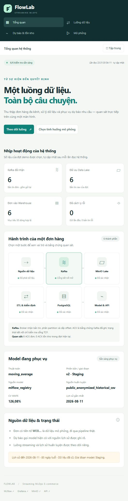

## 1. Luồng dữ liệu bình thường và dữ liệu lỗi

| Ca | Kết quả | ACK đơn / tồn | Raw | Dòng fact | Cách ly |
|---|---|---:|---:|---:|---:|
| Đơn hợp lệ | Đạt | 12 / 2 | 12 | 12 | 0 |
| Lô có bản tin sai | Đạt | 13 / 2 | 13 | 12 | 1 |
| Phát lại cùng lô | Đạt | 26 / 4 | 26 | 12 | 2 |
| Lô 50 đơn | Đạt | 50 / 2 | 50 | 50 | 0 |
| Dừng phát giữa lô | Đạt | 6 / 0 | 6 | 6 | 0 |

### Đơn hợp lệ

Mã đợt `WEB20261104162152950f80`. Đã checkpoint 3/3 file. [JSON gốc](normal.json).

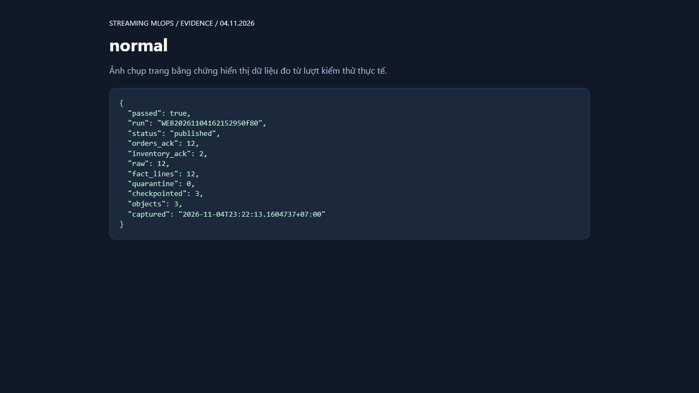

### Lô có bản tin sai

Mã đợt `WEB202611041622132f0a52`. Đã checkpoint 4/4 file. [JSON gốc](invalid.json).

### Phát lại cùng lô

Mã đợt `WEB202611041622132f0a52`. Đã checkpoint 8/8 file. [JSON gốc](replay.json).

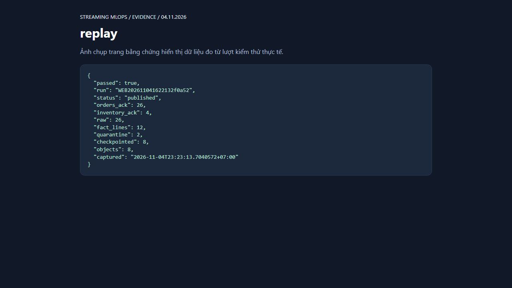

### Lô 50 đơn

Mã đợt `WEB20261104162313c84ab6`. Đã checkpoint 8/8 file. [JSON gốc](burst.json).

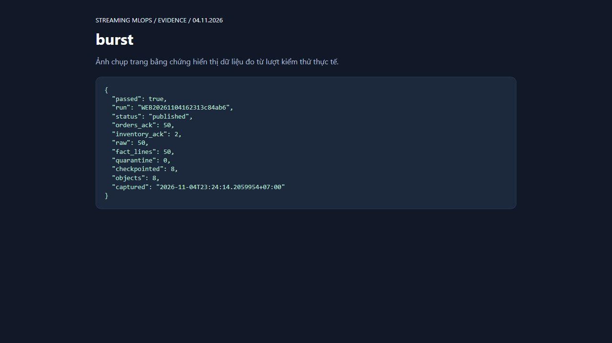

### Dừng phát giữa lô

Mã đợt `WEB2026110416303769541c`. Đã checkpoint 3/3 file. [JSON gốc](producer-stop.json).

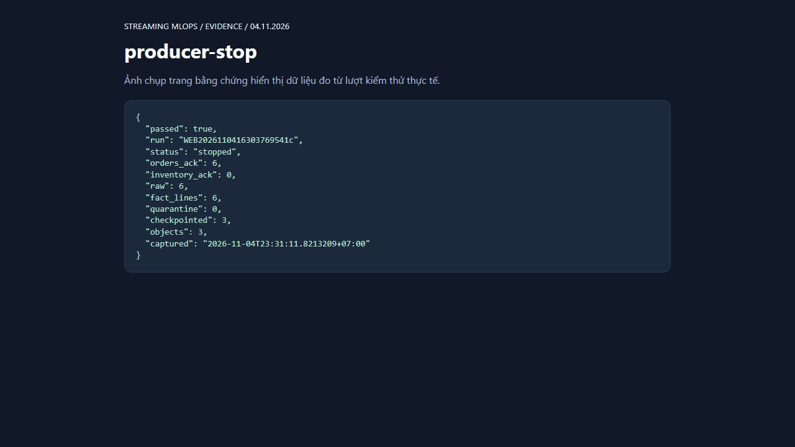

### JSON hỏng, sai sàn, sai giá, phiên bản đến muộn và tồn kho âm

Đợt `AUTO2026110404ba42` gửi 6 bản tin đơn và 3 bản tin kho. Kho giữ 2 dòng COMPLETED với tổng 7 sản phẩm. Tồn mới nhất là 50 dù có snapshot cũ đến sau. MinIO cách ly 3 dòng đơn và 1 dòng tồn kho. API đọc đúng snapshot 50. Request tồn kho không hợp lệ trả HTTP 422. [JSON gốc](check_continuous_pipeline.json).

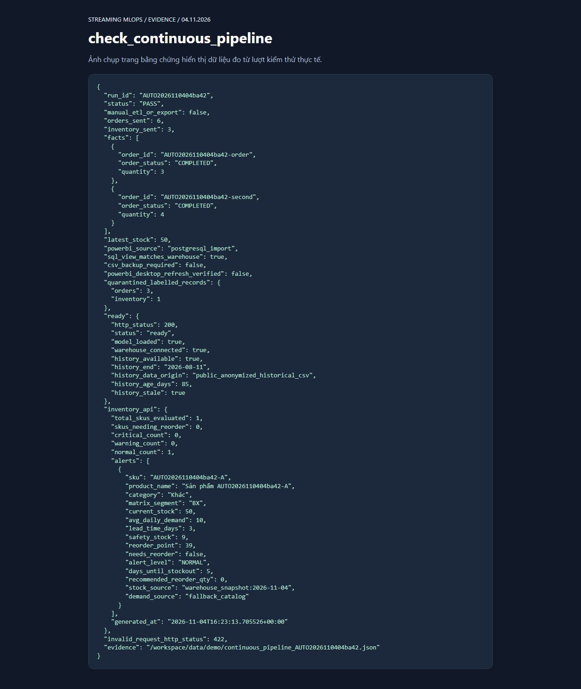

## 2. Dự báo, tồn kho và giám sát

### Dự báo, validate đầu vào và sức khỏe dịch vụ

Readiness HTTP 200. Dự báo HTTP 200 cho SKU `P23*****03` trong 7 ngày, tổng 24.8, version 2 Staging, nguồn `mlflow_registry`, lịch sử `warehouse`. Khoảng ngày đảo ngược trả 400 và đầu vào tồn kho sai trả 422. Lịch sử đến 2026-08-11, cũ 85 ngày. Phép thử chứng minh đường phục vụ model, chưa đánh giá độ chính xác cho nhu cầu hiện tại. [JSON gốc](api-monitor.json).

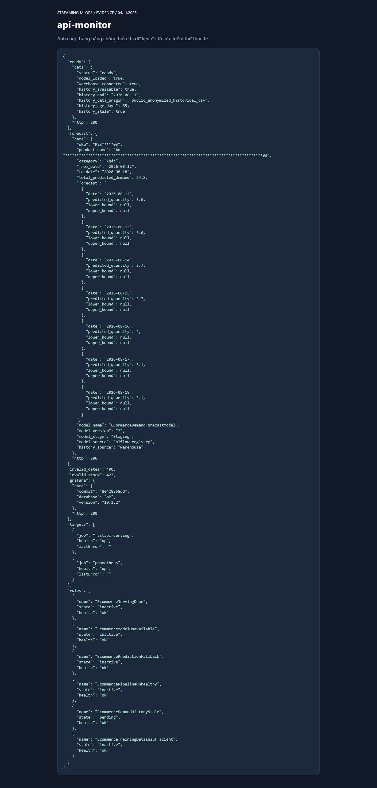

### Cảnh báo với tồn giả định 0

SKU `KCN-ANESSA` trả CRITICAL, tồn 0, SS 20, ROP 79, đề xuất nhập 216, nguồn tồn `request`, nhu cầu `fallback_catalog`. [JSON gốc](stock0.json).

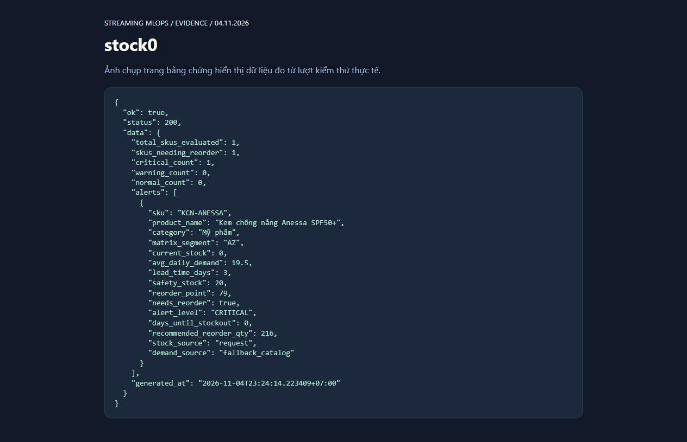

### Cảnh báo với tồn giả định 50

SKU `KCN-ANESSA` trả WARNING, tồn 50, SS 20, ROP 79, đề xuất nhập 166, nguồn tồn `request`, nhu cầu `fallback_catalog`. [JSON gốc](stock50.json).

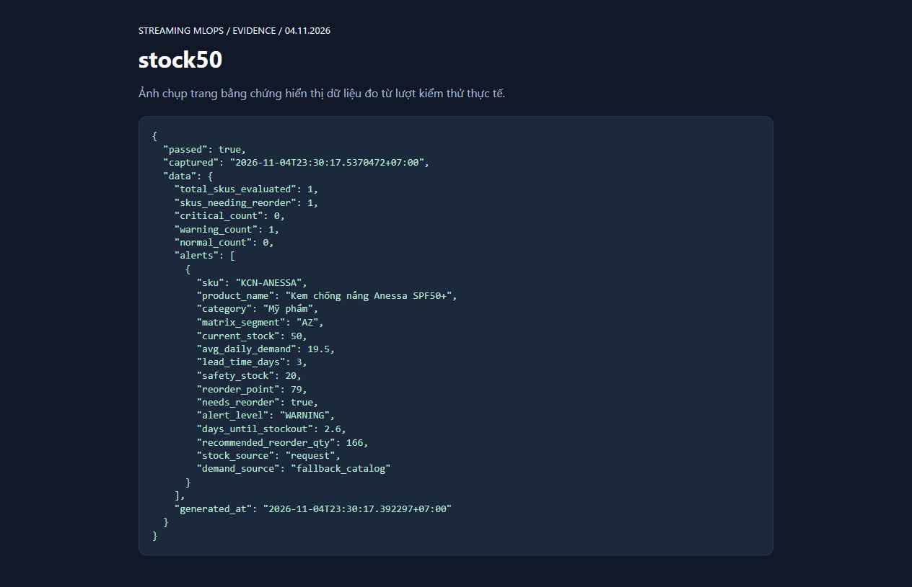

### Cảnh báo với tồn giả định 100

SKU `KCN-ANESSA` trả NORMAL, tồn 100, SS 20, ROP 79, đề xuất nhập 0, nguồn tồn `request`, nhu cầu `fallback_catalog`. [JSON gốc](stock100.json).

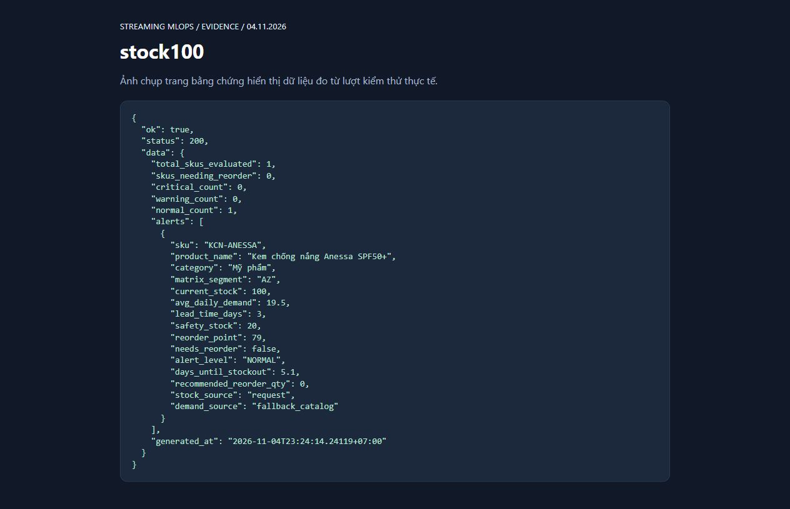

### Prometheus và Grafana

Grafana health HTTP 200. Prometheus báo fastapi-serving = up, prometheus = up. 6 rule được nạp. Ảnh bên dưới chụp trực tiếp từ Prometheus.

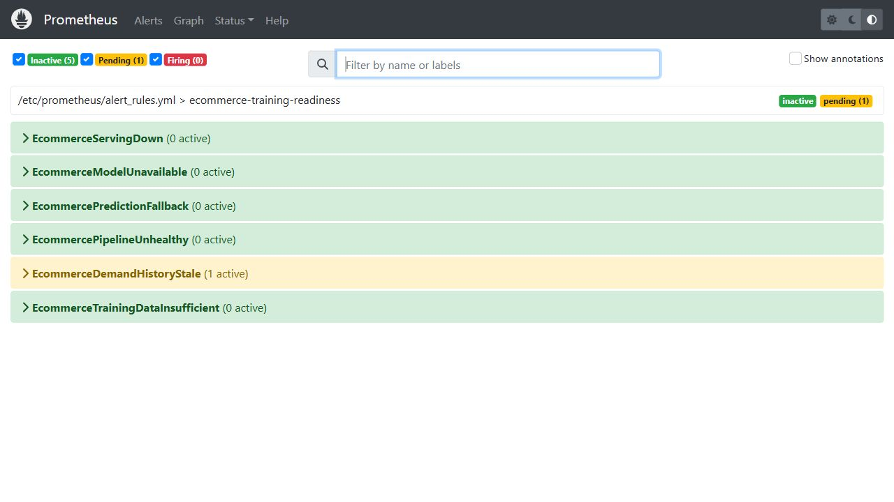

## 3. Ngắt và khôi phục từng service

Mỗi ca dừng một service bằng Docker, ghi nhận trạng thái và bật lại trong khối khôi phục. Các ca kiểm tra backlog đối chiếu lại ACK, Parquet, fact và checkpoint cùng mã đợt sau khi bật lại. Với Kafka, đợt phát khi broker tắt được dùng để kiểm tra lỗi gửi, rồi phát đợt mới sau khôi phục.

### kafka

**Đạt tiêu chí của ca**. Trong lúc ngắt, trạng thái đợt `error`, ACK 0, raw 0, fact 0. Sau khôi phục, đợt `WEB20261104162441ae67ec` có 4 ACK đơn, 4 raw, 4 fact và 3/3 file checkpoint.  [JSON gốc](fault-kafka.json).

### minio

**Đạt tiêu chí của ca**. Trong lúc ngắt, trạng thái đợt `published`, ACK 4, raw —, fact 0. Sau khôi phục, đợt `WEB20261104162518cadddd` có 4 ACK đơn, 4 raw, 4 fact và 3/3 file checkpoint.  [JSON gốc](fault-minio.json).

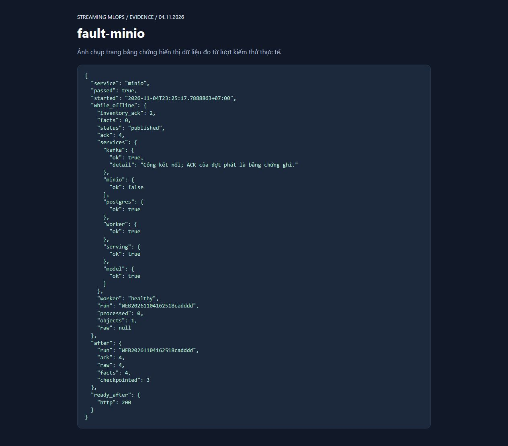

### postgres

**Đạt tiêu chí của ca**. Trong lúc ngắt, trạng thái đợt `published`, ACK 4, raw 1, fact —. Sau khôi phục, đợt `WEB20261104162546f38efb` có 4 ACK đơn, 4 raw, 4 fact và 3/3 file checkpoint.  [JSON gốc](fault-postgres.json).

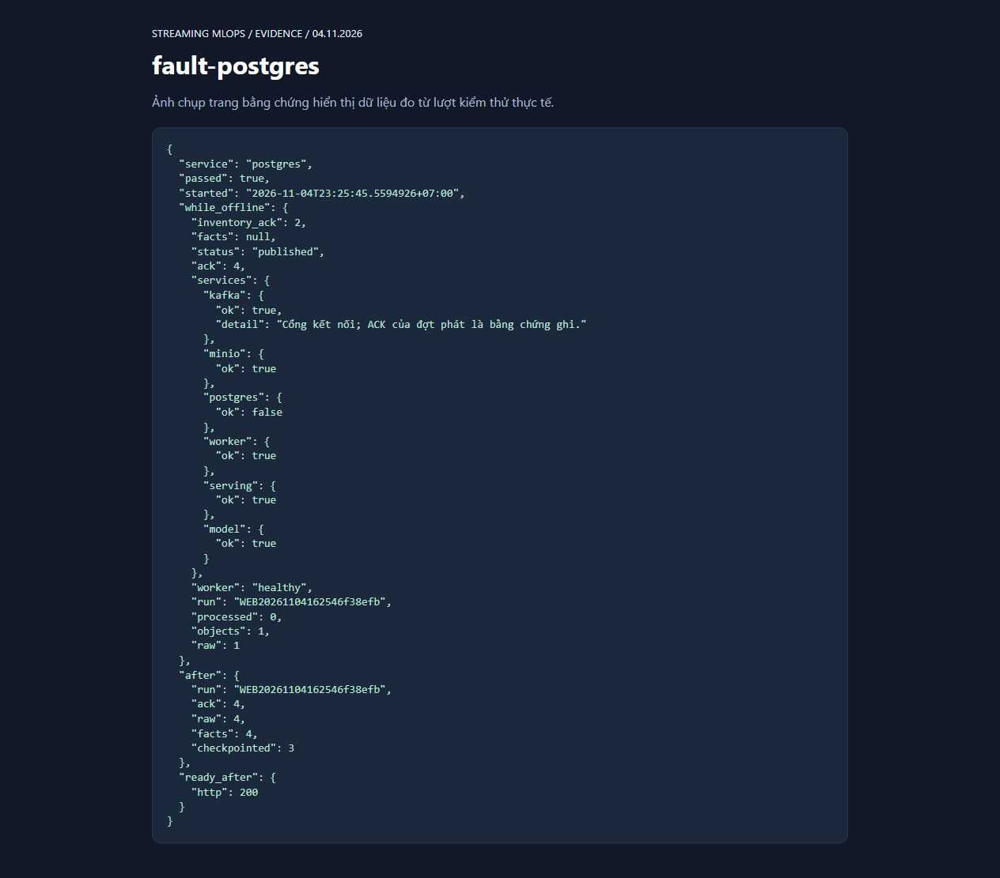

### pipeline-worker

**Đạt tiêu chí của ca**. Trong lúc ngắt, trạng thái đợt `published`, ACK 4, raw 0, fact 0. Sau khôi phục, đợt `WEB2026110416262650ab18` có 4 ACK đơn, 4 raw, 4 fact và 2/2 file checkpoint.  [JSON gốc](fault-pipeline-worker.json).

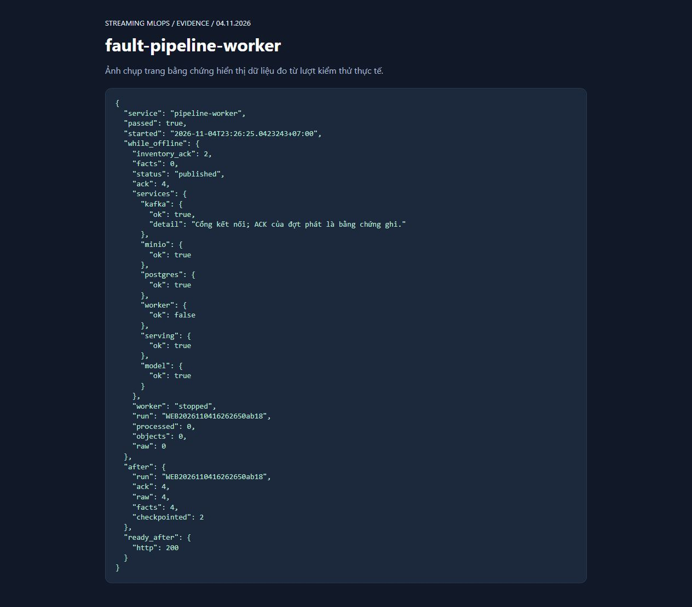

### fastapi

**Đạt tiêu chí của ca**. Trong lúc ngắt, trạng thái đợt `published`, ACK 4, raw 4, fact 4. Đã đối soát 4 dòng fact khi service còn tắt. Sau khôi phục, đợt `WEB20261104162712879ce9` có 4 ACK đơn, 4 raw, 4 fact và 3/3 file checkpoint.  [JSON gốc](fault-fastapi.json).

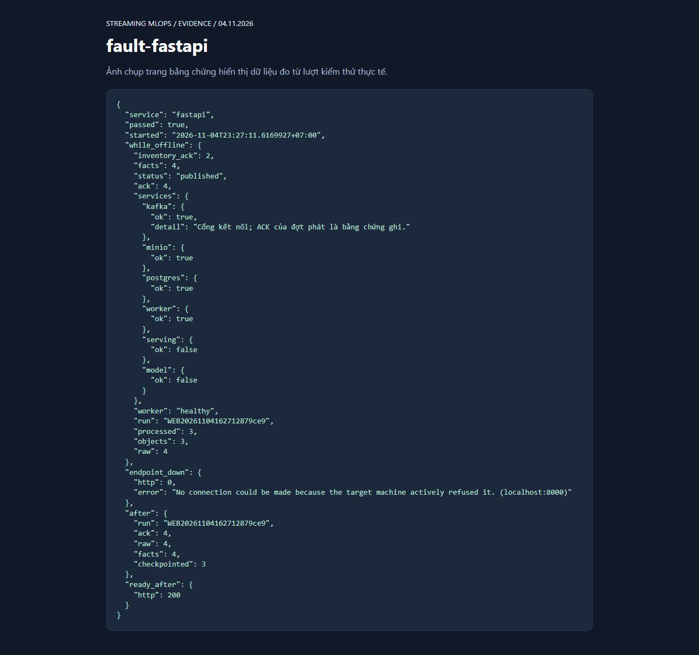

### mlflow

**Đạt tiêu chí của ca**. Trong lúc ngắt, trạng thái đợt `published`, ACK 4, raw 4, fact 4. Đã đối soát 4 dòng fact khi service còn tắt. Sau khôi phục, đợt `WEB20261104162751149fc9` có 4 ACK đơn, 4 raw, 4 fact và 3/3 file checkpoint.  [JSON gốc](fault-mlflow.json).

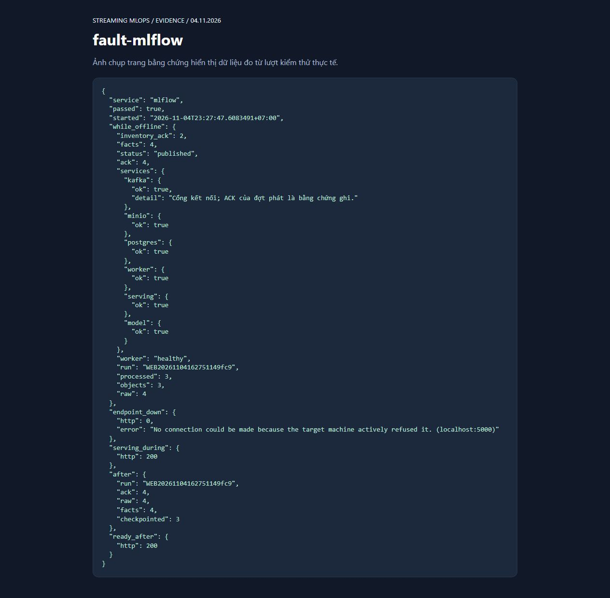

### grafana

**Đạt tiêu chí của ca**. Trong lúc ngắt, trạng thái đợt `published`, ACK 4, raw 4, fact 4. Đã đối soát 4 dòng fact khi service còn tắt. Sau khôi phục, đợt `WEB202611041628156e5bf1` có 4 ACK đơn, 4 raw, 4 fact và 3/3 file checkpoint.  [JSON gốc](fault-grafana.json).

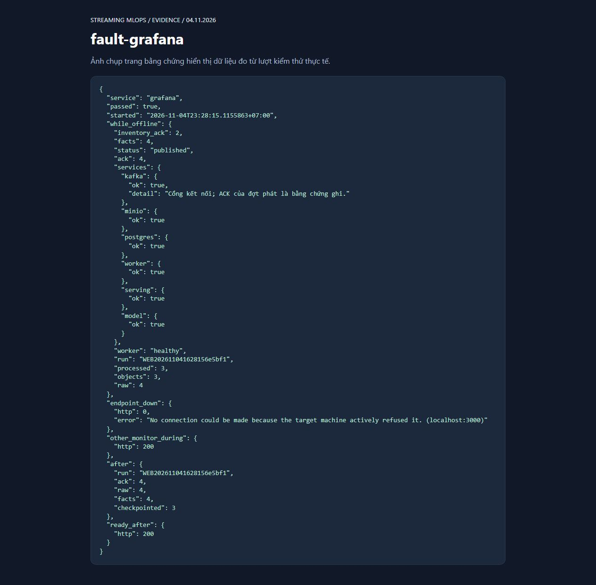

### prometheus

**Đạt tiêu chí của ca**. Trong lúc ngắt, trạng thái đợt `published`, ACK 4, raw 4, fact 4. Đã đối soát 4 dòng fact khi service còn tắt. Sau khôi phục, đợt `WEB202611041628451574d8` có 4 ACK đơn, 4 raw, 4 fact và 3/3 file checkpoint.  [JSON gốc](fault-prometheus.json).

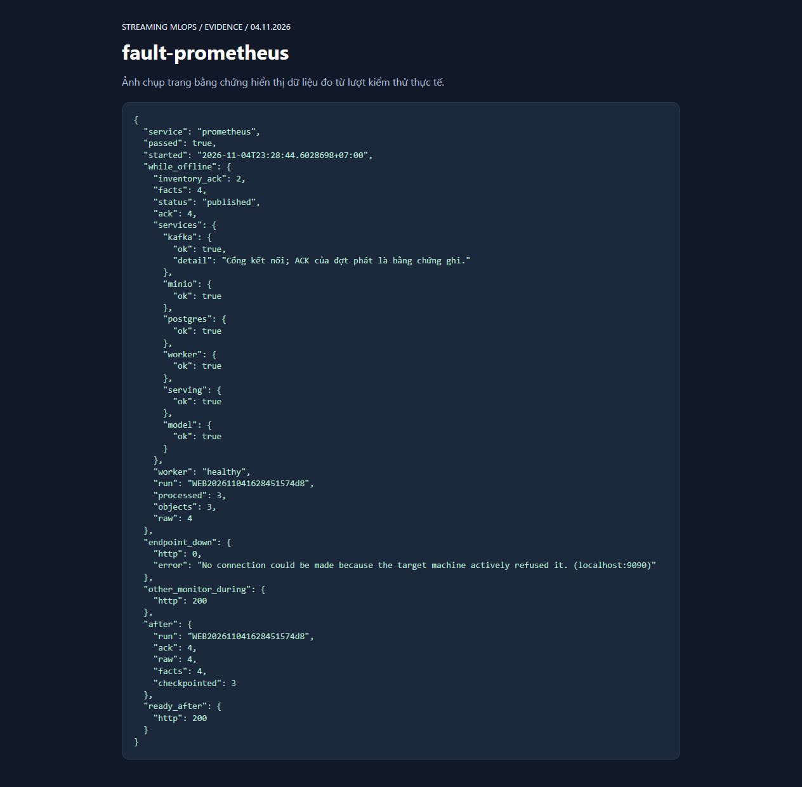

Trong ca tắt FastAPI, Prometheus hiển thị EcommerceServingDown với một cảnh báo đang firing.

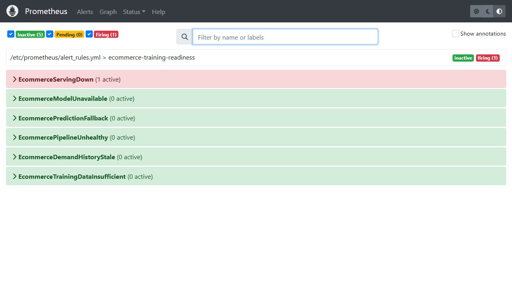

### Kiểm thử logic bổ sung

Bộ unittest FlowLab và simulator trả PASS. Ran 29 tests in 2.183s. Các test này bổ sung cho thực nghiệm Docker. [JSON gốc](unit.json).

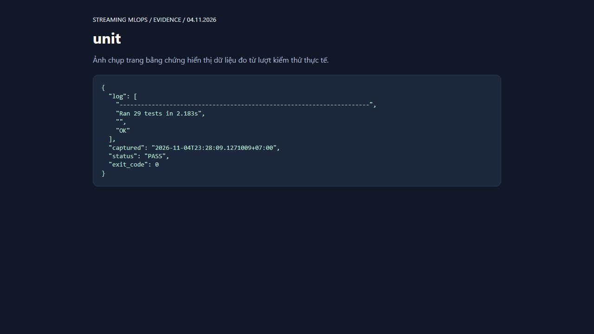

### MLflow lỗi khi API đã nạp model và khi API vừa khởi động

**Đạt**. API đang chạy trả nguồn mlflow_registry. Sau restart trong lúc MLflow tắt, readiness HTTP 503 và dự báo nguồn heuristic_history. Kiểm tra lưu một metric vào tracking cục bộ thành công. Sau khi bật MLflow, readiness HTTP 200, nguồn dự báo mlflow_registry. [JSON gốc](mlflow-cold.json).

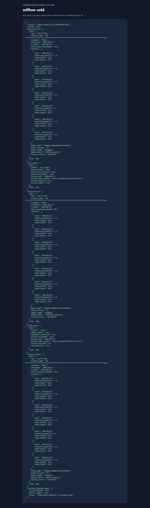

## 4. Nguồn Power BI

Kiểm tra chỉ đọc xác nhận 7 query đúng schema và tổng summary khớp fact. Số tổng tại thời điểm truy vấn là 118678 đơn và 286232 sản phẩm. Power BI Desktop Apply/Refresh chưa được kiểm tra trong lượt này. [JSON gốc](check_powerbi_import.json).

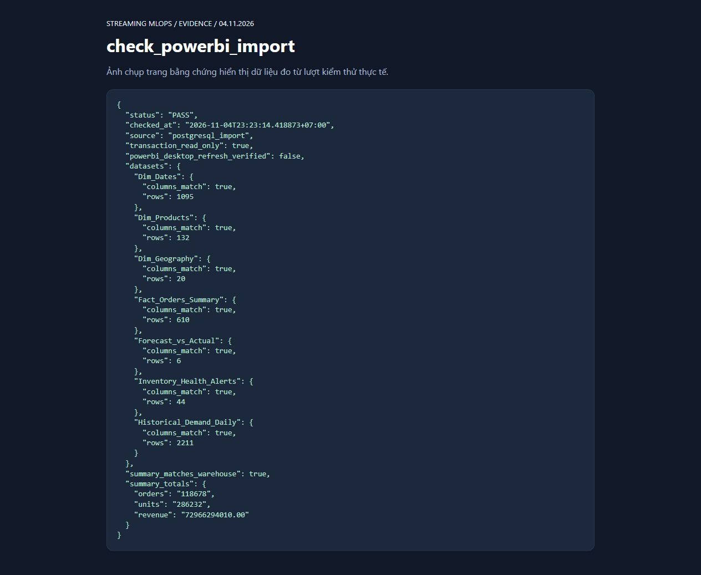

### Trạng thái sau kiểm thử

Worker healthy, FastAPI readiness HTTP 200, Prometheus HTTP 200, Grafana HTTP 200. Đã bật lại các service tạm dừng trong các ca gián đoạn. [JSON gốc](final-state.json).

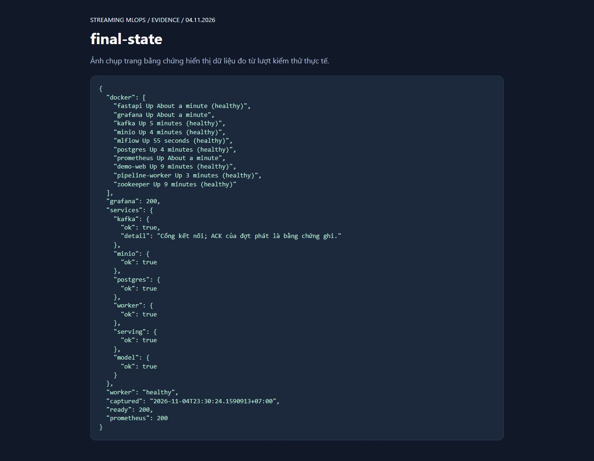

## 5. Tái huấn luyện và chuyển phiên bản model

### Tái huấn luyện với metadata triển khai hiện hành

**Bị chặn ở bước huấn luyện.** Manifest model v2 dùng dữ liệu lịch sử CSV đã khử định danh nhưng thiếu `source_datasets`. Bộ điều phối dừng với lỗi `Historical CSV retraining requires deployment dataset fingerprints.`. Ca chạy dùng bản sao manifest và Registry thử nghiệm. Đây là kết quả trước bản sửa manifest ở mục 7. [JSON gốc](retrain-blocked.json).

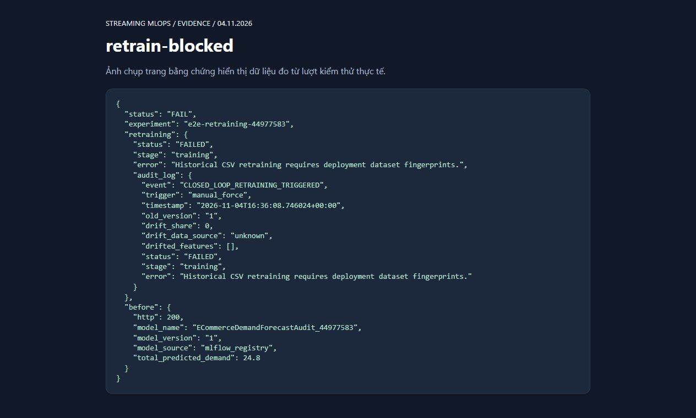

### Tái huấn luyện có đối chiếu nguồn dữ liệu

**Đạt trong môi trường cô lập**. Hai fingerprint được lấy từ artifact đã đăng ký và đối chiếu với Feature Spec trong workspace, rồi chỉ bổ sung vào bản sao manifest. Trigger chạy bằng chế độ ép tay. PostgreSQL có 226 ngày lịch sử so với 78 ngày yêu cầu. Dựng 42768 dòng đặc trưng, huấn luyện MOVING_AVERAGE và LIGHTGBM qua hai fold. Từ trigger đến FastAPI xác nhận reload mất 53.64 giây.

MLflow `ECommerceDemandForecastAudit_2a6915f6` v2 READY / Staging, run `43656b87ffd940fb8f440075b1c0c005` FINISHED. Model được chọn là MOVING_AVERAGE, CV WAPE 126.47%, MAE 0.1278, Bias 45.18%. Kết quả xác nhận quy trình kỹ thuật. WAPE cao và lịch sử kết thúc ngày 2026-08-11 giới hạn việc dùng model cho quyết định vận hành. [JSON gốc](retrain-switch.json).

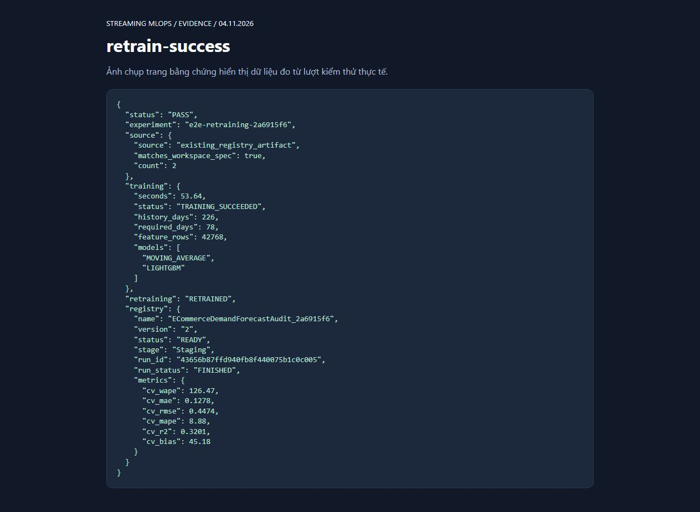

### Chuyển phiên bản, reload lỗi và quay lui

**Đạt**. FastAPI cô lập dự báo từ Registry v1 → v2. Manifest thử trỏ đến version không tồn tại thì reload trả HTTP 503, dự báo vẫn là v2. Khôi phục manifest thử và reload trả HTTP 200, dự báo quay về v1. FastAPI demo được đối chiếu trước và sau, vẫn phục vụ `ECommerceDemandForecastModel` v2. Experiment và version kiểm thử còn lưu trong MLflow để truy vết. [JSON gốc](retrain-switch.json).

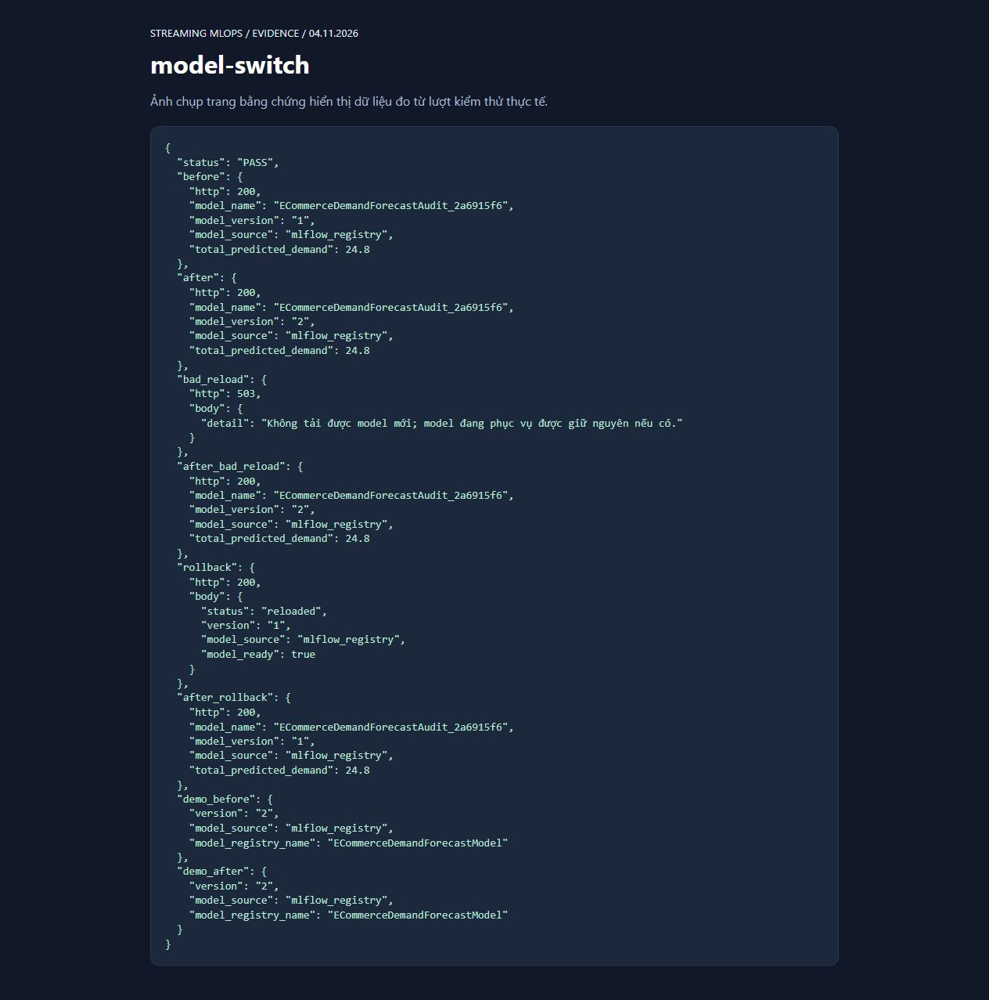

## 6. Tải hỗn hợp kéo dài

**Đạt**. Lô `SOAK87397963f1` chạy 10 phút. Tải mục tiêu là 1 đơn/giây, snapshot tồn kho mỗi 30 giây và 4 HTTP request/giây. Bốn luồng HTTP gọi dự báo 7 ngày và cảnh báo một SKU, theo tỷ lệ 3:1. Pha đầu chạy cùng tác vụ retraining cô lập. Dự báo dùng cùng SKU và cửa sổ ngày nên phép thử có thể hưởng cache. Phép thử này đo độ ổn định tại mức tải đã nêu.

| Nhóm | Số request | Thành công đúng tiêu chí | P50 (ms) | P95 (ms) | P99 (ms) | Max (ms) |
|---|---:|---:|---:|---:|---:|---:|
| Toàn bộ | 2400 | 2400 | 17.116 | 42.201 | 59.774 | 118.033 |
| Dự báo | 1800 | 1800 | 19.772 | 44.445 | 62.83 | 118.033 |
| Tồn kho | 600 | 600 | 7.37 | 17.673 | 30.759 | 90.038 |

Kafka ACK 600 đơn, PostgreSQL có 600 dòng, thiếu 0, dư 0, trùng 0. Tồn kho cuối 620/620. Sau khi ngừng phát, hệ thống mất 10.2 giây để quan sát thấy kho đã xử lý hết. [JSON gốc](soak.json).

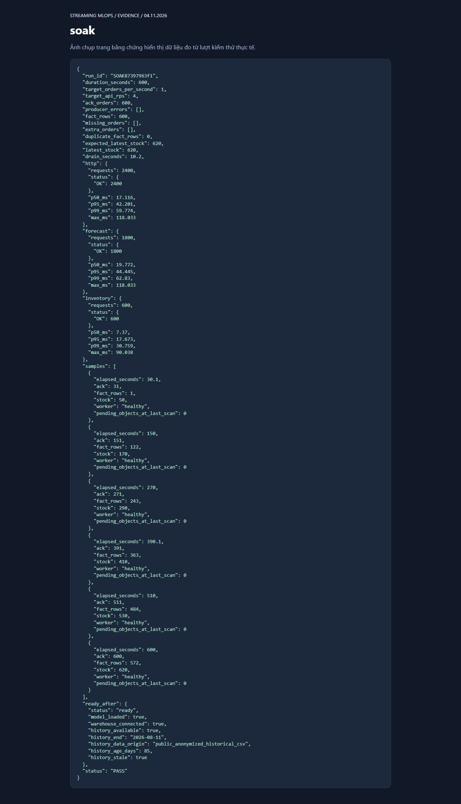

### Quan sát trong lúc đang phát

Tại giây 300.1, Kafka đã ACK 301 đơn, warehouse đã có 265 dòng và worker báo healthy. So sánh ACK với fact tại các mốc đang phát phản ánh lượng đang chờ xử lý, chưa phải số mất dữ liệu. [JSON gốc](soak-progress.json).

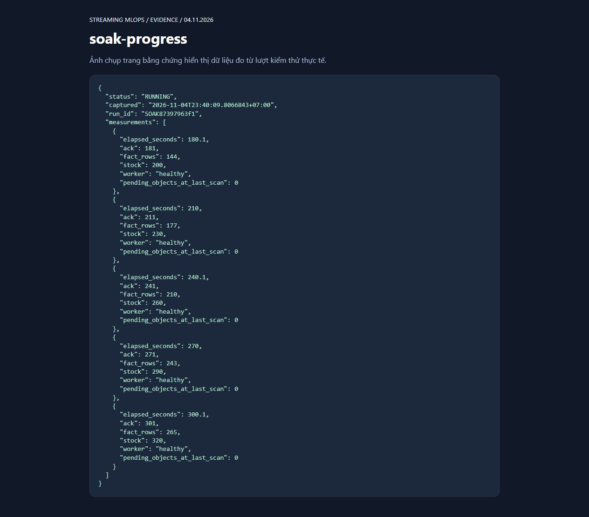

### Đọc lại Kafka, MinIO và checkpoint

Đọc độc lập 600 bản tin đơn và 20 snapshot từ Kafka. MinIO có 600 dòng của lô trong 56 file, 56 file đã checkpoint. Kết quả: **PASS**. [JSON gốc](soak-integrity.json).

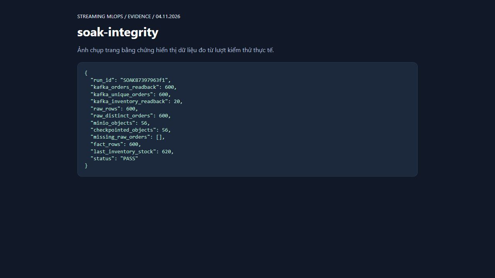

### Tài nguyên và khả năng quan sát trong ca tải

Đã lấy 12 mẫu Docker và Prometheus. Các giá trị CPU và RAM là số quan sát tại những lần lấy mẫu. 12/12 mẫu ghi nhận Prometheus target FastAPI UP. [JSON gốc](soak-resource-summary.json).

| Container | RAM đầu (MiB) | RAM cuối (MiB) | RAM cao nhất quan sát (MiB) | CPU cao nhất quan sát (%) |
|---|---:|---:|---:|---:|
| fastapi-serving | 161 | 164.1 | 164.1 | 63.58 |
| kafka | 473.4 | 481 | 563.4 | 199.86 |
| postgres | 142.2 | 162.5 | 162.5 | 69.58 |
| minio | 152.7 | 250.4 | 250.4 | 12.87 |
| streaming-mlops-ecommerce-pipeline-worker-1 | 301.6 | 301.9 | 302.7 | 5.68 |

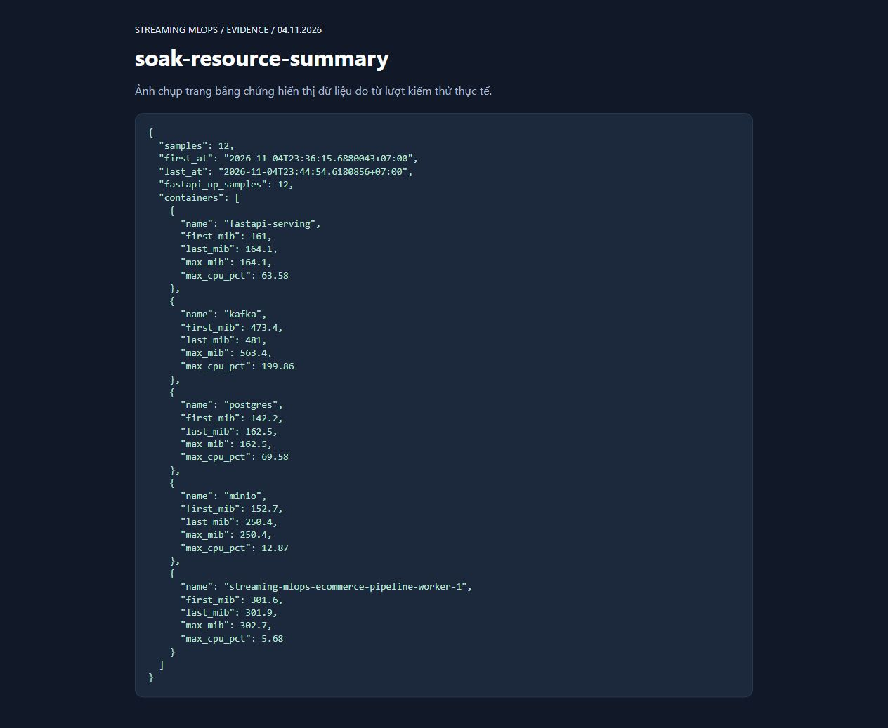

Lần đọc Kafka đầu bằng iterator chỉ quan sát 416 bản tin. Tôi giữ log đó và chạy lại bằng cách đọc hết từng batch đến offset cuối đã chụp. Lần đọc lại xác nhận đủ 600 bản tin. Không phát lại lô kiểm thử giữa hai lần đọc. [JSON gốc](soak-integrity-first-read.json).

### Trạng thái sau ca tải

FastAPI demo báo ready, dùng `ECommerceDemandForecastModel` v2. Worker báo healthy. Dữ liệu thử có nhãn được giữ lại trong stack. [JSON gốc](followup-final-state.json).

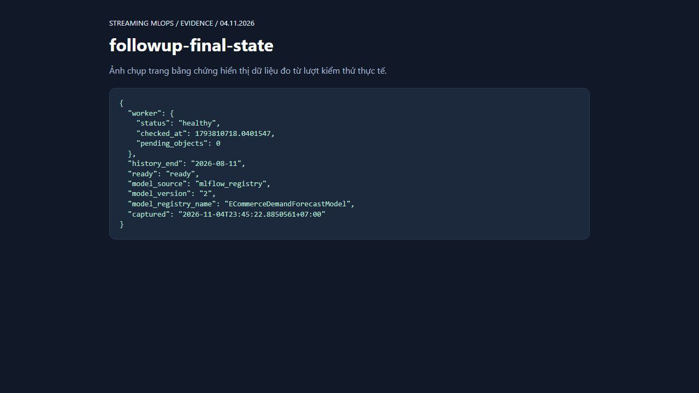

## 7. Sửa manifest và chạy lại ca tái huấn luyện

Đã thêm đúng hai `source_datasets` của Shopee và TikTok vào `data/model_manifest.json`. Hai mã khớp với Feature Spec trong artifact của Registry `ECommerceDemandForecastModel` v2, run `9c01dafd9238464cbcd1cef677324bcc`, và với Feature Spec trong workspace. Thay đổi chỉ bổ sung metadata của nguồn. [JSON gốc](manifest-provenance.json).

**Đạt**. Ca chạy dùng bản sao từ manifest vừa sửa và kiểm tra trực tiếp danh sách nguồn trước khi huấn luyện. Tác vụ thử nghiệm không tự bổ sung trường này. Bộ điều phối trả `RETRAINED` trong 44.24 giây. Run `21200b22bde2453dadd0921b68216829` có trạng thái FINISHED, model thử `ECommerceDemandForecastAudit_9de3fd22` v2 READY / Staging. FastAPI thử nghiệm trả dự báo phiên bản mới sau reload. [JSON gốc](retrain-manifest-fixed.json).

FastAPI demo trước và sau đều trả `ECommerceDemandForecastModel` v2 từ `mlflow_registry`. Phiên bản thử chỉ đăng ký dưới tên Registry riêng. Manifest là file runtime trong thư mục data. Bản sửa chỉ bổ sung hai mã nguồn và giữ nguyên phiên bản đang phục vụ.

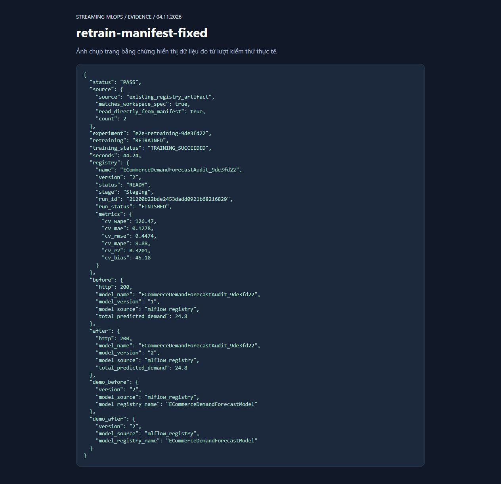

## 8. Phạm vi còn lại

Power BI Desktop Apply/Refresh được tách sang kế hoạch riêng. Chưa thử mất volume, mất đĩa, làm hỏng Parquet trên kho đang sử dụng, backfill, retraining theo lịch hoặc do drift thực tế, hay phát thông báo Prometheus ra ngoài. Ca tái huấn luyện dùng trigger ép tay và Registry cô lập. Ca tải 10 phút chưa xác nhận khả năng chạy nhiều giờ hoặc giới hạn số người dùng đồng thời.
