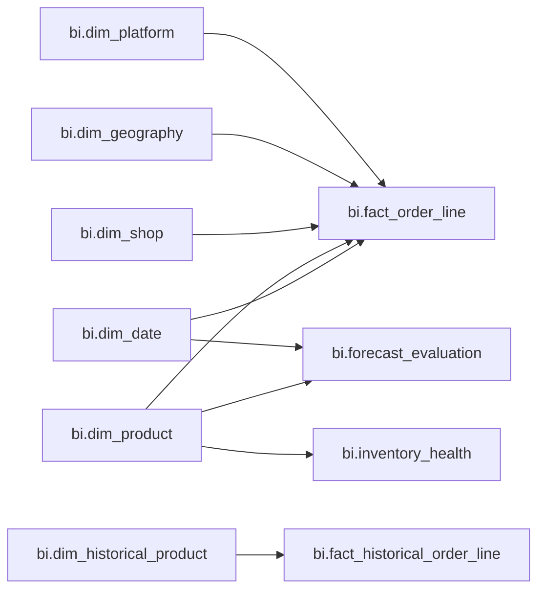

# Warehouse và hợp đồng dữ liệu BI — 01/11/2026

## Hai schema, hai trách nhiệm

`public` chứa bảng vật lý mà consumer, ETL, training và serving đang sử dụng.
`bi` cung cấp view có độ hạt rõ ràng để kết nối Power BI Import. View luôn đọc từ
bảng gốc; không cần xuất CSV hay đồng bộ một bản sao warehouse.

Đây là tái cấu trúc hợp đồng báo cáo và siết tính toàn vẹn bảng gốc, không phải
xóa kho và nạp lại. Các bảng/view cũ được giữ tương thích với luồng hiện tại.

## Độ hạt bảng vật lý

| Bảng public | Một dòng biểu diễn | Khóa nghiệp vụ |
|---|---|---|
| Fact_Orders | Trạng thái mới nhất của một dòng hàng | platform + order_id + source_line_id |
| Fact_Inventory_Daily | Snapshot mới nhất trong ngày của một SKU tại kho trung tâm | product_key + date_key |
| Fact_Forecast_Predictions | Một dự báo SKU/ngày mục tiêu, phiên bản và phạm vi lịch sử | Ràng buộc uq_fact_forecasts_issue hiện có |
| Fact_Historical_Order_Lines | Một dòng nguồn lịch sử đã khử định danh | source_dataset + platform + source_record_id |
| Warehouse_Daily_Coverage | Xác nhận đã nạp đầy đủ một ngày của một nguồn | data_origin + source_dataset + full_date |

Forecast không phải đơn hàng; lịch sử ngoài không tự trở thành doanh thu; stock
không được cộng giữa nhiều ngày để tính tồn hiện tại. Thiếu coverage thì actual
forecast chưa được coi là hoàn tất, dù ngày đó đã qua.

## Hợp đồng schema bi

| View | Độ hạt và quan hệ |
|---|---|
| dim_date | Một ngày; khóa date_key; full_date duy nhất |
| dim_product | Một SKU của catalog vận hành; khóa product_key |
| dim_shop | Một shop của sàn; khóa shop_key |
| dim_geography | Một địa chỉ phân cấp đã chuẩn hóa; khóa geo_key |
| dim_platform | Một sàn; khóa platform |
| fact_order_line | Một dòng hàng; khóa order_line_key, nối đủ product/shop/geo/date/platform |
| fact_inventory_daily | Một SKU/ngày tại kho trung tâm; khóa inventory_snapshot_key |
| inventory_latest | Snapshot mới nhất của từng SKU, có thể khác ngày giữa các SKU |
| inventory_health | Một dòng mỗi SKU có tồn kho, giữ cả SKU chưa đủ dữ liệu tính policy |
| fact_forecast_issue | Tất cả dự báo đã lưu, kể cả legacy/chưa đủ điều kiện đánh giá |
| forecast_evaluation | Dự báo được view đánh giá chọn, giữ nguồn và fingerprint dataset |
| dim_historical_product | Một SKU theo data_origin + source_dataset; khóa text kết hợp an toàn |
| fact_historical_order_line | Một dòng nguồn, nối dim_historical_product bằng historical_product_key |
| quality_order_header_conflicts | Một mã đơn có các dòng khác ngày/shop/địa lý/trạng thái hủy |

Các view có khóa ngoại dưới dạng cột nhưng PostgreSQL không khai báo FK vật lý
trên view. Quan hệ Power BI dựa vào các khóa của bảng gốc, đã đối soát độ hạt;
schema nguồn vẫn giữ các FK vật lý.



## Nguyên tắc nối và tính KPI

Khi chuyển lại Power BI, nguồn bán hàng là **bi.fact_order_line**, không lấy
summary ngày × sàn làm fact chính. Nối `dim_product`, `dim_shop`, `dim_geography`,
`dim_date`, `dim_platform` tới fact qua cột khóa tương ứng, `1:*`, Single direction.
Optional shop/geography còn NULL được hiển thị là chưa xác định, không loại fact
bằng inner join và không bịa shop/địa chỉ cho dữ liệu thiếu.

Ví dụ DAX khi bảng trong Power BI được đặt tên `Fact_Order_Line`:

```dax
Total Orders =
CALCULATE(
    DISTINCTCOUNT(Fact_Order_Line[order_business_key]),
    Fact_Order_Line[is_cancelled] = FALSE()
)

Total Units =
CALCULATE(SUM(Fact_Order_Line[quantity]), Fact_Order_Line[is_cancelled] = FALSE())

Total Buyer Amount =
CALCULATE(SUM(Fact_Order_Line[buyer_amount]), Fact_Order_Line[is_cancelled] = FALSE())

AOV = DIVIDE([Total Buyer Amount], [Total Orders])
```

Tạo mỗi measure riêng. Một đơn nhiều sản phẩm được đếm một lần ở tổng toàn bộ;
khi chia theo sản phẩm, số đơn của các nhóm có thể giao nhau. Không cộng các
distinct count từng nhóm để suy ra tổng số đơn.

`buyer_amount` giữ nguyên nghĩa `buyer_total_amount` của nguồn hiện tại. Chưa có
đặc tả phân bổ tiền cấp header xuống dòng cho tích hợp API nhiều SKU thực tế;
không mặc định cộng tiền header lặp lại là doanh thu. Không dùng số tiền này để
tuyên bố tiền đã thu/lợi nhuận. `reference_selling_price` là trường legacy từng
được đặt tên `unit_cost`, không phải giá vốn nhập hàng.

Inventory latest là snapshot, không phải lịch sử; không dùng slicer ngày bán
hàng lọc snapshot hiện tại. Dùng fact_inventory_daily cho báo cáo lịch sử riêng.
Nếu demand_policy_available=false, không hiển thị SKU đó như NORMAL hoặc tự
gán safety stock bằng 0. Nếu snapshot_time_known=false, không dùng loaded_at
để giả làm thời gian sự kiện đã biết.

Nguồn lịch sử giữ danh mục riêng để tránh trộn SKU cùng mã từ dataset ngoài với
SKU của doanh nghiệp. Forecast evaluation phải giới hạn đúng nguồn/dataset;
không cộng các dự báo có phạm vi thực tế chồng lấn.

## Khởi tạo, migration và kiểm tra

- Khởi tạo mới: `python scripts/init_warehouse.py` cài bảng gốc, integrity
  constraints, view nguồn và schema BI. Worker cũng cài các view BI khi khởi động.
- Kho đã có dữ liệu: `python scripts/migrate_warehouse_schema.py` diễn tập và
  rollback mặc định; thêm `--apply` để commit khi kiểm tra bảo toàn tổng đạt.
- Migration giới hạn thời gian đợi lock và thực hiện trong một transaction.
  Nếu dữ liệu vi phạm ràng buộc, mọi thay đổi trong lần đó rollback.
- Audit chỉ đọc: `python scripts/audit_warehouse_schema.py`.
- Kiểm thử cô lập: đặt `RUN_WAREHOUSE_SCHEMA_TESTS=1`, chạy
  `python -m pytest tests/test_warehouse_schema_v2.py -q`. Fixture tạo schema
  riêng và rollback; không ghi fact hoặc tăng sequence public.
- Không dùng `--drop-first` hoặc `docker compose down -v` cho đợt chỉnh schema này.

Các ràng buộc mới bảo đảm product/date bắt buộc, quantity dương, giá trị tiền
được kiểm tra không âm/NaN, tồn kho không âm và tồn kho ở phạm vi kho trung tâm.
Các ràng buộc cấp dòng không thể tự giải quyết xung đột giữa nhiều dòng cùng đơn.

## Kết quả và các mục chưa đóng

Migration đã áp dụng ngày 01/11/2026, không đổi số dòng hay tổng dữ liệu fact.
12 kiểm thử PostgreSQL cô lập đạt. Xem [evidence áp dụng](../docs/07-bao-cao-do-an/evidence/warehouse_schema_apply_2026-11-01.json)
và [JUnit](../docs/07-bao-cao-do-an/evidence/pytest_warehouse_schema_2026-11-01.xml).

Audit trước migration có 28 mã đơn khác địa lý giữa các dòng, 6 trong số đó khác
shop và 1 mã khác trạng thái hủy. Đây là dấu hiệu cần truy vết payload gốc; chưa
được tự chọn một địa chỉ/shop hay xóa các dòng đó. View chất lượng đánh dấu cả
các dòng có liên quan. Có 24 snapshot legacy chưa biết thời điểm sự kiện.
226 SKU lịch sử chưa thuộc catalog live được biểu diễn bằng dimension lịch sử
riêng, không ép chung catalog hoặc tạo giá bán/giá vốn giả.

Chưa dựng lại PBIX theo schema mới; hướng dẫn 7 bảng public trước đây không còn
là mô hình đích. Bản sửa này chưa thay thế kiểm thử gián đoạn toàn luồng hay xác
nhận chất lượng dữ liệu gốc trong 28 đơn xung đột.
